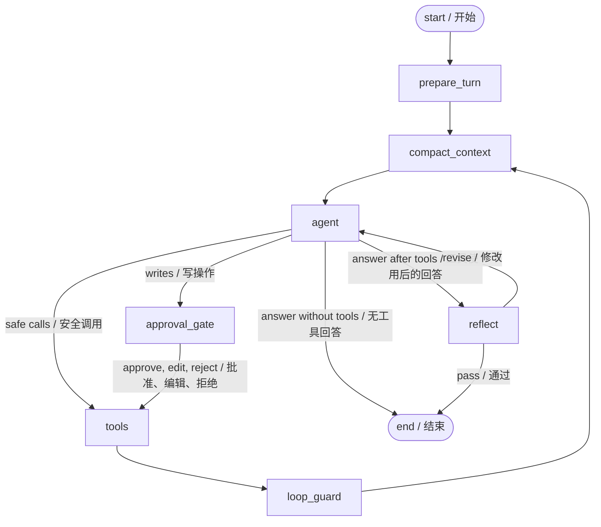

# Ledger — Personal Expense Agent

# Ledger — 个人记账与开销统计助手

A learning project built with a hand-wired LangGraph `StateGraph`: ReAct, MCP, human approval, loop control, reflection, and three layers of memory. All expenses come from your input and persist locally. There is no web search, shell execution tool, sample ledger, payment, or bank integration. Model inference still uses Groq.

这是一个手写 LangGraph `StateGraph` 的学习项目，涵盖 ReAct、MCP、人工审批、循环控制、反思和三层记忆。支出来自你的输入并保存在本地，不使用搜索、shell 执行工具、预填账目、支付或银行接口。模型推理仍通过 Groq 完成。

For the design tradeoffs between `StateGraph + LLM`, `create_agent`, and `create_deep_agent`, including custom orchestration and memory boundaries, see [Agent Design](AGENT_DESIGN.md).

关于 `StateGraph + LLM`、`create_agent` 和 `create_deep_agent` 的选型，以及自定义编排和记忆边界，参见 [Agent 设计说明](AGENT_DESIGN.md)。

**Version 1 supports USD expenses only.** Amounts are positive with at most two decimal places; income, refunds and currency conversion are outside this version. Ask in English or Chinese; the agent responds in your language. Tool category values are fixed Chinese labels, with English meanings in their descriptions.

**第一版只支持美元（USD）支出。** 金额为正数，最多两位小数；暂不处理收入、退款和汇率换算。可以使用中文或英文提问，Agent 按你的语言回答。工具分类采用固定中文值，描述中附有英文对应含义。

## 1. Quick start

## 1. 快速开始

From the repository root, set `GROQ_API_KEY` in `.env` or the environment, then run:

在仓库根目录的 `.env` 或环境变量中设置 `GROQ_API_KEY`，然后运行：

```bash
uv sync
uv run react-agent --user harry
```

The root `.env` loads automatically; exported environment variables take precedence. Optional settings are shown in [.env.example](.env.example); put them in the repository root `.env`. When updating an older installation, replace an old `AGENT_RISKY_TOOLS` value with `add_expense,update_expense,delete_expense`. Run `/tools` to confirm the three write tools have approval marks. Start with the first-session walkthrough in [LEARNING.md](LEARNING.md).

自动加载仓库根目录的 `.env`，已导出的环境变量优先。可选配置见 [.env.example](.env.example)，填写到仓库根目录的 `.env`。更新旧版本时，把旧的 `AGENT_RISKY_TOOLS` 改为 `add_expense,update_expense,delete_expense`，并通过 `/tools` 确认三个写工具带有审批标记。初学者先完成 [LEARNING.md](LEARNING.md) 中的首次体验。

Try one language at a time; the paired examples below are alternatives, not two expenses to record.

下面的双语示例是同一个请求的两种表达，请任选一种，不要把它们当成两笔支出重复录入。

```text
Record $12.50 for lunch today, category food.
今天午餐花了 12.50 美元，分类为餐饮，帮我记录。

How much did I spend this week? What percentage was food?
我这周花了多少钱？餐饮占多少？

Change the lunch expense I just recorded to $11.80.
把刚才那笔午餐改成 11.80 美元。

Remember that I prefer category totals before the detailed records.
记住，我喜欢先看分类汇总，再看明细。

/new
How do I prefer my expense reports formatted?
我希望开销报告按什么顺序展示？
```

Writes pause for `[a]pprove`, `[e]dit args`, or `[r]eject`. Editing replaces the complete tool argument object; include all required fields. The approval UI shows the pending arguments as JSON. Read tools run directly.

写操作暂停后可选择 `[a]` 批准、`[e]` 修改参数、`[r]` 拒绝。编辑时提供完整工具参数对象，需包含必填字段；审批界面会显示待执行参数的 JSON。读取工具直接执行。

## 2. Tools and real data

## 2. 工具与真实数据

| Tool<br>工具 | Purpose<br>用途 | Source<br>来源 | Approval<br>审批 |
|---|---|---|---|
| `add_expense(amount, spent_on, category, note)` | Add a real expense<br>记录真实支出 | MCP | Yes / 是 |
| `list_expenses(start_date, end_date, category, offset, limit)` | Read a page of records<br>分页读取明细 | MCP | No / 否 |
| `update_expense(expense_id, ...)` | Change selected fields<br>修改指定字段 | MCP | Yes / 是 |
| `delete_expense(expense_id)` | Delete a record<br>删除记录 | MCP | Yes / 是 |
| `summarize_expenses(start_date, end_date, category)` | Aggregate all matches<br>汇总全部匹配记录 | MCP | No / 否 |
| `calculate_share(part, total)` | Calculate a percentage<br>计算百分比 | Local / 本地 | No / 否 |
| `get_current_time()` | Resolve relative dates<br>确定相对日期 | Local / 本地 | No / 否 |
| `ask_human(question)` | Clarify essential details<br>澄清必要信息 | Local / 本地 | Question / 提问 |
| `save_memory`, `search_memory`, `delete_memory` | Manage reporting preferences<br>管理报告偏好 | Local / 本地 | No / 否 |

Categories: food → 餐饮, transport → 交通, shopping → 购物, housing → 居住, entertainment → 娱乐, other → 其他. Dates use `YYYY-MM-DD`, both range endpoints are inclusive, and weeks start on Monday using the machine's local time.

分类对应：餐饮、交通、购物、居住、娱乐、其他。日期使用 `YYYY-MM-DD`，查询范围包含起止两天；“本周”按本地时间从周一开始计算。

Money is stored as integer cents, so `$0.10 + $0.20 = $0.30` exactly. Each page has at most five records, each note at most 80 characters. The page reports `total_count` and `next_offset`; totals come from a separate SQL aggregation over **all matches**. Empty ledgers return zero totals, but a percentage of zero is undefined.

金额保存为整数美分，避免浮点误差。每页最多五条，备注最多 80 个字符。分页返回总笔数 `total_count` 和下一页偏移 `next_offset`；金额汇总通过 SQL 计算**全部匹配记录**。空账本合计为零，但总额为零时占比无定义。

## 3. Architecture

## 3. 架构



| File<br>文件 | Learning focus<br>学习重点 |
|---|---|
| `agent/state.py` | State, Context, message reducers<br>状态、上下文、消息合并规则 |
| `agent/config.py` | Budgets, policies, per-user storage paths<br>预算、策略、用户存储路径 |
| `agent/tools.py` | Local tools, schema, ToolRuntime, model-driven HITL<br>本地工具、schema、运行时注入、模型主动提问 |
| `mcp_servers/expense_server.py` | FastMCP, validation, SQLite transactions<br>工具服务、参数校验、SQLite 事务 |
| `agent/mcp_client.py` | Discovery, adapters, transport, startup degradation<br>工具发现、适配、传输、启动失败降级 |
| `agent/prompts.py` | Dynamic context, summary, critic instructions<br>动态上下文、摘要、反思指令 |
| `agent/memory.py` | Namespaces, keyword retrieval, top-k recall<br>命名空间、关键词检索、top-k 召回 |
| `agent/graph.py` | Nodes, routes, loop control, approvals and reflection<br>节点、路由、循环控制、审批和反思 |
| `agent/llm.py` | Provider factory and dependency injection<br>模型工厂与依赖注入 |
| `main.py` | Event streaming, terminal interaction, durable resume<br>事件流、终端交互、持久化恢复 |
| `tests/` | Deterministic graph tests plus real stdio MCP<br>确定性图测试与真实 stdio MCP |

### ReAct and parallelism

### ReAct 与并行

A model step emits `AIMessage.tool_calls`; `ToolNode` executes them and appends a matching `ToolMessage` for each. The model reads the observations and chooses another action or an answer. Independent calls in one message run in parallel. Dependent calls need different steps: obtain a summary first, then calculate a percentage using that result.

模型生成 `AIMessage.tool_calls`，`ToolNode` 执行并为每次调用生成匹配的 `ToolMessage`。模型读取观察结果，再决定行动或回答。同一消息中的独立调用可并行；有依赖的调用必须分步，例如先汇总，再根据结果计算比例。

### Loop control and tool errors

### 循环控制与工具错误

The five layers remain: budget reminders → final step without tools → errors as observations → repeated-call/error-streak warnings → a hard `recursion_limit`. Counters reset per user turn and persist through pauses. Reflection has its own limit, and rewrites also consume the agent-step budget. When that budget is exhausted, the final answer ends the turn without reflection. One step means one call to the `agent` node, including rewrites; critic and summarizer calls are separate from this counter. Each tool also has a configurable timeout; graph interrupts propagate instead of being mistaken for errors.

保留五层控制：预算提醒 → 最后一步禁用工具 → 错误作为观察结果 → 重复调用/连续错误警告 → `recursion_limit` 硬限制。计数按用户轮次重置，暂停时仍保存。反思有独立次数上限，重写也消耗 Agent 步数预算；该预算耗尽时，最终回答直接结束本轮，跳过反思。一步表示一次 `agent` 节点调用，包含重写；反思模型和摘要模型的调用不计入该计数。工具调用也有可配置超时；图中断会向上传播，不会误当成普通错误吞掉。

A timeout does not guarantee that a server-side write was undone. Read the ledger before retrying an uncertain write. This example does not implement distributed exactly-once execution.

超时不保证服务端写入已撤销。对结果不确定的写操作，重试前应先查询账本。本教学项目没有实现分布式“恰好执行一次”。

### Human-in-the-loop and recovery

### 人工介入与恢复

Policy-driven `approval_gate` and model-driven `ask_human` both use `interrupt()`. A checkpoint saves the pause; `Command(resume=...)` on the same thread re-runs the interrupted node from its beginning. Code before the interrupt must have no side effects. Editing replaces tool arguments in history by message ID. Rejection produces a matching tool result without executing the tool; it does not count as a tool failure.

策略驱动的 `approval_gate` 和模型主动调用的 `ask_human` 都使用 `interrupt()`。检查点保存暂停状态，同一会话中的 `Command(resume=...)` 会从被中断节点的开头重新执行。中断前不能产生副作用。编辑会按消息 ID 替换历史中的工具参数；拒绝会生成对应结果但不执行工具，也不计入工具故障。

At an approval prompt, press Ctrl+C to exit without an extra Enter, then restart with the same `--user` and `--thread ID`. The console checks pending interrupts before accepting new input, including after `/switch`. Resume values are matched by interrupt ID. ToolNode shares an interrupt context across a batch: ask_human must run alone and combine necessary questions into one call. Invalid batches receive an error observation and can recover.

在审批处按 Ctrl+C 退出，无需额外回车；随后使用相同 `--user` 和 `--thread ID` 重启。控制台会在接受新输入前检查并恢复待处理的中断，`/switch` 切换后也一样。恢复值按 interrupt ID 对应。ToolNode 的同批调用共享中断上下文，因此 ask_human 必须单独调用，把必要问题合并提问；不合规调用会收到错误反馈并可自行修正。

### Memory and context

### 记忆与上下文

Short-term checkpoints hold messages and node state. Compaction replaces old **complete turns** with a rolling summary, keeping tool calls paired with results. Long-term Store holds per-user preferences, recalled by English/Chinese keyword overlap and top-k ranking. `ToolRuntime` injects Store and user context, hiding user identity from model-controlled arguments. The system prompt is rebuilt every step and never appended to history.

短期检查点保存消息和节点状态。上下文压缩把旧的**完整轮次**合并为滚动摘要，保留工具调用与结果的配对关系。长期 Store 保存用户偏好，通过中英文关键词重叠排序召回 top-k。`ToolRuntime` 注入 Store 和用户上下文，不让模型通过参数指定用户身份。系统提示词每步重建，不追加到历史消息。

The ledger is the source of truth for expenses. Preferences and conversation summaries are not account balances. Keyword recall is not semantic search and may miss synonyms. You can explicitly query or delete memories; hot-path writes can be compared with background extraction as an extension.

账本是支出的事实来源；偏好记忆和会话摘要不是账户余额。关键词召回不是语义搜索，可能遗漏同义词。可显式查询、删除记忆，并将即时写入与后台提取作为扩展方案比较。

### Reflection

### 反思

After a tool-based answer, if an agent step remains, the critic compares the draft with the request and bounded tool log. On revision it removes the draft with `RemoveMessage` and sends the draft plus feedback back through the system prompt. A `Command` updates state and chooses the next node together. Malformed critic JSON is treated as a pass; this quality check is not an authorization boundary. Reflection cannot roll back writes.

使用工具后，若仍有 Agent 步数，反思模型将回答草稿与请求、有限长度的工具日志对照。需要修改时通过 `RemoveMessage` 删除草稿，再通过系统提示词传回草稿和反馈。`Command` 同时更新状态并选择下一节点。反思 JSON 无法解析时按通过处理；质量检查不能承担授权职责。反思无法回滚写入。

### MCP and storage

### MCP 与存储

`mcp_servers.json` launches the real expense service with stdio. The adapter discovers schemas and turns them into LangChain tools. A failed server is skipped with a warning. Each call can use a new process, so ledger state persists in SQLite. The server validates values and binds SQL parameters even after human approval; model arguments never select storage paths. Tool output is normalized and capped centrally.

`mcp_servers.json` 通过 stdio 启动真实记账服务，适配器发现 schema 并转为 LangChain 工具。启动失败的服务会警告后跳过。每次调用可能使用新进程，因此账本保存在 SQLite 中。即使用户批准，服务端仍校验参数并使用 SQL 参数绑定；模型参数不能选择存储路径。工具结果在统一拦截点规范化并限制长度。

```text
data/
  store.sqlite
  users/<sha256(user_id)>/
    checkpoints.sqlite
    expenses.sqlite
```

`store.sqlite` uses `("memories", user_id)` namespaces. The user hash keeps IDs from becoming paths; each user also has separate checkpoints and ledger. This is local separation, not authentication. Old workspace files and old top-level checkpoints are left untouched and are not loaded into the new expense app; their old tool names are incompatible.

`store.sqlite` 使用 `("memories", user_id)` 命名空间。用户哈希避免把 ID 当成路径，每个用户的检查点和账本也相互独立。这是本地分组，不是认证系统。旧 workspace 文件和顶层检查点不会被修改或载入新记账应用，因为旧工具名称已不兼容。

## 4. Configuration and inspection

## 4. 配置与检查

| Variable<br>变量 | Default<br>默认值 | Meaning<br>含义 |
|---|---|---|
| `GROQ_API_KEY` | Required / 必填 | Model credentials<br>模型密钥 |
| `AGENT_MODEL` | `openai/gpt-oss-20b` | Tool-capable model<br>支持工具调用的模型 |
| `GROQ_BASE_URL` | `https://api.groq.com` | Host; SDK adds `/openai/v1`<br>主机地址，SDK 添加后缀 |
| `GROQ_TEMPERATURE` | `0.2` | Sampling temperature<br>采样温度 |
| `AGENT_MAX_ITERATIONS` | `8` | Steps per user turn<br>每轮步数 |
| `AGENT_MAX_REFLECTIONS` | `1` | Revision limit<br>反思次数上限 |
| `AGENT_REFLECTION` | `true` | Enable critic<br>启用反思 |
| `AGENT_CONTEXT_BUDGET` | `6000` | Approximate history token budget<br>历史消息估算 token 预算 |
| `AGENT_TOOL_TIMEOUT_SECONDS` | `20` | Timeout per tool call<br>单次工具超时 |
| `AGENT_RISKY_TOOLS` | `add_expense,update_expense,delete_expense` | Approval policy<br>审批策略 |
| `AGENT_DATA_DIR` | App `data/` | Persistent storage root<br>持久化目录 |

Commands: `/new`, `/threads`, `/switch ID`, `/state`, `/history`, `/memory`, `/forget ID`, `/tools`, `/graph`, `/help`, `/quit`. `/history` exposes checkpoints for learning; it is not a built-in ledger undo command.

命令包括新建/切换会话、检查状态/检查点、查看/删除记忆、查看工具/图和退出。`/history` 展示检查点供学习，并不是账本撤销功能。

## 5. Verification

## 5. 验证

```bash
uv run python -m pytest src/agent_apps/react_agent/tests -q
```

Tests need no Groq API key. A scripted model drives the real graph and stdio MCP service with isolated temporary ledgers. Checks cover approvals, edits, rejection, clarification, persisted resume, exact money, filters, pagination, user separation, loop guards, timeouts, compaction, memory, reflection, example configuration, model configuration, and real terminal exit/restart after Ctrl+C. Terminal integration tests require a POSIX PTY and are skipped on platforms without one. This verifies mechanisms; bilingual response quality from a live model still needs manual evaluation with the paired examples above.

测试无需 Groq API Key。脚本模型驱动真实图和 stdio MCP 服务，账本使用隔离临时目录。覆盖审批、编辑、拒绝、澄清、持久化恢复、精确金额、筛选、分页、用户分组、循环保护、超时、压缩、记忆、反思、示例配置、模型配置，以及真实终端中 Ctrl+C 后的退出和重启。终端集成测试需要 POSIX PTY，不具备该条件的平台会跳过。它验证工程机制；真实模型的双语表达质量仍需使用上面的成对示例手动评估。
