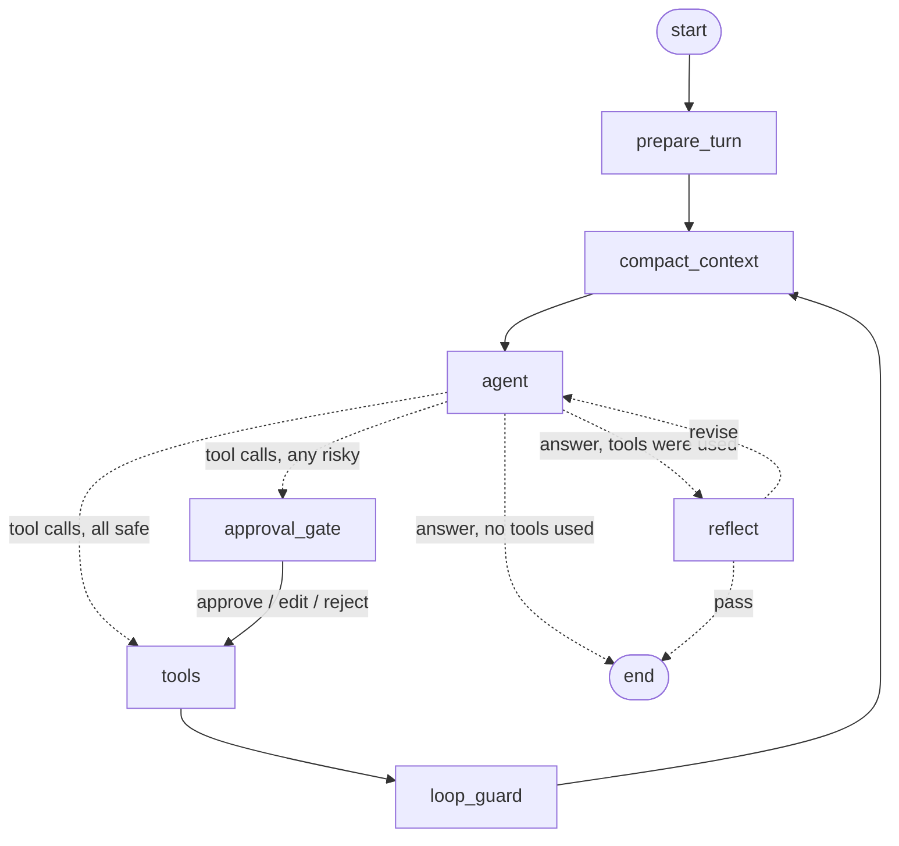

# Atlas — a LangGraph ReAct Agent (MCP · HITL · Loop Engineering · Memory)

A console agent built the way production LangGraph agents are built today: a **hand-wired
`StateGraph`** instead of the one-line `create_react_agent`, so every engineering concern —
the ReAct loop, loop control, human approval, tool sourcing via MCP, and memory — is an
explicit, inspectable node or edge.

> 📚 **Studying the code?** Start with [`LEARNING.md`](LEARNING.md) — a reading order, core
> concepts, 18 hands-on exercises and self-check questions. Every source file is annotated
> with `📘 LEARN` / `⚠ PITFALL` / `🔁 FLOW` / `🧪 TRY` comments.

The "business" of the agent is deliberately simple (a workspace assistant that manages files,
does math, runs shell commands and remembers facts about you). The point is the **mechanics**.

| Concern | Where it lives | Technique |
|---|---|---|
| ReAct loop | `agent` ⇄ `tools` nodes | Model emits tool calls → tools run → results fed back → repeat |
| Loop engineering | `agent`, `loop_guard`, `reflect`, `recursion_limit` | Step budget, forced final answer, repeat/error detection, self-critique loop, hard fuse |
| Human-in-the-loop | `approval_gate`, `ask_human` tool | `interrupt()` + `Command(resume=...)`, approve / edit / reject, durable pause |
| MCP | `mcp_servers/`, `agent/mcp_client.py` | Own MCP server over stdio, loaded with `langchain-mcp-adapters` |
| Tools | `agent/tools.py` | Local `@tool`s, `ToolRuntime` injection, tool-call interceptor |
| Memory | `agent/memory.py`, `compact_context` | Checkpointer (short-term), rolling summary (compaction), Store (long-term) |
| Model | `agent/llm.py` | Groq (`ChatGroq`, default: `openai/gpt-oss-20b`) |

---

## 1. Quick start

```bash
# 1) Groq credentials (or set GROQ_API_KEY in the repository root .env)
export GROQ_API_KEY="your-groq-api-key"
# Optional: export AGENT_MODEL="openai/gpt-oss-20b"

# 2) Python 3.12+ (from the repository root)
uv sync

# 3) Run
uv run react-agent --user harry
```

Try these in order — each one exercises a different mechanism:

```text
you> what's 17% of 2380, plus 99?                   # ReAct + local tool + critic
you> write a note todo.md listing 3 groceries       # MCP tool + approval gate (try [e]dit)
you> list the files, then delete todo.md            # MCP read (no approval) + delete (approval; try [r]eject)
you> remember that I prefer answers in bullet points# long-term memory write
/new                                                # fresh thread...
you> how do I like my answers formatted?            # ...memory recalled across threads
you> run a shell command                            # vague → agent may call ask_human
/state   /history   /memory   /graph                # inspect what happened
```

Configuration is environment-driven (see `.env.example`); the repository root `.env` is
loaded automatically, with exported environment variables taking precedence. For example:
`AGENT_MODEL=openai/gpt-oss-20b AGENT_MAX_ITERATIONS=12 uv run react-agent`.

Offline tests (no Groq API key or Ollama needed — a scripted fake model drives the real graph and the real MCP server):

```bash
# 17 tests: ReAct, HITL approve/edit/reject, ask_human/resume, tool errors, step budget, loop guard,
# compaction, cross-thread memory, reflection, Groq configuration and embeddings.
uv run python -m pytest src/agent_apps/react_agent/tests -q
```

---

## 2. Architecture

### 2.1 The graph



| Node | Responsibility |
|---|---|
| `prepare_turn` | Runs once per user message. Resets per-turn counters; recalls relevant long-term memories into state. |
| `compact_context` | If the thread exceeds the token budget, summarises old messages into `summary` and deletes them. |
| `agent` | Builds a fresh system prompt from state, calls Groq. On the last allowed step it calls the model **without tools** to force an answer. |
| `approval_gate` | `interrupt()`s with the risky calls. Applies the human's decisions to the pending tool calls. |
| `tools` | `ToolNode` over local + MCP tools, with an interceptor that blocks rejected calls and normalises outputs. |
| `loop_guard` | Detects identical repeated calls and error streaks; writes a warning that the next prompt includes. |
| `reflect` | A critic pass on the final draft. On "revise" it removes the draft and sends feedback back to `agent`. |

### 2.2 Project layout

```text
src/agent_apps/react_agent/
├── main.py                     # console REPL: streaming, interrupt handling, slash commands
├── mcp_servers.json            # which MCP servers to launch (stdio / http / sse)
├── mcp_servers/
│   └── workspace_server.py     # our MCP server (FastMCP): sandboxed file tools
├── agent/
│   ├── config.py               # all knobs (env-overridable)
│   ├── state.py                # AgentState (persisted) + AgentContext (per-run)
│   ├── graph.py                # ★ nodes, routing, loop engineering, HITL
│   ├── prompts.py              # dynamic system prompt, summariser & critic prompts
│   ├── tools.py                # local tools incl. ask_human + memory tools
│   ├── memory.py               # long-term memory (Store) helpers + recall
│   ├── mcp_client.py           # MCP → LangChain tool adapter
│   └── llm.py                  # ChatGroq + optional Ollama embeddings
├── tests/                      # offline tests with a scripted model
├── LEARNING.md                 # reading order, exercises, self-check questions
├── workspace/                  # the sandbox the agent's file tools operate on
└── data/                       # created at runtime: checkpoints.sqlite, store.sqlite
```

### 2.3 Runtime wiring

```text
                    ┌──────────────────────── main.py (console) ────────────────────────┐
  you> text ───────▶│ graph.astream(input, config{thread_id}, context{user_id})          │
                    │   ├─ prints node updates (tool calls, results, critic, compaction) │
                    │   └─ if snapshot.interrupts → prompt human → Command(resume=...)   │
                    └───────────────┬───────────────────────────────────┬───────────────┘
                                    │                                   │
                ┌───────────────────▼──────────────┐      ┌─────────────▼─────────────┐
                │ Compiled StateGraph              │      │ AsyncSqliteSaver          │
                │  nodes ── ChatGroq(model)   ─────┼──┐   │  checkpoints.sqlite       │ ← short-term memory,
                │  tools ── local @tool funcs      │  │   │  (state after every step) │   pause/resume, history
                │        └─ MCP tools ─────────────┼─┐│   └───────────────────────────┘
                └──────────────────────────────────┘ ││   ┌───────────────────────────┐
                                                     ││   │ AsyncSqliteStore          │ ← long-term memory
                     stdio (JSON-RPC) ◀──────────────┘│   │  store.sqlite             │   namespace=("memories", user)
           ┌──────────────────────────┐               │   └───────────────────────────┘
           │ workspace_server.py (MCP)│               └──▶ Groq HTTPS API
           └──────────────────────────┘
```

---

## 3. How each mechanism works

### 3.1 ReAct, as a graph

ReAct = **Re**ason + **Act**: the model alternates between thinking and calling tools, and
reads each tool's observation before deciding the next move. With native function calling the
"thought" is implicit; one cycle is:

```text
agent:  [system, ...history]  →  AIMessage(tool_calls=[calculator({"expression": "0.17*2380"})])
tools:  run calculator         →  ToolMessage("404.6", tool_call_id=...)
agent:  [... + the above]      →  AIMessage(tool_calls=[calculator({"expression": "404.6+99"})])
tools:                         →  ToolMessage("503.6")
agent:                         →  AIMessage("17% of 2380 is 404.6; plus 99 is 503.6.")   # no tool_calls → leave loop
```

The routing function `route_after_agent` *is* the ReAct decision: "has tool calls" → keep
looping; "no tool calls" → the model has decided it's done. Multiple tool calls in one
`AIMessage` run in parallel inside `ToolNode`.

Why not `create_react_agent`? It hides exactly the seams this project is about. A hand-built
graph lets us insert approval, loop detection, compaction and critique as first-class nodes.

### 3.2 Loop engineering

An agent is a `while` loop whose exit condition is decided by a stochastic model. Loop
engineering is everything that keeps that loop **bounded, convergent and recoverable**. Five
layers, from soft to hard:

| # | Mechanism | Trigger | Effect |
|---|---|---|---|
| 1 | **Budget awareness** | ≤ 2 steps left | System prompt tells the model to wrap up. |
| 2 | **Forced final answer** | step == `max_iterations` (default 8) | `agent` calls the model *without* tools bound, so it physically cannot call another tool and must answer. Graceful, not a crash. |
| 3 | **Error-as-observation** | a tool raises | `ToolNode(handle_tool_errors=_handle_tool_error)` turns tool failures into `ToolMessage(status="error")`, while allowing graph interrupts to propagate; the model reads the error and self-corrects (wrong path, bad args…). |
| 4 | **Loop guard** | same `name(args)` ≥ 3× in a turn, or ≥ 3 consecutive errors | `loop_guard` writes `loop_warning`; the next system prompt contains it, steering the model out of the rut. |
| 5 | **Hard fuse** | > `recursion_limit` super-steps (60) | LangGraph raises `GraphRecursionError`; the REPL reports it. Should never fire if 1–4 work. |

Plus a deliberate **outer loop**: `reflect` → `agent`. After a final draft (only when tools were
used — trivial chat isn't worth an extra LLM call), a critic checks it against the tool log. On
`revise`, the draft is removed from history (`RemoveMessage`) and moved into the system prompt
together with the feedback, so the model rewrites rather than appends. Capped by
`max_reflections` (default 1) so the critic can't trap the agent either.

Counters (`iterations`, `reflections`) live in graph state and are reset by `prepare_turn`, so
budgets are **per user turn**, and they survive pauses because state is checkpointed.

### 3.3 Human-in-the-loop

Two patterns, both built on LangGraph's `interrupt()`:

**a) Approval gate (policy-driven).** Tools listed in `AGENT_RISKY_TOOLS`
(`run_shell, write_file, delete_file`) route to `approval_gate` instead of `tools`.

```text
agent ─▶ approval_gate: interrupt({"type":"approval","calls":[...]})
                         │   graph state saved to SQLite, astream() returns
                         ▼
          main.py sees snapshot.interrupts → asks you [a]pprove / [e]dit / [r]eject
                         │
          graph.astream(Command(resume={"decisions": {call_id: {...}}}))
                         ▼
          approval_gate re-runs; interrupt() now RETURNS the decisions
            approve → unchanged
            edit    → AIMessage rewritten with new args (same message id ⇒ replaced in history)
            reject  → recorded in state.hitl_decisions
                         ▼
          tools: interceptor `enforce_hitl` short-circuits rejected calls with
                 ToolMessage("REJECTED by human. Reason: ...") — the tool never runs
```

Design points worth noticing:

- **Durable pause.** The pause is a checkpoint, not a blocked thread. You could quit, restart
  with `--thread <id>`, and the pending approval would still be there.
- **Re-execution semantics.** On resume, the interrupted node runs again from the top;
  `interrupt()` returns the resume value instead of pausing. So code before `interrupt()` must be
  side-effect free — `approval_gate` only reads state before it.
- **Well-formed history on reject.** Every tool call still gets a `ToolMessage` (the rejection
  notice), so the conversation stays valid for any chat API, and the model learns *why* it was
  stopped and adapts.
- **Edits are honest.** The edited args replace the original in the `AIMessage`, so later turns
  see what actually ran.

**b) `ask_human` tool (model-driven).** The model decides it needs clarification and calls
`ask_human(question)`. The tool body calls `interrupt({"type":"question"})`; your answer becomes
the tool's return value. Same mechanism, initiated by the model instead of a policy.

### 3.4 MCP (Model Context Protocol)

MCP standardises how tools are *served*; the model still sees ordinary function-calling schemas.

```text
mcp_servers.json ──▶ MultiServerMCPClient ──spawn──▶ python workspace_server.py (stdio)
                         │  initialize / tools/list (JSON-RPC)
                         ▼
             MCP tool schema (JSON Schema)  ──adapter──▶  LangChain BaseTool
                         │                                    │
                         └──────── bind_tools() ─────────────▶ the model sees: write_file(path, content, append)
             model calls write_file ─▶ adapter ─▶ tools/call over stdio ─▶ server executes ─▶ result
```

- `workspace_server.py` is a real MCP server built with **FastMCP**: `list_files`, `read_file`,
  `write_file`, `delete_file`, `search_files`, all sandboxed to `./workspace` (path-escape check).
- To the graph, MCP tools and local tools are indistinguishable — same `ToolNode`, same approval
  policy (by tool name), same error handling.
- MCP tools return content *blocks*; the interceptor flattens them to plain text and caps size
  (small local models handle plain strings much more reliably).
- **Add any MCP server** without touching code — e.g. the official filesystem or fetch servers:

  ```json
  {
    "workspace": { "...": "..." },
    "fetch": { "transport": "stdio", "command": "uvx", "args": ["mcp-server-fetch"] },
    "remote": { "transport": "streamable_http", "url": "http://localhost:8000/mcp" }
  }
  ```

  A server that fails to start is skipped with a warning; the agent still runs.

### 3.5 Tools

- Local tools are plain `@tool` functions (`calculator` with a safe AST evaluator,
  `get_current_time`, `run_shell` with timeout + output cap, `ask_human`, memory tools).
- **`ToolRuntime` injection**: memory tools declare `runtime: ToolRuntime`; LangGraph injects the
  Store and the per-run `context` (user id). The parameter is hidden from the model's schema.
- **Tool-call interceptor** (`ToolNode(awrap_tool_call=...)`): one choke point around every tool
  execution — used here for HITL enforcement and output normalisation; the same hook is where you'd
  add auth, rate limits, caching or tracing.

### 3.6 Memory management

Three layers, each solving a different problem:

```text
┌─ Long-term (Store, cross-thread) ──────────────────────────────────────────────┐
│ namespace ("memories", user_id) → {"content": "...", "created_at": ...}         │
│ write: agent calls save_memory / delete_memory (explicit, model-decided)        │
│ read : prepare_turn auto-recalls top-k for the new message → system prompt      │
│        (keyword overlap by default; semantic search if OLLAMA_EMBED_MODEL is set) │
└──────────────────────────────────────────────────────────────────────────────────┘
┌─ Compaction (rolling summary) ─────────────────────────────────────────────────┐
│ when ~tokens(messages) > AGENT_CONTEXT_BUDGET:                                  │
│   old messages ─LLM─▶ summary (merged with previous summary) → system prompt    │
│   RemoveMessage(old ids) deletes them from state; last N messages kept verbatim │
│   cut point snaps back to a user message, so an AI tool call is never separated │
│   from its ToolMessages                                                         │
└──────────────────────────────────────────────────────────────────────────────────┘
┌─ Short-term (Checkpointer, per thread) ────────────────────────────────────────┐
│ AsyncSqliteSaver persists full state after every super-step, keyed by thread_id │
│ → multi-turn conversation, resume after restart, durable HITL pauses,           │
│   /history shows every checkpoint (the basis for time-travel / replay)          │
└──────────────────────────────────────────────────────────────────────────────────┘
```

**Context engineering ties it together**: the system prompt is rebuilt on every `agent` step
from state — base instructions + summary + recalled memories + loop warnings + critique + budget
notice. The model always sees a curated view, not an ever-growing transcript.

---

## 4. State reference

```python
class AgentState(MessagesState):          # messages: add_messages reducer (append / replace-by-id / remove)
    summary: str                          # compaction output
    memories: list[str]                   # recalled long-term memories (this turn)
    iterations: int                       # agent steps this turn         ┐
    reflections: int                      # critic revisions this turn    │ reset by prepare_turn
    loop_warning: str                     # from loop_guard               │
    critique: dict | None                 # {"draft", "feedback"}         │
    hitl_decisions: dict                  # tool_call_id → reject reason  ┘

@dataclass
class AgentContext:                       # per-run, not persisted
    user_id: str
```

## 5. Configuration

| Env var | Default | Meaning |
|---|---|---|
| `GROQ_API_KEY` | *(required)* | Groq API key, read when creating the chat model |
| `AGENT_MODEL` | `openai/gpt-oss-20b` | Groq model with tool calling |
| `GROQ_BASE_URL` | `https://api.groq.com` | SDK host; do not append `/openai/v1` |
| `GROQ_TEMPERATURE` | `0.2` | Chat model temperature |
| `OLLAMA_BASE_URL` | `http://localhost:11434` | Used only for optional embeddings |
| `OLLAMA_EMBED_MODEL` | *(unset)* | e.g. `nomic-embed-text` → semantic memory recall |
| `AGENT_MAX_ITERATIONS` | `8` | ReAct step budget per turn |
| `AGENT_MAX_REFLECTIONS` | `1` | Critic revisions per turn |
| `AGENT_REFLECTION` | `true` | Enable the critic loop |
| `AGENT_CONTEXT_BUDGET` | `6000` | Approx. tokens before compaction |
| `AGENT_RISKY_TOOLS` | `run_shell,write_file,delete_file` | Tools that need approval |

## 6. Console commands

`/new` new thread · `/threads` · `/switch <id>` · `/state` counters, summary, context size ·
`/history` checkpoints · `/memory` · `/forget <id>` · `/tools` (⚠ = approval) · `/graph` Mermaid ·
`/quit`

## 7. Notes & limits

- Models occasionally emit malformed tool calls; the error-as-observation and loop
  guard layers exist precisely for this. Choose a Groq model that supports tool calling.
- If switching `OLLAMA_EMBED_MODEL` on or off, delete `data/store.sqlite` (the vector index
  dimensions are fixed at creation).
- `run_shell` executes real commands in `./workspace` — that's why it's behind approval.
