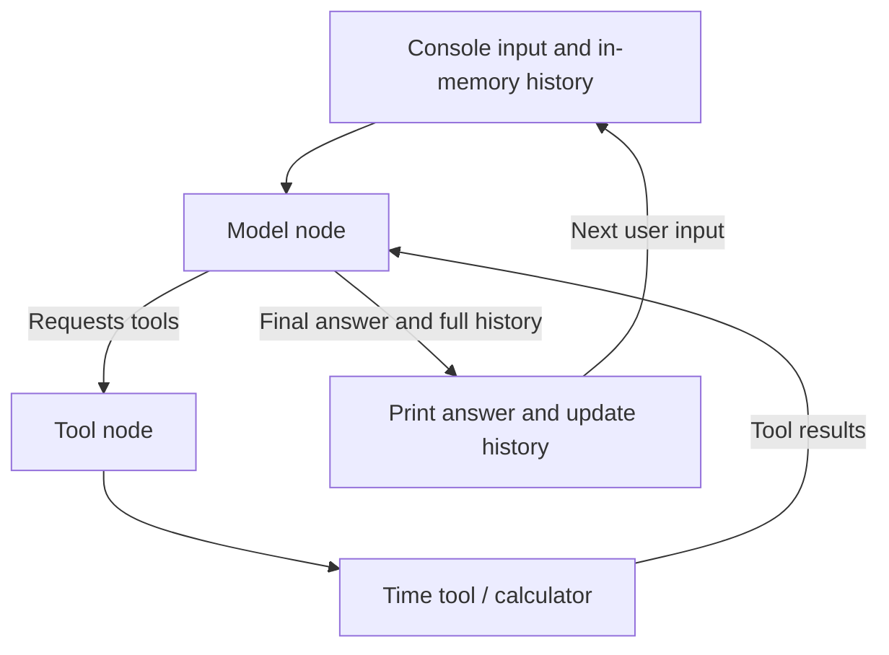
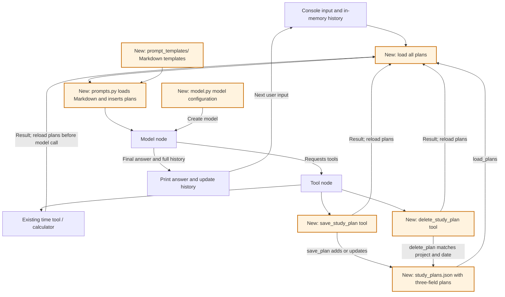
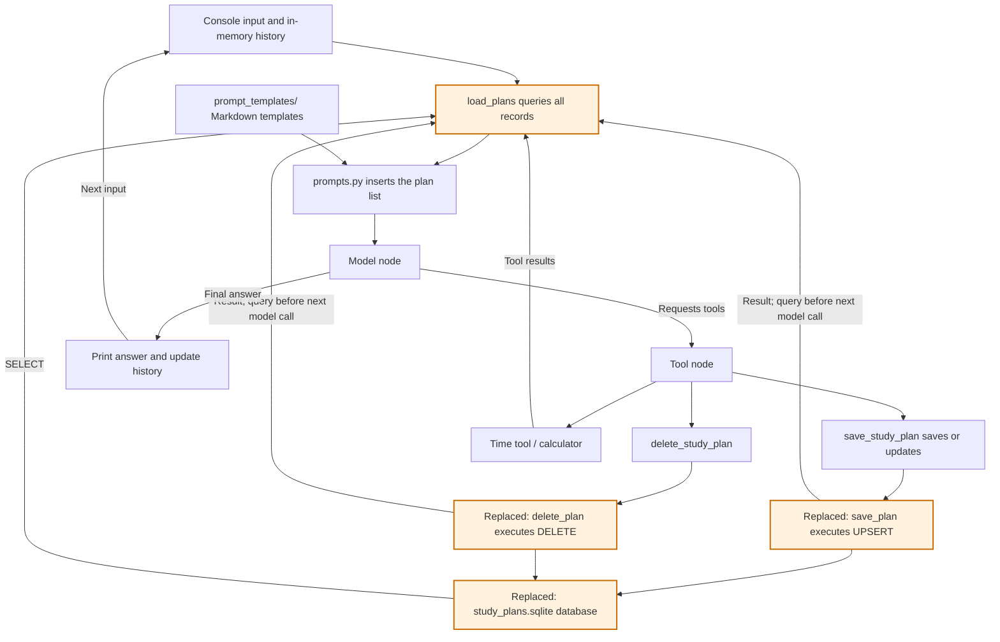
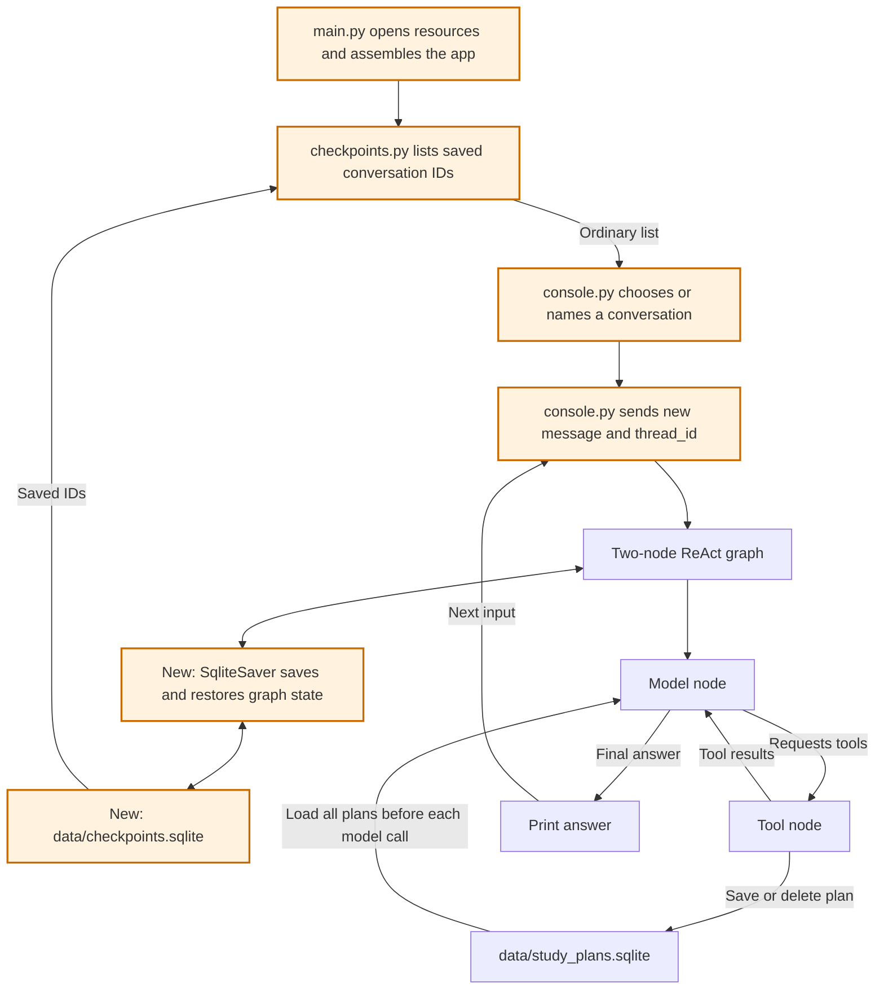

# Version Learning Guide

English | [简体中文](VERSIONS.zh-CN.md)

This document records what each version teaches, what it adds, and how to verify it. Append the same information when a future version adds another building block.

The running code is **version 4**, using SQLite for both conversation checkpoints and study plans. Versions 1 through 3 describe the learning history, not separate runnable directories. Earlier JSON storage and manual message-list management are historical; follow version 4 when reading the current conversation code.

Code, prompts, tool descriptions, and terminal messages use English. The assistant replies in English by default, with another language available on explicit request. Exit with `exit` or `quit`.

Diagrams show both components and data flow. Only **Model node** and **Tool node** are registered LangGraph nodes; storage helpers and the console are ordinary Python functions.

## Version 1: console chat and minimal ReAct

### Learning goal

Follow the complete cycle: user input, model decision, tool execution, tool observation, and final answer. Understand how a message list preserves context between turns.

### Component diagram



### Building blocks

| Block | Location | What to understand |
|---|---|---|
| Model creation | `create_model()`, now in `model.py` | Read the API key and create a model object |
| Local tools | `tools.py` | `@tool`, parameter types, and descriptions |
| Model node | `call_model()` in `graph.py` | Send instructions and messages; return state updates |
| Tool node | `ToolNode` in `graph.py` | Execute requests and create tool-result messages |
| Conditional routing | `route_after_model()` | Continue with tools or finish the turn |
| Console loop | `chat()`, now in `console.py` | Read input, invoke the graph, and keep complete history in this historical version |

### Reading order

1. Read `get_current_time()` and `calculate()` to see ordinary functions become tools.
2. Read node registration and edges at the end of `build_graph()` in `graph.py`; there are only two nodes.
3. Read `call_model()` and `route_after_model()`. Distinguish a state update from a node-name return value.
4. Read `chat()`, including why `[*messages, HumanMessage(text)]` includes old messages.
5. Read `create_model()` and `main()` to connect the startup steps.

When reviewing version 1 in today's code, temporarily skip storage reads and the plan save/delete tools.

### Exercises

- Greet the assistant and observe an answer without tools.
- Ask for the current time and observe the tool message.
- Ask how many hours 45 minutes per day for 7 days totals; observe calculation results becoming inputs to later calls.
- Say "I only have 30 minutes a day," then ask how much that is in a week.

### Self-check

- Why is binding a tool different from executing it?
- Why does the model node return `{"messages": [response]}`?
- Why does tool execution lead back to the model?
- Why must you replace complete history instead of appending the entire result again?

## Version 2: save and delete study plans in a file

### Learning goal

Understand how information moves from conversation into a file, survives a restart, and returns to the model through its system prompt.

This version settled on a list of plans with exactly three fields: `project`, `minutes`, and `date`. The earlier `daily_minutes` preference idea was replaced within version 2.

### Component diagram

Orange components were added in this version. The model node, tool node, and conditional routing remain the same.



Before each model call, `call_model()` reads all plans through `memory.py` and calls `build_system_prompt()` in `prompts.py`. A successful save or deletion is visible in the very next model request. Both steps happen inside the model node.

### What changed from version 1

| Change | Location | Purpose |
|---|---|---|
| Plan structure | `StudyPlan` in `memory.py` | Declare project, integer minutes, and date |
| Read function | `load_plans()` | Read a JSON list; return an empty list if the file is missing |
| Save function | `save_plan()` | Validate and add a plan or update the same project/date |
| Delete function | `delete_plan()` | Delete one matching plan; return False without writing if missing |
| Write tools | `save_study_plan()` and `delete_study_plan()` | Perform requested storage changes |
| Markdown prompts | `prompt_templates/` and `prompts.py` | Separate instructions from template loading and data formatting |
| Model configuration | `model.py` | Keep model creation separate from orchestration |
| Ignored runtime data | `.gitignore` | Keep personal plans out of the repository |

Adding tools to `TOOLS` reused the same tool node and edges.

### Reading order

The JSON implementation below is historical and is no longer present in the current `memory.py`. Use version 3's reading order when following today's source.

1. Review file storage: `Path`, `read_text()`, `json.loads()`, `json.dumps()`, and list insertion, update, and deletion.
2. Read the save and delete tools. Saving requires three fields; deletion requires only project and date. Both report success after the write.
3. Inspect `TOOLS` and how the model and tool node share it.
4. Read the Markdown rules, then `prompts.py`, then the storage-read portion of `call_model()`.
5. Follow saving, deleting, and reading after restart through the diagram.

Model creation lives in `model.py`. Prompt text lives in Markdown; `prompts.py` loads and formats it. These boundaries preserve the two-node graph.

`system_prompt.md` holds behavioral rules. `study_plans_prompt.md` uses `{plans}` for the saved list. The short tool-error instruction stays in `prompts.py` as `TOOL_ERROR_MESSAGE`. Filenames are lowercase, Python constants uppercase. The Markdown directory has no `__init__.py`; Python imports the sibling `prompts.py`. Restart after editing templates.

### The historical JSON file

The first successful save created `simple_react_agent/data/study_plans.json`:

```json
[
  {"project": "Python", "minutes": 60, "date": "2026-10-29"},
  {"project": "English", "minutes": 30, "date": "2026-10-29"}
]
```

The path was anchored to `memory.py`, with one shared list for a single user. Projects must not be blank, duration must be an integer from 1 to 1440 minutes, and dates must be valid `YYYY-MM-DD` calendar dates. There are no extra IDs, notes, or timestamps.

The same project and date updates duration; other combinations add a plan. A missing file starts empty. Invalid content reports an error and is preserved. The older `preferences.json` file is not used.

### Saving flow

```text
User: Save a 60-minute Python plan for 2026-10-29.
    -> save_study_plan(project="Python", minutes=60, date="2026-10-29")
    -> save_plan("Python", 60, "2026-10-29")
    -> Write succeeds and the tool confirms it
    -> Next model request reads the updated list
```

### Reading after restart

```text
Restart with empty in-memory conversation history
    -> User asks: What study plans do I have?
    -> load_plans() reads project, duration, and date
    -> The list is inserted into the system prompt
    -> The model lists plans or uses the calculator for arithmetic
```

### Deletion flow

```text
User: Delete the Python plan for 2026-10-29.
    -> delete_study_plan(project="Python", date="2026-10-29")
    -> Validate the key and load the list
    -> Delete the matching plan and write the rest
    -> Return confirmation; the next model request reloads the list
```

Duration is not required for deletion. Ask when the target is unclear. A missing plan returns False without creating or rewriting the JSON file. Deleting the last plan writes `[]`; failed writes preserve the previous plans and cannot report successful deletion.

### Exercises

1. Start without a plan file and try ordinary conversation and existing tools.
2. Save Python, 60 minutes, 2026-10-29; verify exactly three fields.
3. Add an English plan for that date and a Python plan for another date; retain all three.
4. Update the first Python plan to 90 minutes; change only its matching key.
5. Restart and ask for all saved plans.
6. Request a Python plan without duration or date; the assistant should ask for them. Relative dates require the time tool.
7. Make a temporary calculation and verify saved plans are unchanged.
8. Delete the first Python plan; retain English on the same date and Python on another date.
9. Repeat deletion and observe a missing result. Delete the last plan and restart to verify an empty list.
10. Edit `prompt_templates/system_prompt.md`, restart, and observe the updated instructions.

Actual tool selection depends on the model and instructions. Check tool output and storage to verify writes. Offline tests separately verify schema, CRUD, restarts, concurrency, and graph integration.

### Self-check

- Why does saving a file still require reading it into a prompt?
- Why can a restarted agent know plans without knowing the prior conversation?
- Why read before each model call rather than only at startup?
- Why do new save/delete tools need no new graph nodes?
- Why does deletion need only project and date?
- What happens if storage succeeds but the following model call fails?

The successful write remains. The console discards incomplete-turn messages; it does not roll back a completed storage operation.

### Error handling

The console handles expected API, file, value, and type errors. Startup configuration errors receive a readable message, while graph construction errors propagate. There is no blanket `except Exception`; unexpected errors retain their traceback.

### Two historical file-write details

Version 2 used a shared `Lock` around read/modify/write operations so concurrent tools could not overwrite each other's changes within one process.

Saving and deletion shared `_write_plans()`. `with NamedTemporaryFile(...) as temporary:` closed the temporary file before replacing the target. Failed operations cleaned it up and preserved the original file. These mechanisms were replaced by SQLite transactions in version 3.

### Unicode console editing

Without line editing, Backspace could remove only part of a UTF-8 character. Importing `readline` enables whole-character editing, and `chat()` disables automatic input history. Graph and message handling are unaffected.

Pseudo-terminal regression tests send real Backspace keys to verify the first character, a complete Unicode phrase, and mixed Latin/Unicode input can be deleted and replaced correctly.

## Version 3: SQLite storage

### Learning goal and scope

Replace JSON persistence with Python's standard `sqlite3` module. Learn tables, parameters, transactions, and connection management while preserving the same four tools, two nodes, three plan fields, and CRUD behavior.

The main change is in `memory.py`. No database server or ORM is needed. The file is `simple_react_agent/data/study_plans.sqlite`, anchored to the module path.

### Module organization introduced in version 3

Version 3 also separates graph construction from the console and renames the Markdown directory from `prompts/` to `prompt_templates/`:

```text
simple_react_agent/
├── main.py              # Create the model, build the graph, and run console chat
├── graph.py             # build_graph(), model node, tool node, and routing
├── model.py             # Model configuration and creation
├── tools.py             # Time, calculator, save, and delete tools
├── memory.py            # Plan validation and SQLite CRUD
├── prompts.py           # Load templates and format the plan list
└── prompt_templates/    # Markdown instructions and plan-list template
```

`main()` passes the model to `build_graph(model)`, which returns a compiled graph. Its nested model-node function captures the bound model so it can use it when the graph runs. Importing `graph.py` does not start console chat. `prompts.py` remains the Python import entry point; `prompt_templates/` contains Markdown assets only. These changes keep the same two-node ReAct loop.

### Component diagram

Orange components replace the storage implementation. Database queries happen inside the model node and do not add graph nodes.



`build_system_prompt()` still receives a list of dictionaries. JSON in the prompt is a display format; persistent storage is SQLite.

### Table: exactly three business fields

```sql
CREATE TABLE IF NOT EXISTS study_plans (
    project TEXT NOT NULL CHECK (length(trim(project)) > 0),
    minutes INTEGER NOT NULL
        CHECK (typeof(minutes) = 'integer' AND minutes BETWEEN 1 AND 1440),
    date TEXT NOT NULL,
    PRIMARY KEY (project, date)
);
```

The composite primary key enforces one plan for a given project and date. Python validation still normalizes project names and checks integer durations and real dates. There are no custom IDs, notes, or creation timestamps.

`StudyPlan` remains a `TypedDict`, which describes the dictionary shape without validating values at runtime. `_validate_plan_key()` validates project and date; `_validate_plan()` also checks duration. Saving and loading use the full validation, while deletion validates only the key. This version does not replace these functions with a Pydantic `BaseModel`.

`ORDER BY rowid` preserves insertion order, including when duration changes. This is SQLite's internal row identifier, not an extra business field or return value.

### Compatible interfaces

| Capability | Python interface | SQL operation | Behavior |
|---|---|---|---|
| Create | `save_plan(project, minutes, planned_date)` | `INSERT` | Return the saved three-field dictionary |
| Update | The same `save_plan(...)` | `UPDATE minutes` on key conflict | Preserve other plans |
| Read | `load_plans()` | `SELECT project, minutes, date` | Return the complete dictionary list |
| Delete | `delete_plan(project, planned_date)` | `DELETE` with both key fields | Return True if deleted; False if missing |

The save tool also performs updates. Reads still enter the prompt through `load_plans()`; there is no separate query tool.

Parameterized UPSERT handles saving:

```sql
INSERT INTO study_plans (project, minutes, date)
VALUES (?, ?, ?)
ON CONFLICT(project, date) DO UPDATE SET minutes = excluded.minutes;
```

Deletion uses `WHERE project = ? AND date = ?` and checks affected rows. User values are bound as parameters, not interpolated into SQL strings.

### Connections, transactions, and errors

- Each operation opens its own connection, with a write timeout, instead of sharing connections between tool threads.
- `_connect()` uses `@contextmanager`, with a `Generator[sqlite3.Connection]` return annotation. `with connection` commits or rolls back; outer `contextlib.closing()` closes the connection.
- Writes execute direct SQL statements. SQLite coordinates concurrent writes and transactions instead of rewriting the entire list.
- The temporary-file replacement and Python write lock are removed; validation and `StudyPlan` remain.
- The console handles `sqlite3.Error` explicitly alongside the existing error categories.
- The first access prepares the table. Empty storage returns `[]`; deleting the last record leaves an empty table.

See [Python sqlite3 documentation](https://docs.python.org/3.13/library/sqlite3.html) for transactions and connections, and [SQLite UPSERT documentation](https://sqlite.org/lang_upsert.html) for conflict handling.

### Start with an empty database

Version 3 does not reuse historical data. `CREATE TABLE IF NOT EXISTS` prepares an empty table on first use. Old JSON is not read or imported, and no database-version marker is maintained.

Table preparation is part of `_connect()`, so there are no extra initialization or migration functions. Newly saved plans persist; later starts reuse the table without clearing it.

### Changed files

| File | Change |
|---|---|
| `memory.py` | Replace storage while preserving the three public CRUD functions; centralize table preparation, connections, and transactions in `_connect()` |
| `main.py` | Handle console input/output and expected errors; import the graph factory |
| `graph.py` | Construct the graph and define nodes and routing independently of the console |
| `tools.py` | Preserve study-plan tool names, arguments, and CRUD behavior |
| `prompts.py`, `prompt_templates/` | Keep receiving the same list of plans and the same template placeholder |
| `tests/` | Retain graph and console regressions; test SQLite CRUD and verify old JSON is ignored |
| Documentation | Explain database location and fresh-start behavior in English and Chinese |

The existing `data/` ignore rule covers personal databases.

### Reading and verification order

Read table creation and the composite key first, then SELECT, UPSERT, DELETE, and finally connection/transaction management.

The tests cover:

1. Creating an empty database with exactly three business fields.
2. Adding multiple plans, updating a matching key, and deleting only a specified plan.
3. An empty result after deleting the last plan and restarting.
4. Committed records visible in another process, and concurrent writes that retain unrelated plans.
5. Type and range validation, including project names containing quotes.
6. Rollback on failure, connection closure, and preservation of existing records.
7. Old JSON being ignored even when malformed; new SQLite plans persisting across restarts.
8. Tool, graph, and Unicode console regressions.

## Version 4: persistent conversations with a SQLite checkpointer

### Learning goal and scope

Let LangGraph manage conversation state and restore it after a process restart. Learn the roles of `MessagesState`, `SqliteSaver`, and `thread_id`. The four tools, two graph nodes, three plan fields, and study-plan CRUD stay the same.

Version 3 kept the complete `messages` list in the console. Version 4 passes only new messages to a graph compiled with a checkpointer. `MessagesState` merges the messages; the checkpointer restores and saves state. The model itself does not store the history.

### Component diagram

Orange components are new or changed in this version. Checkpoint storage is a graph capability, not another graph node.



### What changed from version 3

| Component | Change |
|---|---|
| `main()` | Open the conversation menu, create the model after selection, and keep `SqliteSaver.from_conn_string(...)` open around selection, graph construction, and chat |
| `checkpoints.py` | Own `CHECKPOINTS_FILE` and `list_threads(checkpointer)`; isolate SQL and checkpoint-table details |
| `console.py` | Own `select_thread(threads)` and `chat()`; choose from a plain list and send only new messages with the thread ID |
| `build_graph()` | Accept a checkpointer and pass it to `graph.compile(checkpointer=...)` |
| `prompt_templates/system_prompt.md` | Clarify that plan tools save plan fields while the application separately saves conversation history |
| Failure handling | End the console on expected errors; continue pending work on the next launch of the same thread |
| `tests/test_checkpoints.py` | Verify actual SQLite restoration, thread isolation, and recovery using offline models |
| Runtime data | Add `data/checkpoints.sqlite`, covered by the existing `data/` ignore rule |

The SQLite checkpointer dependency is already installed in the project. No new framework or tool is needed. `build_graph()` keeps the checkpointer optional for isolated graph tests; the console always supplies `SqliteSaver`.

### Module boundaries

```text
simple_react_agent/
├── main.py           # Startup, resource lifetime, and composition
├── checkpoints.py   # Checkpoint path and conversation queries
├── console.py       # Conversation menu, chat, and terminal error messages
├── graph.py         # ReAct graph, nodes, and routing
├── model.py         # Model creation
├── memory.py        # Study-plan validation and storage
├── tools.py         # Tool entry points
├── prompts.py       # Prompt loading and formatting
└── prompt_templates/
```

`main.py` connects the modules explicitly:

```python
threads = checkpoints.list_threads(checkpointer)
thread_id = select_thread(threads)
```

The menu receives `list[str]` and does not depend on `SqliteSaver` or its tables. Database details stay in `checkpoints.py`, while interaction and graph-error messages stay in `console.py`. `main.py` keeps saver lifetime and startup handling. It enters the menu directly and does not parse command-line arguments. This is a version 4 refactor, not a new learning version or a database migration.

### Follow one turn through the code

1. `main()` opens `SqliteSaver` and shows the menu. After a conversation is selected or named, it creates the model and passes the saver to `build_graph()`. The connection stays open until chat finishes.
2. `console.py`'s `chat()` uses `{"configurable": {"thread_id": "study-python"}, "recursion_limit": 20}` for this conversation, annotated as `RunnableConfig`.
3. The console invokes the graph with `{"messages": [HumanMessage(text)]}`. It does not resend the full history.
4. LangGraph loads saved state for that thread, merges the new message, and runs the existing model/tool loop. Checkpoints record execution state at step boundaries.
5. A later invocation with the same database and thread ID restores that conversation. A different ID uses separate history.
6. Exiting the saver context closes the connection without deleting the database.

`thread_id` identifies a conversation, not an operating-system thread or user account. The startup menu uses its name as the ID. Names are case-sensitive; surrounding whitespace is stripped. New names must be nonempty and must not already exist. Select an existing conversation by its displayed number, choose `0` to create one, or enter `exit`/`quit` to leave. There is no command-line conversation selector or automatic default selection. Older IDs such as `default` still appear in the list.

`checkpoints.py`'s `list_threads()` reads only distinct IDs from the existing checkpoint table, without deserializing message histories or adding a separate registry table. A fresh file with no checkpoint table returns an empty list. Newly named conversations become list entries after their first graph input is checkpointed. Menu numbers are just positions in the sorted list, not permanent IDs. Opening the menu and exiting do not create a model or require an API key.

### Two stores, two purposes

| File | Contents | Scope |
|---|---|---|
| `data/checkpoints.sqlite` | Graph state: messages, tool requests/results, and execution progress | Separate state per `thread_id` |
| `data/study_plans.sqlite` | `project`, `minutes`, and `date` | Shared plan list across all threads in this app |

The model node still reads current plans before every model call. A different conversation can see saved plans without seeing another conversation's messages. Upgrading preserves existing SQLite plans, but version 3's lost in-memory conversations cannot be recovered. Both databases are anchored to the application directory and ignored by Git.

### Failed or interrupted turns

Unlike versions 2 and 3, failed-turn state is not discarded. Expected API, storage, or graph-limit errors end the console session. Successfully written checkpoints remain. At the next launch, `graph.get_state(config).next` identifies pending nodes, and `graph.invoke(None, config=config)` continues the unfinished turn before accepting a new message. `None` means continue saved work, not append an empty user message.

For example, if saving a plan finished and its tool result was checkpointed, but the following model call failed, restarting the same thread resumes the model call using that tool result. It does not run the completed save step again.

Checkpoints and plan writes use separate transactions. A node interrupted before its completion was recorded can run again; this does not guarantee exactly-once tool side effects. Plan writes already committed are not rolled back by a later model failure. A persistent failure can be fixed before restarting, or a new thread can be used for a fresh conversation. History is not compacted, and a given thread should be used by one console process at a time.

### Reading order and exercises

1. Read `main()` and its `with SqliteSaver.from_conn_string(...)` lifetime.
2. Read `list_threads()` in `checkpoints.py`, then `select_thread(threads)` in `console.py`, to understand how a plain list becomes a selected `thread_id`.
3. Read the checkpointer parameter and `compile()` call in `graph.py`.
4. Read `console.py`'s `chat()` config and new-message input; compare with manual history management from version 3.
5. Read the pending-state check and `invoke(None, ...)` recovery branch.
6. Read `tests/test_checkpoints.py` to see recovery without real model calls.

Try:

```bash
uv run simple-react-agent
```

Choose `0` and name a conversation `study-python`. Tell it "I want to learn decorators," exit, run the same command, select the saved conversation by number, and ask what you wanted to learn. Then create `study-english` from the menu and check that its conversation is separate. Save a plan in either conversation and verify it is visible in the other. Try invalid menu choices, blank names, and duplicate names; existing data should remain unchanged.

Offline checks:

```bash
uv run pytest -q src/agent_apps/simple_react_agent/tests
```

Tests cover cross-process restoration of messages and tool results, thread isolation, shared plans, no duplicate messages, recovery after a model failure without repeating a completed save, saver connection closure, menu selection, blank/duplicate names, quitting without an API key, database errors, and existing CRUD/console regressions. Unicode editing is verified in both conversation naming and chat input.

### Self-check

- Why does an in-memory checkpointer lose history after the process exits, while `SqliteSaver` retains it?
- Why does each turn now send only the new message?
- Why are both the same database and the same `thread_id` needed to restore a conversation?
- Why can two threads share plans while keeping different message histories?
- Why must unfinished tool/model work be resumed before adding a new user message?

See the official [LangGraph persistence guide](https://docs.langchain.com/oss/python/langgraph/persistence) and [SqliteSaver reference](https://reference.langchain.com/python/langgraph.checkpoint.sqlite/SqliteSaver/from_conn_string) for the underlying APIs.

## Recording future versions

For each new building block, append goals, a diagram, changed components, reading order, and verification steps to both language editions.

Versions 2 and 3 keep the same project, duration, and date fields. Version 3 focuses on replacing persistence and understanding transactions while preserving CRUD behavior.
