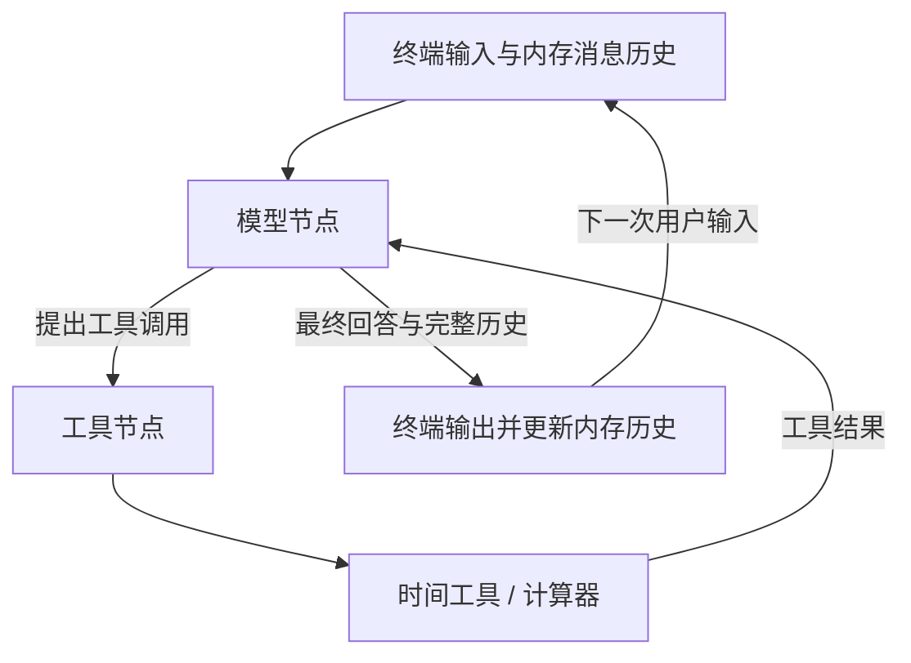
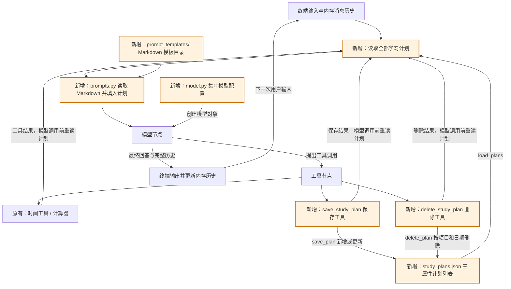
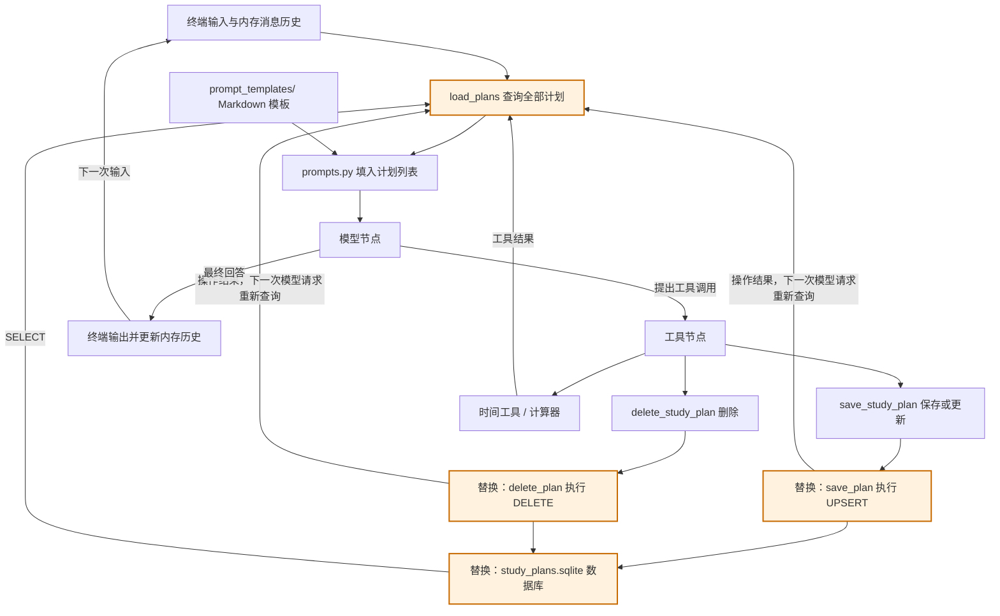

# 学习版本与积木路线

[English](VERSIONS.md) | 简体中文

当前代码、提示词、工具说明和终端文案默认使用英文，退出命令为 `exit` 或 `quit`。本文保留中文学习说明，以下旧版本内容用于回顾功能演进。

这份文档专门记录每个版本学什么、增加什么、怎样验证。后续增加功能时，继续在这里追加对应版本。

当前运行代码是第三版，已使用 SQLite。第一版与第二版记录用于回顾演进过程；版本表示学习阶段，并不是互相独立的运行目录。

图中既包含程序组件，也包含数据流；真正注册到 LangGraph 的节点始终只有“模型节点”和“工具节点”。文件读写函数和终端循环都不是额外的图节点。

## 第一版：终端对话与最小 ReAct

### 学习目标

走通“用户输入 → 模型决定 → 执行工具 → 模型读取结果 → 回答”的完整过程，并理解消息列表怎样延续当前对话。

### 组件结构图



### 这一版搭了哪些积木

| 积木 | 所在位置 | 需要理解的内容 |
|---|---|---|
| 模型创建 | `create_model()`，现已抽到 `model.py` | 读取密钥、创建模型对象 |
| 本地工具 | `tools.py` | `@tool`、参数类型、工具说明 |
| 模型节点 | `graph.py` 的 `call_model()` | 把提示词和消息交给模型，返回状态更新 |
| 工具节点 | `graph.py` 的 `ToolNode` | 执行模型请求，生成工具结果消息 |
| 条件路由 | `route_after_model()` | 有工具调用就执行，没有就结束本轮 |
| 终端循环 | `chat()` | 接收输入、运行图、保存返回的完整历史 |

### 推荐阅读顺序

1. 先看 `get_current_time()` 和 `calculate()`，理解普通函数如何成为工具。
2. 看 `graph.py` 中 `build_graph()` 最后的节点注册和连线，确认只有两个节点。
3. 看 `call_model()` 与 `route_after_model()`，区分“返回状态更新”和“返回下一节点名称”。
4. 看 `chat()`，理解 `[*messages, HumanMessage(text)]` 为什么要传入旧消息。
5. 看 `model.py` 中的 `create_model()` 和主程序的 `main()`，把启动过程连起来。

回顾第一版时，可以暂时跳过当前代码中的计划读取，以及计划保存、删除工具。

### 动手验证

- 普通问候：观察模型直接回答。
- 询问当前时间：观察时间工具的提示。
- “每天45分钟，7天多少小时”：观察一次或多次计算器调用，以及工具结果如何用于后续计算。
- 先说“我每天只有30分钟”，再问“一周能学多久”：观察会话历史的作用。

### 学完后的自查

- 为什么绑定工具不等于执行工具？
- 为什么模型节点返回 `{"messages": [response]}`？
- 为什么工具节点执行结束后，要再次回到模型节点？
- 为什么保存完整历史时不能再把整份结果追加一遍？

## 第二版：用文件保存和删除学习计划

### 学习目标

理解信息怎样从对话写入文件、跨程序重启保存，再通过系统提示词进入模型上下文。

本版长期记忆按最终需求保存学习计划列表，每条仅有项目、学习时长、日期三个属性，字段分别是 `project`、`minutes`、`date`。此前的 `daily_minutes` 方案由这套结构替代，版本号仍为第二版。

### 组件结构图

橙色部分是第二版新增的组件。原有模型节点、工具节点和条件路由继续使用。



`call_model()` 在每次模型调用前，通过 `memory.py` 读取全部计划，再调用 `prompts.py` 的 `build_system_prompt()` 组装提示词。因此保存或删除工具执行完成后，下一次模型请求就能读到新内容。这两个步骤都在模型节点内部完成。

### 相比第一版增加了什么

| 变化 | 位置 | 作用 |
|---|---|---|
| 新增计划结构 | `memory.py` 的 `StudyPlan` | 明确项目、整数分钟数、日期三个字段 |
| 新增读取函数 | `memory.py` 的 `load_plans()` | 从 JSON 数组读取计划；文件不存在时返回空列表 |
| 新增保存函数 | `memory.py` 的 `save_plan()` | 校验字段，新增计划或更新同项目同日期的计划 |
| 新增删除函数 | `memory.py` 的 `delete_plan()` | 按项目和日期删除一条；未找到时返回 False，不改动文件 |
| 新增保存、删除工具 | `tools.py` 的 `save_study_plan()`、`delete_study_plan()` | 用户明确要求时调用对应的数据操作函数 |
| Markdown 提示词 | `prompt_templates/` 目录与 `prompts.py` | 将指令保存在 Markdown 文件中，读取后填入全部学习计划 |
| 单独抽离模型配置 | `model.py` 的 `create_model()` | 主程序通过导入创建模型，配置逻辑集中在一个文件 |
| 忽略运行数据 | `.gitignore` | 个人计划文件不提交到代码仓库 |

图仍然只有两个节点；保存和删除工具加入 `TOOLS` 后，沿用原来的工具执行路径。

### 推荐阅读顺序

下面的 JSON 实现属于历史版本，当前 `memory.py` 已不再包含这些文件操作。对照现有源码时，请使用第三版的阅读顺序。

1. 先读 `memory.py`：`Path`、`read_text()`、`json.loads()`、`json.dumps()`，以及列表的新增、更新、删除。
2. 再读 `save_study_plan()` 和 `delete_study_plan()`：保存需要三个属性，删除只需项目和日期；为什么文件写成功后才提示成功。
3. 查看 `TOOLS`：新工具如何同时交给模型和工具节点。
4. 看 `prompt_templates/` 下的 Markdown 规则和 `prompts.py` 的读取、拼接，再回到 `call_model()`：文件内容怎样进入系统提示词。
5. 对照上面的结构图，跟踪一次保存、删除和重启后的读取。

本版将 `create_model()` 放在 `model.py`，提示词文本放在 `prompt_templates/` 的 Markdown 文件中，读取和动态组装逻辑放在 `prompts.py`。模型参数和两节点图结构保持不变。

`system_prompt.md` 管理助手的行为规则，`study_plans_prompt.md` 通过 `{plans}` 占位符接收计划列表。简短的工具错误指令直接保留为 `prompts.py` 中的 `TOOL_ERROR_MESSAGE` 字符串。文件名采用小写，Python 常量名采用大写。`prompt_templates/` 只存放 Markdown，不放 `__init__.py`，Python 导入入口仍为同级的 `prompts.py`。编辑模板后重新启动程序生效。

### 计划文件是什么样

首次成功保存后，会创建 `simple_react_agent/data/study_plans.json`：

```json
[
  {"project": "Python", "minutes": 60, "date": "2026-10-29"},
  {"project": "英语", "minutes": 30, "date": "2026-10-29"}
]
```

路径根据 `memory.py` 的位置确定，从其他工作目录启动也会使用同一个文件。这个学习版本共用一份计划列表，适合单人使用。

项目不能为空；时长必须是1到1440之间的整数分钟；日期必须是 `YYYY-MM-DD` 格式的真实日期。不保存编号、备注或其他属性。同项目同日期再次保存会更新时长，不同项目或不同日期会新增。

不存在文件时正常开始；文件内容损坏时明确报错，并避免覆盖旧文件。此前的 `preferences.json` 保留但不再读取，也不会凭空补出项目和日期进行迁移。

### 保存过程

```text
用户说“保存2026年10月29日学习Python60分钟的计划”
    → 模型请求 save_study_plan(project="Python", minutes=60, date="2026-10-29")
    → 工具调用 save_plan("Python", 60, "2026-10-29")
    → 文件写入成功，工具返回确认
    → 下一次模型请求读取全部计划，再生成回答
```

### 重启后的使用过程

```text
重新启动，内存对话历史为空
    → 用户问“我有哪些学习计划？”
    → load_plans() 读取项目、时长、日期
    → 将全部计划加入系统提示词
    → 模型根据这些数据列出计划；需要汇总时再调用计算器
```

### 删除过程

```text
用户说“删除2026年10月29日的Python计划”
    → 模型请求 delete_study_plan(project="Python", date="2026-10-29")
    → delete_plan() 校验项目和日期，读取列表
    → 找到匹配项就删除并写回，其他计划保留
    → 工具返回成功，下一次模型请求读取更新后的列表
```

删除不需要时长。项目或日期不明确时先询问；未找到计划时返回 False，不创建或重写文件。最后一条删除后写入 `[]`，重启也会读取到空列表。文件写入失败时保留原有计划，工具不会返回删除成功。

### 动手验证

1. 首次启动且没有计划文件时，普通对话和原有工具应正常工作。
2. 保存“2026年10月29日，Python，60分钟”，打开文件确认只有三个字段。
3. 保存同一天的英语计划，再保存另一天的Python计划，确认三条都保留。
4. 把第一条Python计划更新为90分钟，确认只更新相同项目、相同日期的一条。
5. 退出后重启，询问“我有哪些学习计划？”，确认能读取此前记录。
6. 只说“帮我保存Python学习计划”，助手应补问缺少的时长和日期；说“今天”时先查询当前时间。
7. 只要求临时计算其他学习时长时，已有计划保持不变。
8. 删除“2026年10月29日的Python计划”，确认同一天英语和另一天Python都保留。
9. 再次删除同一条，确认提示未找到；删除最后一条后重启，确认列表为空。
10. 编辑 `prompt_templates/system_prompt.md` 后重启，观察提示词调整效果。

模型是否调用工具由提示词和模型共同决定。观察实际工具提示和文件内容，确认是否真的保存或删除；离线测试另外验证三个字段、列表增改删、新进程读取、并行写入和图内衔接。

### 学完后的自查

- 为什么信息写进文件后，还要读取并加入提示词？
- 为什么重新启动后知道学习计划，却没有上一段完整对话？
- 为什么每次调用模型前读取，而不只在启动时读取？
- 为什么新增保存工具不需要新增图节点？
- 为什么删除只需项目和日期？删除后，系统提示词为什么会立即变化？
- 当前保存工具已经成功，但后面的模型请求失败时，文件会怎样？

最后一题的答案：文件仍然保留已成功写入的值。终端循环只丢弃失败半轮的内存消息，并不会回滚文件写入。

### 异常处理的阅读重点

终端循环分别处理模型接口错误、文件读写错误、计划数据的值错误与类型错误。启动时只将配置相关的值错误和文件错误转成中文提示；图的构建错误直接抛出。没有使用 `except Exception` 统一捕获，未列出的错误会保留堆栈，方便定位程序问题。

### 保存多条计划时的两个细节

工具节点可能同时执行多个保存、删除请求，共用的 `Lock` 把每次“读列表、增改删、写回”作为完整操作，避免不同请求互相覆盖。这只协调当前进程内的工具调用。

保存和删除共用 `_write_plans()`：`with NamedTemporaryFile(...) as temporary:` 自动管理临时文件的打开和关闭；内容写完、文件关闭后才替换正式文件。失败时清理临时文件，保留原有计划。可以先看懂列表操作，再回头学习这两处写入保护。

### 终端中文输入修复

原来的 `input()` 未启用行编辑，中文退格可能只删除 UTF-8 字节的一部分，出现首字删不干净或残留字符。现在导入标准库 `readline` 启用字符编辑，并在 `chat()` 中关闭自动输入历史；图和消息处理不变。

回归测试使用伪终端输入真实退格键，检查单个中文字、整段中文和中英文混合内容能否删到第一个字，再输入新内容并正确提交。这项修复沿用第二版结构，不增加图节点。

## 第三版：SQLite 存储

### 学习目标与范围

将 JSON 文件存储替换为 Python 标准库 `sqlite3`，学习表结构、SQL 参数、事务和连接管理。用户对话、四个工具、两个图节点，以及项目、学习时长、日期三个属性保持第二版规则。

这次主要改 `memory.py`，不用增加数据库服务或 ORM。SQLite 数据库保存在 `simple_react_agent/data/study_plans.sqlite`，路径仍根据模块位置确定。

### 当前模块布局

第三版还将图构建从终端入口中拆出，并把 Markdown 目录从 `prompts/` 改名为 `prompt_templates/`：

```text
simple_react_agent/
├── main.py              # 创建模型、构建图、运行终端对话
├── graph.py             # build_graph()、模型节点、工具节点与路由
├── model.py             # 模型配置与创建
├── tools.py             # 时间、计算器、保存和删除工具
├── memory.py            # 计划校验与 SQLite 增删改查
├── prompts.py           # 读取模板、格式化计划列表
└── prompt_templates/    # Markdown 行为规则与计划列表模板
```

`main()` 将模型传给 `build_graph(model)`，后者返回编译后的图。内部嵌套的模型节点函数通过闭包保留绑定工具后的模型，在图运行时使用。导入 `graph.py` 不会启动终端对话。`prompts.py` 仍是 Python 导入入口，`prompt_templates/` 只保存 Markdown 资源。这些拆分不改变原有两节点 ReAct 循环。

### 组件结构图

橙色部分表示本版替换的存储组件；文件读取和数据库查询仍在模型节点内部调用，不增加图节点。



计划仍以 Python 字典列表交给 `build_system_prompt()`。提示词中继续用 JSON 文本展示这些字典，是数据展示格式；真正持久化的位置改为 SQLite。

### 表结构：仍然只有三个业务字段

```sql
CREATE TABLE IF NOT EXISTS study_plans (
    project TEXT NOT NULL CHECK (length(trim(project)) > 0),
    minutes INTEGER NOT NULL
        CHECK (typeof(minutes) = 'integer' AND minutes BETWEEN 1 AND 1440),
    date TEXT NOT NULL,
    PRIMARY KEY (project, date)
);
```

`project + date` 是联合主键，继续表示“同一项目、同一日期最多一条计划”。不增加自定义编号、备注、创建时间等字段。Python 层继续负责项目规范化、整数类型以及真实日期的严格校验。

`StudyPlan` 仍然是 `TypedDict`，只描述字典结构，不执行运行时校验。`_validate_plan_key()` 校验项目和日期，`_validate_plan()` 额外校验时长。保存和读取使用完整校验，删除只校验定位计划的键。本版没有改用 Pydantic `BaseModel` 替代这些函数。

读取时使用 `ORDER BY rowid` 保持原有新增顺序；更新分钟数不会改变记录位置。这里使用的是 SQLite 普通表自带的内部行标识，不增加对外字段或返回值。

### 对外接口与行为保持兼容

| 能力 | Python 接口 | 数据库操作 | 既有行为 |
|---|---|---|---|
| 新增 | `save_plan(project, minutes, planned_date)` | `INSERT` | 返回保存后的三字段字典 |
| 修改 | 同一个 `save_plan(...)` | 主键冲突时 `UPDATE minutes` | 同项目同日期更新，其他记录保留 |
| 查询 | `load_plans()` | `SELECT project, minutes, date` | 返回全部计划的字典列表，供提示词使用 |
| 删除 | `delete_plan(project, planned_date)` | 带项目、日期条件的 `DELETE` | 删除成功返回 True，未找到返回 False |

保持当前工具入口，不新增独立“修改”或“查询”工具。保存工具继续兼任修改；查询仍由模型调用前的 `load_plans()` 提供数据。

保存语句采用参数化 UPSERT：

```sql
INSERT INTO study_plans (project, minutes, date)
VALUES (?, ?, ?)
ON CONFLICT(project, date) DO UPDATE SET minutes = excluded.minutes;
```

删除也使用 `WHERE project = ? AND date = ?`，通过受影响行数判断是否找到计划。所有用户数据作为参数传入，不通过字符串拼接构造 SQL。

### 连接、事务和错误处理

- 每次数据操作使用自己的连接，并设置合理的写入等待时间，避免工具并行时跨线程共用连接。
- `_connect()` 用 `@contextmanager` 提供统一入口，返回类型标注为 `Generator[sqlite3.Connection]`。以 `with connection` 处理提交和回滚，再通过外层 `contextlib.closing()` 明确关闭连接。`with connection` 本身不负责关闭连接。
- 新增、修改、删除直接执行单条参数化 SQL，由数据库事务协调写入，不再手动重写整个列表。
- 已移除 JSON 版本的临时文件替换和 Python 写入锁；校验函数与 `StudyPlan` 保留。
- 主程序增加对 `sqlite3.Error` 的具体处理；保留 `TypeError`、`ValueError` 的分类，不捕获笼统的 `Exception`。
- 首次初始化建立表；无计划时仍返回空列表，删除最后一条后数据库保留空表。

SQLite 连接与事务上下文的行为参考 [Python sqlite3 文档](https://docs.python.org/3.13/library/sqlite3.html)，保存时的冲突更新参考 [SQLite UPSERT 文档](https://sqlite.org/lang_upsert.html)。

### 直接从空数据库开始

第三版不使用历史数据。首次访问时通过 `CREATE TABLE IF NOT EXISTS` 准备空表，不读取或导入任何旧 JSON，也不维护数据库版本标记。

这段建表逻辑直接放在 `_connect()` 中，不需要额外的初始化或迁移函数。新保存的数据会持续存在；再次启动只复用已有表，不清空新计划。

### 本版文件改动

| 文件 | 实际改动 |
|---|---|
| `memory.py` | 已替换存储实现，保留三个公开数据操作函数；通过 `_connect()` 统一建表、连接与事务管理 |
| `main.py` | 处理终端输入输出和预期错误，导入图工厂 |
| `graph.py` | 独立于终端的图构建、节点定义和条件路由 |
| `tools.py` | 保留工具名称、参数、返回文本和行为 |
| `prompts.py`、`prompt_templates/` | 继续接收同样的计划字典列表，不改变模板占位符 |
| `tests/` | 保留工具、图、重启读取与终端回归；测试 SQLite 增删改查，并确认旧 JSON 不被读取 |
| `README.md`、本文档 | 当前为第三版，说明数据库位置与空库开始的规则 |

`data/` 已被忽略，无需新增个人数据提交规则。

### 验证与阅读顺序

先读建表语句与联合主键，再读 `SELECT`，随后读 UPSERT、DELETE，最后看连接管理与事务。

本版测试覆盖：

1. 没有旧文件时能初始化，查询返回空列表。
2. 多条计划新增、同键更新、指定删除，返回结构与第二版一致。
3. 删除最后一条后重启仍为空，不从旧 JSON 复活数据。
4. 新进程能读到已提交计划；多个并行保存、删除不丢失其他记录。
5. 错误类型与数值范围仍被校验，项目包含引号等字符也能正确作为 SQL 参数处理。
6. 写入失败时事务回滚，数据库连接正常关闭，原有记录保留。
7. 即使旧 JSON 存在或已损坏，也不会读取它；数据库从空列表开始，新保存的计划重启后保留。
8. 表中只有三个业务字段，工具、图和终端中文退格回归继续通过。

## 后续版本怎样继续记录

每增加一块积木，就在这份文档追加一个版本，写清学习目标、结构图、新增组件、阅读顺序和验证方式。

第二版与第三版都只保留项目、学习时长、日期三个属性。第三版的学习重点是存储替换和事务，增删改查能力保持一致。
