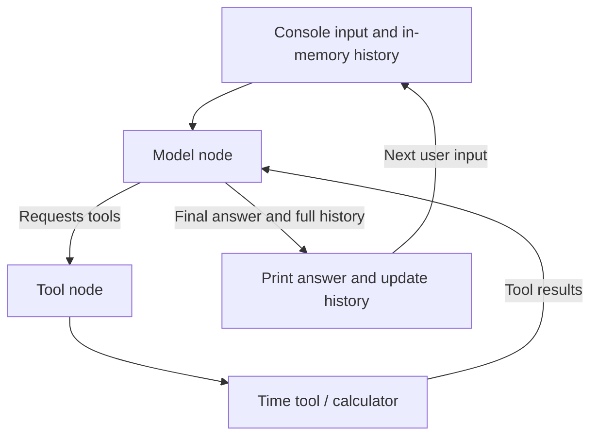
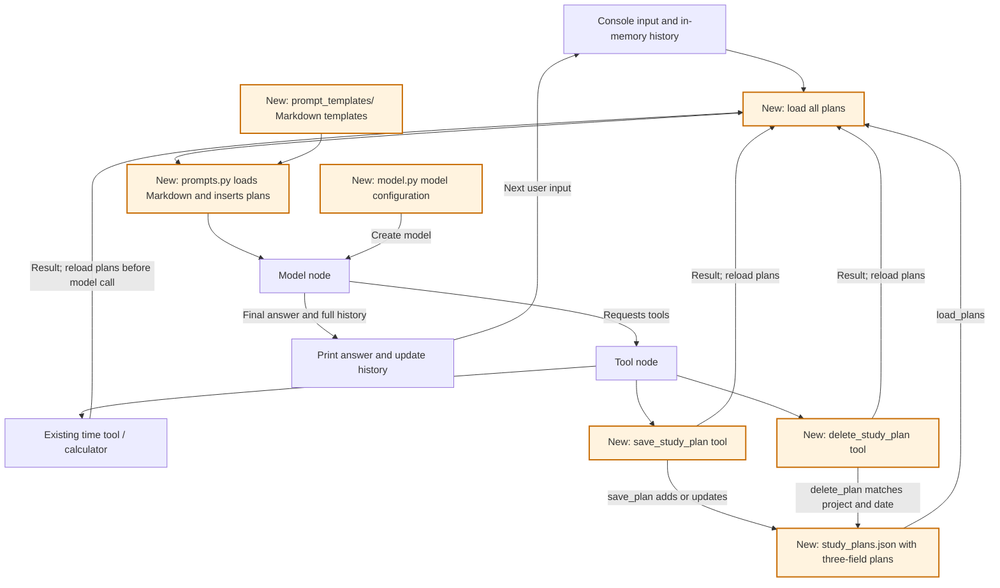
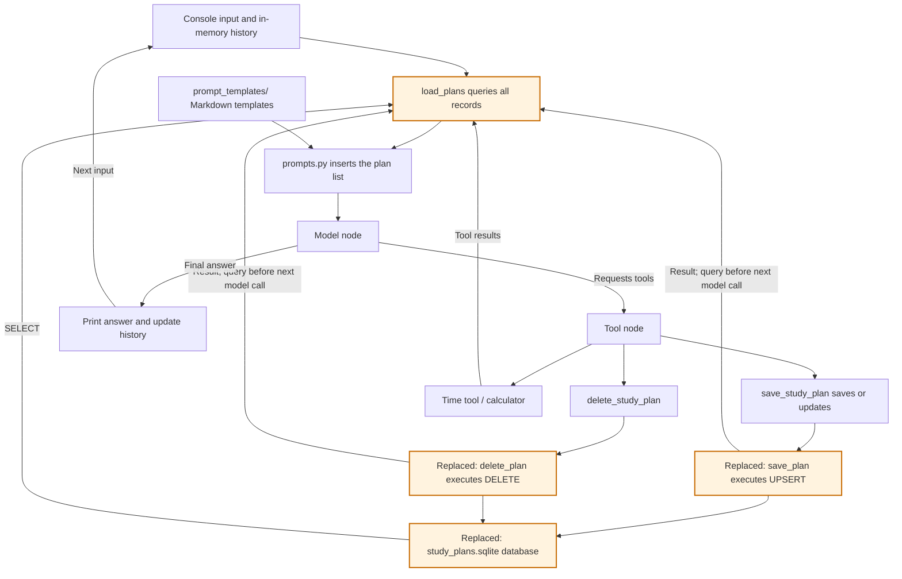
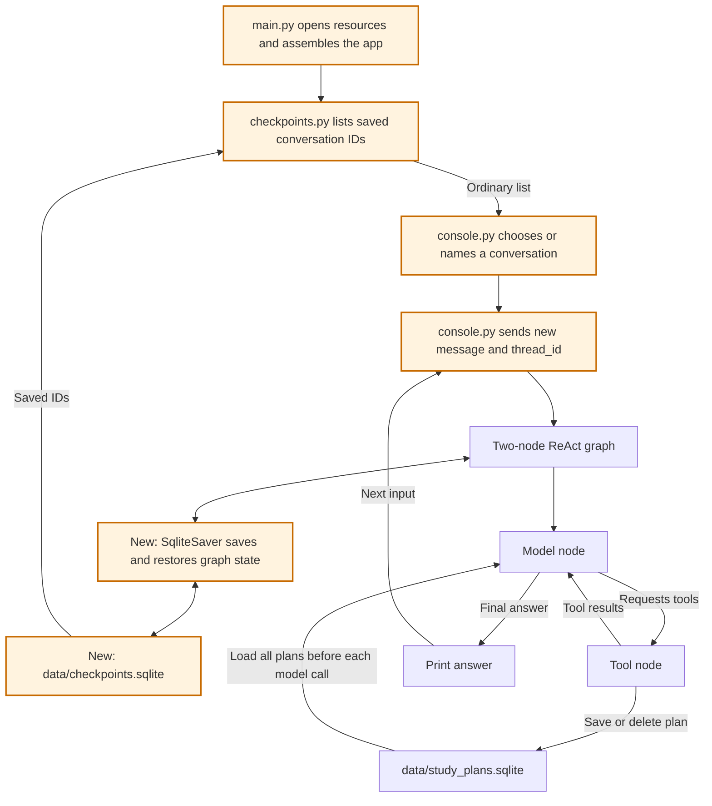
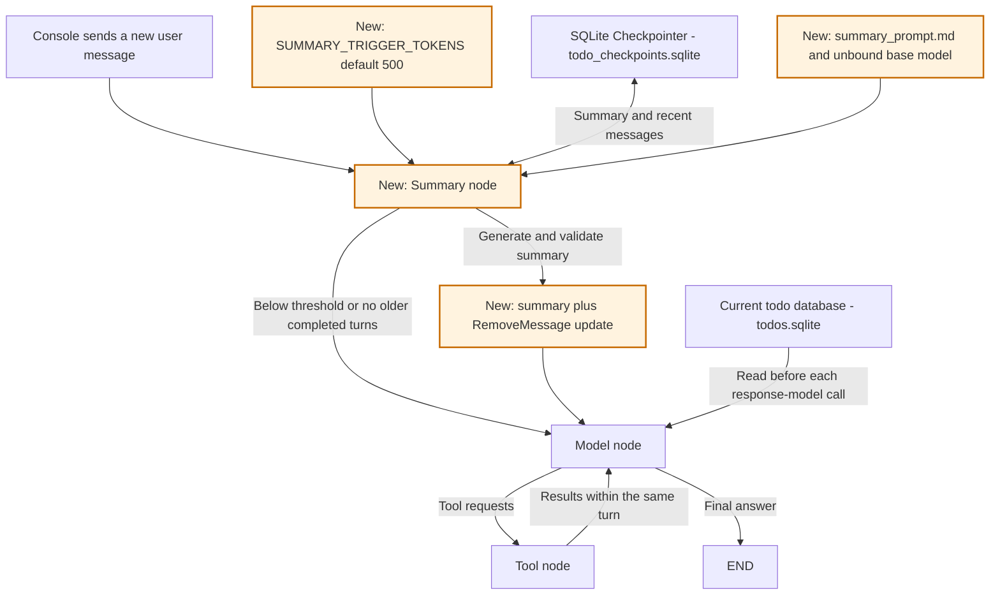
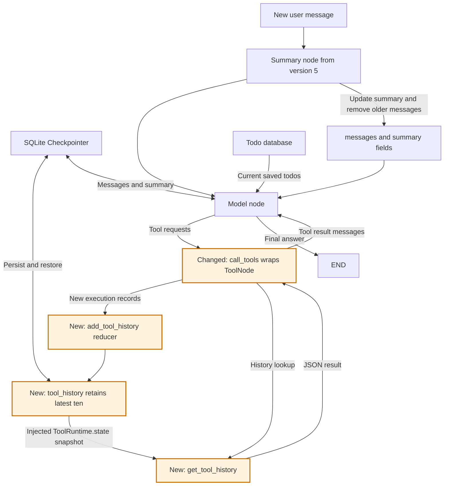

# Version Learning Guide

English | [简体中文](VERSIONS.zh-CN.md)

## Version overview

| Version | What was added or changed | Learning focus |
|---|---|---|
| V1 | Console chat, time/calculator tools, and a minimal ReAct loop | Model/tool nodes, routing, and message history |
| V2 | Three-field study plans, JSON persistence, save/update/delete tools | Tool schemas, validation, and persistent business data |
| V3 | Replace JSON with SQLite; separate graph construction and prompt templates | SQL CRUD, transactions, connections, and module boundaries |
| V4 | SQLite checkpoints, saved conversation selection, and resume after failure | `MessagesState`, Checkpointer, `thread_id`, and console/storage separation |
| V5 | Rolling summaries, configurable token threshold, local configuration, and Todo naming/storage | Context compression, complete turns, and `RemoveMessage` |
| V6 | Custom tool-history reducer, execution records, history queries, and an `agent/` package with a central configuration entry point | Incremental State updates, runtime injection, persistence, and model access to custom state |
| V7 (current) | Tool observation, human approval, middleware composition, and checkpointed per-call recovery | Wrappers, `interrupt`, `Command(resume=...)`, terminal decisions, and durable tasks |

This document records what each version teaches, what it adds, and how to verify it. Append the same information when a future version adds another building block.

The running code is **version 7**, adding per-tool observation middleware to
version 6's custom State and history queries, plus human approval and durable
per-call recovery. Version 5 covers summary compression, version 6 covers State
maintenance, and version 7 covers composed wrappers, pause/resume, and tasks.
The current assistant uses Todo names throughout its tools, functions, types,
and SQLite storage. Versions 1 through 6 describe the learning history rather
than separate runnable directories.

Code, prompts, tool descriptions, and terminal messages use English. The assistant replies in English by default, with another language available on explicit request. Exit with `exit` or `quit`.

Current Agent execution and persistence modules live under `agent/`, with startup, console, and shared configuration at the application root. Earlier sections retain their historical paths; use the version 6 layout plus version 7's middleware and console approval flow when navigating current source.

Diagrams show components and data flow. Versions 1-4 have **Model node** and **Tool node**; version 5 adds **Summary node**. Version 6 keeps those three nodes and adds custom state processing inside the tools step. Version 7 adds a wrapper inside `ToolNode` without adding nodes. Storage helpers
and the console are ordinary Python functions.

## Version 1: console chat and minimal ReAct

### Learning goal

Follow the complete cycle: user input, model decision, tool execution, tool observation, and final answer. Understand how a message list preserves context between turns.

### Component diagram



### Building blocks

| Block | Location | What to understand |
|---|---|---|
| Model creation | `create_model()`, now in `model.py` | Read the API key and create a model object |
| Local tools | `tools.py` | `@tool`, parameter types, and descriptions |
| Model node | `call_model()` in `graph.py` | Send instructions and messages; return state updates |
| Tool node | `ToolNode` in `graph.py` | Execute requests and create tool-result messages |
| Conditional routing | `route_after_model()` | Continue with tools or finish the turn |
| Console loop | `chat()`, now in `console.py` | Read input, invoke the graph, and keep complete history in this historical version |

### Reading order

1. Read `get_current_time()` and `calculate()` to see ordinary functions become tools.
2. Read node registration and edges at the end of `build_graph()` in `graph.py`; there are only two nodes.
3. Read `call_model()` and `route_after_model()`. Distinguish a state update from a node-name return value.
4. Read `chat()`, including why `[*messages, HumanMessage(text)]` includes old messages.
5. Read `create_model()` and `main()` to connect the startup steps.

When reviewing version 1 in today's code, temporarily skip storage reads and the plan save/delete tools.

### Exercises

- Greet the assistant and observe an answer without tools.
- Ask for the current time and observe the tool message.
- Ask how many hours 45 minutes per day for 7 days totals; observe calculation results becoming inputs to later calls.
- Say "I only have 30 minutes a day," then ask how much that is in a week.

### Self-check

- Why is binding a tool different from executing it?
- Why does the model node return `{"messages": [response]}`?
- Why does tool execution lead back to the model?
- Why must you replace complete history instead of appending the entire result again?

## Version 2: save and delete study plans in a file

### Learning goal

Understand how information moves from conversation into a file, survives a restart, and returns to the model through its system prompt.

This version settled on a list of plans with exactly three fields: `project`, `minutes`, and `date`. The earlier `daily_minutes` preference idea was replaced within version 2.

### Component diagram

Orange components were added in this version. The model node, tool node, and conditional routing remain the same.



Before each model call, `call_model()` reads all plans through `memory.py` and calls `build_system_prompt()` in `prompts.py`. A successful save or deletion is visible in the very next model request. Both steps happen inside the model node.

### What changed from version 1

| Change | Location | Purpose |
|---|---|---|
| Plan structure | `StudyPlan` in `memory.py` | Declare project, integer minutes, and date |
| Read function | `load_plans()` | Read a JSON list; return an empty list if the file is missing |
| Save function | `save_plan()` | Validate and add a plan or update the same project/date |
| Delete function | `delete_plan()` | Delete one matching plan; return False without writing if missing |
| Write tools | `save_study_plan()` and `delete_study_plan()` | Perform requested storage changes |
| Markdown prompts | `prompt_templates/` and `prompts.py` | Separate instructions from template loading and data formatting |
| Model configuration | `model.py` | Keep model creation separate from orchestration |
| Ignored runtime data | `.gitignore` | Keep personal plans out of the repository |

Adding tools to `TOOLS` reused the same tool node and edges.

### Reading order

The JSON implementation below is historical and is no longer present in the current `memory.py`. Use version 3's reading order when following today's source.

1. Review file storage: `Path`, `read_text()`, `json.loads()`, `json.dumps()`, and list insertion, update, and deletion.
2. Read the save and delete tools. Saving requires three fields; deletion requires only project and date. Both report success after the write.
3. Inspect `TOOLS` and how the model and tool node share it.
4. Read the Markdown rules, then `prompts.py`, then the storage-read portion of `call_model()`.
5. Follow saving, deleting, and reading after restart through the diagram.

Model creation lives in `model.py`. Prompt text lives in Markdown; `prompts.py` loads and formats it. These boundaries preserve the two-node graph.

`system_prompt.md` holds behavioral rules. `study_plans_prompt.md` uses `{plans}` for the saved list. The short tool-error instruction stays in `prompts.py` as `TOOL_ERROR_MESSAGE`. Filenames are lowercase, Python constants uppercase. The Markdown directory has no `__init__.py`; Python imports the sibling `prompts.py`. Restart after editing templates.

### The historical JSON file

The first successful save created `todo_list_assistant_agent/data/study_plans.json`:

```json
[
  {"project": "Python", "minutes": 60, "date": "2026-10-29"},
  {"project": "English", "minutes": 30, "date": "2026-10-29"}
]
```

The path was anchored to `memory.py`, with one shared list for a single user. Projects must not be blank, duration must be an integer from 1 to 1440 minutes, and dates must be valid `YYYY-MM-DD` calendar dates. There are no extra IDs, notes, or timestamps.

The same project and date updates duration; other combinations add a plan. A missing file starts empty. Invalid content reports an error and is preserved. The older `preferences.json` file is not used.

### Saving flow

```text
User: Save a 60-minute Python plan for 2026-10-29.
    -> save_study_plan(project="Python", minutes=60, date="2026-10-29")
    -> save_plan("Python", 60, "2026-10-29")
    -> Write succeeds and the tool confirms it
    -> Next model request reads the updated list
```

### Reading after restart

```text
Restart with empty in-memory conversation history
    -> User asks: What study plans do I have?
    -> load_plans() reads project, duration, and date
    -> The list is inserted into the system prompt
    -> The model lists plans or uses the calculator for arithmetic
```

### Deletion flow

```text
User: Delete the Python plan for 2026-10-29.
    -> delete_study_plan(project="Python", date="2026-10-29")
    -> Validate the key and load the list
    -> Delete the matching plan and write the rest
    -> Return confirmation; the next model request reloads the list
```

Duration is not required for deletion. Ask when the target is unclear. A missing plan returns False without creating or rewriting the JSON file. Deleting the last plan writes `[]`; failed writes preserve the previous plans and cannot report successful deletion.

### Exercises

1. Start without a plan file and try ordinary conversation and existing tools.
2. Save Python, 60 minutes, 2026-10-29; verify exactly three fields.
3. Add an English plan for that date and a Python plan for another date; retain all three.
4. Update the first Python plan to 90 minutes; change only its matching key.
5. Restart and ask for all saved plans.
6. Request a Python plan without duration or date; the assistant should ask for them. Relative dates require the time tool.
7. Make a temporary calculation and verify saved plans are unchanged.
8. Delete the first Python plan; retain English on the same date and Python on another date.
9. Repeat deletion and observe a missing result. Delete the last plan and restart to verify an empty list.
10. Edit `prompt_templates/system_prompt.md`, restart, and observe the updated instructions.

Actual tool selection depends on the model and instructions. Check tool output and storage to verify writes. Offline tests separately verify schema, CRUD, restarts, concurrency, and graph integration.

### Self-check

- Why does saving a file still require reading it into a prompt?
- Why can a restarted agent know plans without knowing the prior conversation?
- Why read before each model call rather than only at startup?
- Why do new save/delete tools need no new graph nodes?
- Why does deletion need only project and date?
- What happens if storage succeeds but the following model call fails?

The successful write remains. The console discards incomplete-turn messages; it does not roll back a completed storage operation.

### Error handling

The console handles expected API, file, value, and type errors. Startup configuration errors receive a readable message, while graph construction errors propagate. There is no blanket `except Exception`; unexpected errors retain their traceback.

### Two historical file-write details

Version 2 used a shared `Lock` around read/modify/write operations so concurrent tools could not overwrite each other's changes within one process.

Saving and deletion shared `_write_plans()`. `with NamedTemporaryFile(...) as temporary:` closed the temporary file before replacing the target. Failed operations cleaned it up and preserved the original file. These mechanisms were replaced by SQLite transactions in version 3.

### Unicode console editing

Without line editing, Backspace could remove only part of a UTF-8 character. Importing `readline` enables whole-character editing, and `chat()` disables automatic input history. Graph and message handling are unaffected.

Pseudo-terminal regression tests send real Backspace keys to verify the first character, a complete Unicode phrase, and mixed Latin/Unicode input can be deleted and replaced correctly.

## Version 3: SQLite storage

### Learning goal and scope

Replace JSON persistence with Python's standard `sqlite3` module. Learn tables, parameters, transactions, and connection management while preserving the same four tools, two nodes, three plan fields, and CRUD behavior.

The main change is in `memory.py`. No database server or ORM is needed. The file is `todo_list_assistant_agent/data/study_plans.sqlite`, anchored to the module path.

### Module organization introduced in version 3

Version 3 also separates graph construction from the console and renames the Markdown directory from `prompts/` to `prompt_templates/`:

```text
todo_list_assistant_agent/
├── main.py              # Create the model, build the graph, and run console chat
├── graph.py             # build_graph(), model node, tool node, and routing
├── model.py             # Model configuration and creation
├── tools.py             # Time, calculator, save, and delete tools
├── memory.py            # Plan validation and SQLite CRUD
├── prompts.py           # Load templates and format the plan list
└── prompt_templates/    # Markdown instructions and plan-list template
```

`main()` passes the model to `build_graph(model)`, which returns a compiled graph. Its nested model-node function captures the bound model so it can use it when the graph runs. Importing `graph.py` does not start console chat. `prompts.py` remains the Python import entry point; `prompt_templates/` contains Markdown assets only. These changes keep the same two-node ReAct loop.

### Component diagram

Orange components replace the storage implementation. Database queries happen inside the model node and do not add graph nodes.



`build_system_prompt()` still receives a list of dictionaries. JSON in the prompt is a display format; persistent storage is SQLite.

### Table: exactly three business fields

```sql
CREATE TABLE IF NOT EXISTS study_plans (
    project TEXT NOT NULL CHECK (length(trim(project)) > 0),
    minutes INTEGER NOT NULL
        CHECK (typeof(minutes) = 'integer' AND minutes BETWEEN 1 AND 1440),
    date TEXT NOT NULL,
    PRIMARY KEY (project, date)
);
```

The composite primary key enforces one plan for a given project and date. Python validation still normalizes project names and checks integer durations and real dates. There are no custom IDs, notes, or creation timestamps.

`StudyPlan` remains a `TypedDict`, which describes the dictionary shape without validating values at runtime. `_validate_plan_key()` validates project and date; `_validate_plan()` also checks duration. Saving and loading use the full validation, while deletion validates only the key. This version does not replace these functions with a Pydantic `BaseModel`.

`ORDER BY rowid` preserves insertion order, including when duration changes. This is SQLite's internal row identifier, not an extra business field or return value.

### Compatible interfaces

| Capability | Python interface | SQL operation | Behavior |
|---|---|---|---|
| Create | `save_plan(project, minutes, planned_date)` | `INSERT` | Return the saved three-field dictionary |
| Update | The same `save_plan(...)` | `UPDATE minutes` on key conflict | Preserve other plans |
| Read | `load_plans()` | `SELECT project, minutes, date` | Return the complete dictionary list |
| Delete | `delete_plan(project, planned_date)` | `DELETE` with both key fields | Return True if deleted; False if missing |

The save tool also performs updates. Reads still enter the prompt through `load_plans()`; there is no separate query tool.

Parameterized UPSERT handles saving:

```sql
INSERT INTO study_plans (project, minutes, date)
VALUES (?, ?, ?)
ON CONFLICT(project, date) DO UPDATE SET minutes = excluded.minutes;
```

Deletion uses `WHERE project = ? AND date = ?` and checks affected rows. User values are bound as parameters, not interpolated into SQL strings.

### Connections, transactions, and errors

- Each operation opens its own connection, with a write timeout, instead of sharing connections between tool threads.
- `_connect()` uses `@contextmanager`, with a `Generator[sqlite3.Connection]` return annotation. `with connection` commits or rolls back; outer `contextlib.closing()` closes the connection.
- Writes execute direct SQL statements. SQLite coordinates concurrent writes and transactions instead of rewriting the entire list.
- The temporary-file replacement and Python write lock are removed; validation and `StudyPlan` remain.
- The console handles `sqlite3.Error` explicitly alongside the existing error categories.
- The first access prepares the table. Empty storage returns `[]`; deleting the last record leaves an empty table.

See [Python sqlite3 documentation](https://docs.python.org/3.13/library/sqlite3.html) for transactions and connections, and [SQLite UPSERT documentation](https://sqlite.org/lang_upsert.html) for conflict handling.

### Start with an empty database

Version 3 does not reuse historical data. `CREATE TABLE IF NOT EXISTS` prepares an empty table on first use. Old JSON is not read or imported, and no database-version marker is maintained.

Table preparation is part of `_connect()`, so there are no extra initialization or migration functions. Newly saved plans persist; later starts reuse the table without clearing it.

### Changed files

| File | Change |
|---|---|
| `memory.py` | Replace storage while preserving the three public CRUD functions; centralize table preparation, connections, and transactions in `_connect()` |
| `main.py` | Handle console input/output and expected errors; import the graph factory |
| `graph.py` | Construct the graph and define nodes and routing independently of the console |
| `tools.py` | Preserve study-plan tool names, arguments, and CRUD behavior |
| `prompts.py`, `prompt_templates/` | Keep receiving the same list of plans and the same template placeholder |
| `tests/` | Retain graph and console regressions; test SQLite CRUD and verify old JSON is ignored |
| Documentation | Explain database location and fresh-start behavior in English and Chinese |

The existing `data/` ignore rule covers personal databases.

### Reading and verification order

Read table creation and the composite key first, then SELECT, UPSERT, DELETE, and finally connection/transaction management.

The tests cover:

1. Creating an empty database with exactly three business fields.
2. Adding multiple plans, updating a matching key, and deleting only a specified plan.
3. An empty result after deleting the last plan and restarting.
4. Committed records visible in another process, and concurrent writes that retain unrelated plans.
5. Type and range validation, including project names containing quotes.
6. Rollback on failure, connection closure, and preservation of existing records.
7. Old JSON being ignored even when malformed; new SQLite plans persisting across restarts.
8. Tool, graph, and Unicode console regressions.

## Version 4: persistent conversations with a SQLite checkpointer

### Learning goal and scope

Let LangGraph manage conversation state and restore it after a process restart. Learn the roles of `MessagesState`, `SqliteSaver`, and `thread_id`. The four tools, two graph nodes, three plan fields, and study-plan CRUD stay the same.

Version 3 kept the complete `messages` list in the console. Version 4 passes only new messages to a graph compiled with a checkpointer. `MessagesState` merges the messages; the checkpointer restores and saves state. The model itself does not store the history.

### Component diagram

Orange components are new or changed in this version. Checkpoint storage is a graph capability, not another graph node.



### What changed from version 3

| Component | Change |
|---|---|
| `main()` | Open the conversation menu, create the model after selection, and keep `SqliteSaver.from_conn_string(...)` open around selection, graph construction, and chat |
| `checkpoints.py` | Own `CHECKPOINTS_FILE` and `list_threads(checkpointer)`; isolate SQL and checkpoint-table details |
| `console.py` | Own `select_thread(threads)` and `chat()`; choose from a plain list and send only new messages with the thread ID |
| `build_graph()` | Accept a checkpointer and pass it to `graph.compile(checkpointer=...)` |
| `prompt_templates/system_prompt.md` | Clarify that plan tools save plan fields while the application separately saves conversation history |
| Failure handling | End the console on expected errors; continue pending work on the next launch of the same thread |
| `tests/test_checkpoints.py` | Verify actual SQLite restoration, thread isolation, and recovery using offline models |
| Runtime data | Add `data/checkpoints.sqlite`, covered by the existing `data/` ignore rule |

The SQLite checkpointer dependency is already installed in the project. No new framework or tool is needed. `build_graph()` keeps the checkpointer optional for isolated graph tests; the console always supplies `SqliteSaver`.

### Module boundaries

```text
todo_list_assistant_agent/
├── main.py           # Startup, resource lifetime, and composition
├── checkpoints.py   # Checkpoint path and conversation queries
├── console.py       # Conversation menu, chat, and terminal error messages
├── graph.py         # ReAct graph, nodes, and routing
├── model.py         # Model creation
├── memory.py        # Study-plan validation and storage
├── tools.py         # Tool entry points
├── prompts.py       # Prompt loading and formatting
└── prompt_templates/
```

`main.py` connects the modules explicitly:

```python
threads = checkpoints.list_threads(checkpointer)
thread_id = select_thread(threads)
```

The menu receives `list[str]` and does not depend on `SqliteSaver` or its tables. Database details stay in `checkpoints.py`, while interaction and graph-error messages stay in `console.py`. `main.py` keeps saver lifetime and startup handling. It enters the menu directly and does not parse command-line arguments. This is a version 4 refactor, not a new learning version or a database migration.

### Follow one turn through the code

1. `main()` opens `SqliteSaver` and shows the menu. After a conversation is selected or named, it creates the model and passes the saver to `build_graph()`. The connection stays open until chat finishes.
2. `console.py`'s `chat()` uses `{"configurable": {"thread_id": "study-python"}, "recursion_limit": 20}` for this conversation, annotated as `RunnableConfig`.
3. The console invokes the graph with `{"messages": [HumanMessage(text)]}`. It does not resend the full history.
4. LangGraph loads saved state for that thread, merges the new message, and runs the existing model/tool loop. Checkpoints record execution state at step boundaries.
5. A later invocation with the same database and thread ID restores that conversation. A different ID uses separate history.
6. Exiting the saver context closes the connection without deleting the database.

`thread_id` identifies a conversation, not an operating-system thread or user account. The startup menu uses its name as the ID. Names are case-sensitive; surrounding whitespace is stripped. New names must be nonempty and must not already exist. Select an existing conversation by its displayed number, choose `0` to create one, or enter `exit`/`quit` to leave. There is no command-line conversation selector or automatic default selection. Older IDs such as `default` still appear in the list.

`checkpoints.py`'s `list_threads()` reads only distinct IDs from the existing checkpoint table, without deserializing message histories or adding a separate registry table. A fresh file with no checkpoint table returns an empty list. Newly named conversations become list entries after their first graph input is checkpointed. Menu numbers are just positions in the sorted list, not permanent IDs. Opening the menu and exiting do not create a model or require an API key.

### Two stores, two purposes

| File | Contents | Scope |
|---|---|---|
| `data/checkpoints.sqlite` | Graph state: messages, tool requests/results, and execution progress | Separate state per `thread_id` |
| `data/study_plans.sqlite` | `project`, `minutes`, and `date` | Shared plan list across all threads in this app |

The model node still reads current plans before every model call. A different conversation can see saved plans without seeing another conversation's messages. Upgrading preserves existing SQLite plans, but version 3's lost in-memory conversations cannot be recovered. Both databases are anchored to the application directory and ignored by Git.

### Failed or interrupted turns

Unlike versions 2 and 3, failed-turn state is not discarded. Expected API, storage, or graph-limit errors end the console session. Successfully written checkpoints remain. At the next launch, `graph.get_state(config).next` identifies pending nodes, and `graph.invoke(None, config=config)` continues the unfinished turn before accepting a new message. `None` means continue saved work, not append an empty user message.

For example, if saving a plan finished and its tool result was checkpointed, but the following model call failed, restarting the same thread resumes the model call using that tool result. It does not run the completed save step again.

Checkpoints and plan writes use separate transactions. A node interrupted before its completion was recorded can run again; this does not guarantee exactly-once tool side effects. Plan writes already committed are not rolled back by a later model failure. A persistent failure can be fixed before restarting, or a new thread can be used for a fresh conversation. History is not compacted, and a given thread should be used by one console process at a time.

### Reading order and exercises

1. Read `main()` and its `with SqliteSaver.from_conn_string(...)` lifetime.
2. Read `list_threads()` in `checkpoints.py`, then `select_thread(threads)` in `console.py`, to understand how a plain list becomes a selected `thread_id`.
3. Read the checkpointer parameter and `compile()` call in `graph.py`.
4. Read `console.py`'s `chat()` config and new-message input; compare with manual history management from version 3.
5. Read the pending-state check and `invoke(None, ...)` recovery branch.
6. Read `tests/test_checkpoints.py` to see recovery without real model calls.

Try:

```bash
uv run todo-list-assistant-agent
```

Choose `0` and name a conversation `study-python`. Tell it "I want to learn decorators," exit, run the same command, select the saved conversation by number, and ask what you wanted to learn. Then create `study-english` from the menu and check that its conversation is separate. Save a plan in either conversation and verify it is visible in the other. Try invalid menu choices, blank names, and duplicate names; existing data should remain unchanged.

Offline checks:

```bash
uv run pytest -q src/agent_apps/todo_list_assistant_agent/tests
```

Tests cover cross-process restoration of messages and tool results, thread isolation, shared plans, no duplicate messages, recovery after a model failure without repeating a completed save, saver connection closure, menu selection, blank/duplicate names, quitting without an API key, database errors, and existing CRUD/console regressions. Unicode editing is verified in both conversation naming and chat input.

### Self-check

- Why does an in-memory checkpointer lose history after the process exits, while `SqliteSaver` retains it?
- Why does each turn now send only the new message?
- Why are both the same database and the same `thread_id` needed to restore a conversation?
- Why can two threads share plans while keeping different message histories?
- Why must unfinished tool/model work be resumed before adding a new user message?

See the official [LangGraph persistence guide](https://docs.langchain.com/oss/python/langgraph/persistence) and [SqliteSaver reference](https://reference.langchain.com/python/langgraph.checkpoint.sqlite/SqliteSaver/from_conn_string) for the underlying APIs.

## Version 5: rolling conversation summaries

### Learning goal and scope

Distinguish saved checkpoints, the current graph state, and the context sent to the model. Compress older completed conversations into a rolling summary while keeping recent turns verbatim. The conversation menu, SQLite saver, four tools, and three-field stored records remain unchanged. The earlier execution-budget proposal is not part of this version.

### Todo naming and storage adjustment

The application now presents Todo List Assistant Agent for home, work, and learning tasks. This includes prompts, tool/function/type names, and fresh database files within version 5. State maintenance is covered separately in version 6; execution budgets remain a future topic.

| Existing field | Current meaning |
|---|---|
| `project` | Todo name |
| `minutes` | Estimated duration in minutes, still required and limited to 1-1440 |
| `date` | Scheduled date, still required in YYYY-MM-DD format |

Adding, listing/filtering, updating duration, deleting, and duration calculations use the existing code paths. There is no completion/status field, so saying a todo is done does not authorize deletion or persist completion. The same name/date updates duration only; a new name/date creates another record rather than renaming or rescheduling the original.

Current naming is consistent across layers:

| Layer | Current name |
|---|---|
| Record type | `TodoItem` |
| Storage functions in `memory.py` | `load_todos()`, `save_todo()`, `delete_todo()` |
| Model-facing tools in `tools.py` | `save_todo`, `delete_todo` |
| Todo database and table | `data/todos.sqlite`, `todos` |
| Conversations and summaries | `data/todo_checkpoints.sqlite` |
| List template and placeholder | `prompt_templates/todo_list_prompt.md`, `{todos}` |

There are no legacy tool aliases or data migrations. Todo records and conversations start empty in the new files, then persist across restarts. Old `data/study_plans.sqlite`, `data/checkpoints.sqlite`, and JSON files are ignored and can be deleted manually. LangGraph still manages its own checkpoint table names through `SqliteSaver`.

`TODO_LIST_PROMPT` loads the todo template. System instructions, tool descriptions, return messages, console labels, and summary instructions use todo wording. The package and launch command keep their generic names. Versions 1-4 above remain historical learning records, with their original identifiers.

### Component diagram

Orange components are new or changed. There are now three registered nodes: summarize, model, and tools.



The update box is ordinary node logic, not an additional graph node. The tools-to-model edge bypasses summarization, preserving the current tool chain.

### Configuration

Historical configuration at this learning stage (the current configuration is described in version 6):

In this agent's own `src/agent_apps/todo_list_assistant_agent/.env`, beside `config.py`:

```dotenv
SUMMARY_TRIGGER_TOKENS=500
```

`config.py` defines the absolute `ENV_FILE` path, `read_env()`, `SummaryConfig`, and summary-setting parsing/validation. The reader uses `dotenv_values(..., interpolate=False)` on that file only. It does not search parent directories, read same-named process variables, or modify `os.environ`. Both `create_model()` and `load_summary_config()` use this reader independently, so loading one does not prepare the other's settings. `main()` passes `SummaryConfig` into `build_graph()`. An absent trigger uses the configuration class default; an explicit invalid value produces a startup error. Restart after changes. Programmatic callers can pass `summary_config=SummaryConfig(trigger_tokens=500)` directly to `build_graph()`.

The local `.env` contains `GROQ_API_KEY`, `AGENT_MODEL`, `GROQ_BASE_URL`, and `SUMMARY_TRIGGER_TOKENS`. It is ignored by Git; the adjacent `.env.example` lists the same four keys without a real secret and can be committed. The repository-level `.env` remains available to other agents, but is not read by this one. This configuration isolation belongs to version 5; earlier versions' configuration locations are historical.

| Setting | Learning default |
|---|---|
| Trigger | At least 500 estimated tokens in summary + message history |
| Verbatim retention | Last two completed user turns, plus the current turn |
| Summary length | Prompt target of approximately 100-150 tokens, not a hard output limit |
| Model | Reuse the base model without bound tools |

The estimator uses `count_tokens_approximately()` with its character-based defaults. It excludes fixed system instructions, saved todos, and tool schemas. This is not provider billing or a hard model-context limit. Four or five detailed turns may trigger compression; brief exchanges may take longer. Lower the threshold for a test, but there must still be a completed turn older than the two retained turns.

### State and rolling updates

`AgentState` extends `MessagesState` with an optional `summary`. A state without this field uses an empty string. Previous database files are not loaded by the Todo application.

Before user turn 5, for example:

```text
Completed turns 1, 2, 3, 4 + current user input 5
    -> Summarize turns 1 and 2
    -> Keep summary + original turns 3 and 4 + current turn 5
```

At a later trigger, combine the existing summary with only the newly selected older messages. Removed messages are not summarized again from the full archive. Summaries should preserve goals, constraints, corrections, decisions, and open questions, while treating the transcript as data rather than instructions.

After successful generation, the summary node returns both the new `summary` and `RemoveMessage` entries for the selected prefix. The message reducer applies removals, and the Checkpointer saves the resulting state. The summary response is not appended as a normal assistant message. The response model receives current instructions, current saved todos, the historical summary, and recent original messages.

### Complete turns and failure behavior

Selection begins at user-message boundaries and retains the latest two complete turns. A tool request and all matching results stay together. Unfinished or malformed tool exchanges are not compacted. The summarizer receives a JSON transcript containing roles, content, tool requests, and results; it does not execute tools or access the todo database.

If an otherwise valid summary does not reduce the older context, the summary node returns no state update and continues to the response model. Original messages and the previous summary remain unchanged. This handles short old turns followed by a long current input without trapping the conversation in repeated summary failures; the next launch accepts new input after the turn completes. The generation attempt still costs a model call, but no compaction notice is printed.

An API failure propagates through the existing console error handling. Empty text, tool calls, or a truncated response raises `SummaryError`. No removal update is returned on failure, so the original messages and old summary remain. A failed summary node can be resumed with the same conversation. A later response-model failure does not undo an already committed summary.

After a successful turn with compaction, the console prints:

```text
Context: Earlier conversation summarized; recent turns kept.
```

The summary text itself is not printed. Current saved todos always come from SQLite; an old summary about a deleted todo must not recreate it or override the current list.

### Files and reading order

| File | What to read |
|---|---|
| `config.py` | Agent-local `.env` reading, `SummaryConfig`, value conversion, and threshold validation |
| `.env.example` | Shareable template for the four agent-local settings |
| `state.py` | Optional summary alongside the inherited message reducer |
| `summarization.py` | Token estimate, completed-prefix selection, plain-text validation, and removal update |
| `prompt_templates/summary_prompt.md` | Rules for updating an existing summary |
| `prompts.py`, `prompt_templates/todo_list_prompt.md` | Display stored todos with unchanged keys and include historical summary data in the response prompt |
| `graph.py` | Register the summary node between START and model |
| `console.py` | Show compaction and summary errors without printing summary contents |
| `tests/test_summarization.py` | Threshold boundaries, durable rolling state, and failure recovery |
| `tests/test_config.py` | Isolation from outer files, process variables, and the current working directory |
| `tests/test_todos.py` | Fresh databases ignoring old files, todo prompts and tool contracts, CRUD, and pending todo-tool recovery across restarts |

Read in the table's order, then trace one ordinary turn, one turn that triggers summary generation, and one tool-using turn. Summarization adds a model request only when needed, so it adds some cost and latency.

File reading, parsing, and validation form one configuration-loading responsibility and stay together in `config.py`. `model.py` depends on this module for raw settings. This version 5 organization preserves the existing `.env` location and configuration behavior.

### Exercises and checks

1. Start a new conversation with threshold 500. Discuss a goal, available time, learning style, and a topic, using detailed exchanges.
2. Observe the compaction notice, then ask about an early fact. Summary is lossy, so inspect actual results rather than assuming every detail survived.
3. Exit, reopen the same conversation, and verify earlier summarized information is still available.
4. Create another conversation and verify the summary is not shared; saved todos are shared.
5. Raise `SUMMARY_TRIGGER_TOKENS` to 6000, restart, and compare trigger frequency.

Offline tests cover local configuration isolation from parent files and process variables, the exact trigger boundary, no compression without eligible turns, JSON serialization of tool exchanges, rolling summary updates, invalid-summary preservation, skipping non-shortening summaries, continuing and reopening a short conversation after a long input, cross-process restoration, states without an initial summary, conversation isolation, and unchanged todo CRUD.

This version compacts the latest state and model input. Older checkpoint snapshots are retained, so the SQLite file is not automatically reduced. Large individual inputs, very long retained turns, and huge preexisting archives can still exceed model capacity; chunked summarization and strict context budgets are outside this version.

See the official [LangGraph summary example](https://docs.langchain.com/oss/python/langgraph/add-memory#summarize-messages) and [approximate token counter reference](https://reference.langchain.com/python/langchain-core/messages/utils/count_tokens_approximately).

## Version 6: State updates and tool execution history

### Learning goal and scope

Learn to maintain custom State fields by having a node return an incremental update
and letting a reducer combine it with the saved value. Version 5's rolling summary
continues to work; this version adds a separate, bounded history of tool executions.
The four existing tools remain available, and a fifth read-only tool exposes the
recorded history on demand. The todo fields, three registered nodes, database paths,
and model environment variable names remain unchanged. Summary settings now live
in Python configuration. Separate execution budgets and middleware-based recording
are future topics.

### Agent package and central configuration

The application separates entry points, Agent execution, persistence, and configuration:

```text
todo_list_assistant_agent/
├── main.py, console.py            # Startup and terminal interaction
├── config/
│   ├── __init__.py                # Public exports only
│   ├── agent.py                   # Agent summary and execution settings
│   ├── model.py                   # Model settings and validation
│   └── app.py                     # Paths, .env reading, and AppConfig assembly
├── agent/
│   ├── __init__.py
│   ├── graph.py, state.py, tools.py
│   ├── model.py, prompts.py, summarization.py
│   ├── memory.py                  # Todo validation and SQL CRUD
│   ├── checkpoints.py             # Checkpoint path and conversation queries
│   └── prompt_templates/
├── .env                          # Same configuration location
├── data/                         # Same database locations
├── docs/
└── tests/
```

`main.py` imports from `.agent.graph`, `.agent.model`, and `.agent.checkpoints`;
`console.py` imports `SummaryError` from `.agent.summarization`. Execution and
persistence helpers live together in `agent/`; persistence still depends on shared
configuration rather than console interaction. Tests and subprocess examples use
the new module paths. Templates move with their loader, and package initialization
has no startup side effects.

`config/` is the configuration entry point. `load_config()` reads the local `.env`
once for model settings and returns `AppConfig` with the parsed model settings and the shared `AGENT_CONFIG`.
`config/agent.py` defines all Agent defaults directly in Python:

```python
@dataclass(frozen=True)
class AgentConfig:
    summary_trigger_tokens: int = 500
    summary_keep_turns: int = 2
    recursion_limit: int = 20
    tool_history_limit: int = 10
```

Edit these positive integer defaults in code and restart. The summary settings
have explicit prefixes to distinguish them from other Agent settings. There is
no `__post_init__` validation, separate Agent loader, or Agent environment parser.
The local `.env` and `.env.example` contain only the three model keys. The summary
environment variable shown in the historical lesson above is no longer read.

`app.py` owns paths, `AppConfig`, the single `read_env()`, and `load_config()`;
`model.py` defines and parses model settings. `__init__.py` only exports the public
API. Importing configuration does not read files. `main.py` loads once after
conversation selection, then passes the model settings explicitly:

```python
settings = load_config()
model = create_model(settings.model)
graph = build_graph(model, checkpointer=checkpointer)
```

The model factory does not read `.env`. Exiting the menu requires no key.
`load_config(env_file)` supports an explicit file without changing the default path;
tests use temporary files or patch `config.app`. No global loaded settings object
or cache is needed for this startup flow.

`config/agent.py` creates one shared `AGENT_CONFIG = AgentConfig()` object.
`load_config()` exposes it through `settings.agent`; the graph and reducer use the
same object directly. `build_graph()` binds its `recursion_limit` through
`with_config()` so the console only supplies `thread_id`. This counts graph steps,
including summary nodes, rather than individual tool executions.

All State fields stay in `AgentState(MessagesState)`. The
`add_tool_history(old, new)` reducer reads `AGENT_CONFIG.tool_history_limit`.
There is no schema factory, dynamic State class, or per-graph Agent configuration.
This application uses one shared Agent configuration for its entire process.

These changes remain within version 6. Database paths, node names, State fields,
existing conversations, summaries, tool records, and unfinished checkpoints are
preserved. `AGENTS.md` and `CLAUDE.md` remain at the application root.

The application package is named `todo_list_assistant_agent`, with
`uv run todo-list-assistant-agent` as the console command and
`python -m agent_apps.todo_list_assistant_agent` as the module entry point.
The local `.env` and `data/` move with the application directory; existing todos,
conversations, summaries, and tool records are preserved, with unchanged database
filenames. This naming cleanup remains within version 6.

### Component diagram

Orange components are new or changed. The history, reducer, and lookup boxes
describe state processing and a tool function; they are not additional graph nodes.



### What changed from version 5

| Component | Change |
|---|---|
| `agent/state.py`: `ToolCallRecord` | Describe tool name, requested arguments, actual result text, and timestamp |
| `agent/state.py`: `tool_history` | Add an optional field with a custom reducer |
| `agent/state.py`: `add_tool_history()` | Concatenate existing and incoming records, retaining the latest ten |
| `agent/graph.py`: `call_tools()` | Execute `ToolNode`, match results to requests, and return messages plus new records |
| `agent/tools.py`: `get_tool_history()` | Read current conversation records through injected `ToolRuntime.state` |
| `agent/prompt_templates/system_prompt.md` | Instruct the model to query actual history before presenting it |
| `tests/test_tool_history.py` | Verify recording and queries, runtime injection, errors, retention, persistence, isolation, and summary preservation |

Code comments and docstrings describe behavior without learning-version labels.
Version history belongs in these learning guides; README files describe current usage and design.

### Three fields, three update rules

`AgentState` inherits `messages` from `MessagesState` and declares two optional fields:

| Field | Update rule | Responsibility |
|---|---|---|
| `messages` | `add_messages`: add or replace messages by ID and process removals | Recent conversation and tool exchanges |
| `summary` | Replace the previous value when an update is returned | Summary of older completed turns |
| `tool_history` | `add_tool_history`: concatenate and retain the latest ten | Recent tool execution records |

A node can return only the fields it updates. Omitted fields keep their current
values. `NotRequired` lets initial input omit a field; it does not itself assign a
default value. Read optional saved records with `state.get("tool_history", [])`.
The reducer is attached through:

```python
tool_history: NotRequired[Annotated[list[ToolCallRecord], add_tool_history]]
```

LangGraph calls the reducer with that field's old value and the node's new value,
not with the full State. The implementation returns
`(old + new)[-agent_settings.AGENT_CONFIG.tool_history_limit:]`
(default ten), creating a
new list without changing either input. Returning the entire old history from a
node would cause it to be concatenated again; return only the new records.

### Tool execution and record creation

Follow `call_tools()` in this order:

1. Read the latest `AIMessage` containing the requested tool calls.
2. Invoke the existing `ToolNode` with the current `RunnableConfig`.
3. Match each returned `ToolMessage` to its request using `tool_call_id`.
4. Build records from the tool name, a copy of the requested arguments, actual
   result text, and record-creation time with the local UTC offset.
5. Return both updates together:

```python
return {"messages": tool_messages, "tool_history": records}
```

LangGraph applies the message reducer and history reducer separately. A batch may
contain several calls to the same tool, so matching uses call IDs rather than tool
names. Handled validation/execution errors and error text returned by tools are
recorded as the actual result; they are not converted into success claims. Ordinary
chat creates no new tool records. History lookups are excluded from recording;
their `ToolMessage` still reaches the model and stays in normal message history.

For example, these updates:

```text
Existing history: [save A, save B]
New records:      [delete A]
Merged history:   [save A, save B, delete A]
```

retain only the last ten entries when the merged list is longer. The four record
fields are independent of the three business fields in each saved todo.

### Persistence and summary compression

The same `SqliteSaver` checkpoints `tool_history` along with messages and summary.
A different `thread_id` has its own history. This addition reuses the existing
`data/todo_checkpoints.sqlite`; it does not clear records or require a new table or
a data migration. A saved state without tool history can still be read with an
empty-list fallback.

Summary compression updates `messages` and `summary` while leaving `tool_history`
intact. These records are not automatically added to every model prompt; a history
lookup returns them in a `ToolMessage` when requested. The ten-record
limit controls the current field's entry count; it does not delete older checkpoint
snapshots or shrink the database file.

If the tools step was checkpointed before a later model failure, resuming reuses
its messages and history without appending duplicate records. A step interrupted
before its completion was checkpointed may run again; tool effects and checkpoint
writes remain separate transactions.

Inspect the completed invocation's `result.get("tool_history", [])`, or use
`graph.get_state(config).values.get("tool_history", [])` after restoration. Users can
also ask the assistant to show records using the read-only tool described below.

### Reading history through a tool

`get_tool_history(runtime: ToolRuntime[None, AgentState])` reads
`runtime.state.get("tool_history", [])` and returns the records as JSON, oldest to
newest. `ToolNode` injects `runtime`; it is hidden from the model-facing argument
schema. The model calls this tool with `{}` rather than supplying state or a thread
ID. The existing checkpoint configuration scopes the lookup to this conversation.
The tool does not edit state, write todos, or replay recorded calls.

`call_tools()` skips adding lookup calls to `tool_history` while returning their
normal tool-result messages. Repeated lookups therefore preserve the original ten
slots and do not embed previous query outputs into future records. This exclusion
does not remove lookup messages from normal conversation checkpoints.

A tool batch reads the state before that batch's new records are merged. When the
user asks to perform an action and show history including that action, the model
should run the action first and query history in a subsequent step. A query in the
same batch will not include that action yet.

The system prompt instructs the model to use the lookup for execution history,
report an empty result honestly, show requested names/arguments/results/timestamps,
and treat recorded content as data. There is no separate console command or
automatic history panel. For example:

```text
You: Which tools ran in this conversation? Show their results and timestamps.
Tool: Reading recent tool history.
Assistant: ...
```

The reply should reflect the actual returned records; model wording is not fixed.
See the official [ToolRuntime state access guide](https://docs.langchain.com/oss/python/langchain/tools#access-state).

### Reading order and exercises

1. Read `ToolCallRecord` and `AgentState` in `agent/state.py`; distinguish the record schema
   from the field that holds the list.
2. Read `add_tool_history()` and predict the result of merging eight old records
   with five new ones.
3. Read `call_tools()` in `agent/graph.py`; trace where each record field comes from and
   why only the new batch is returned.
4. Read `get_tool_history()` in `agent/tools.py`; follow runtime injection and why the
   lookup is excluded from recording in `call_tools()`.
5. Follow registration of the `tools` node and confirm the same three-node loop
   now exposes five tools.
6. Read `tests/test_tool_history.py` for batches, errors, restart recovery,
   independent conversations, summary preservation, and read-only history queries.

Try a multi-step calculation and inspect its records. Then send ordinary chat and
verify that no tool record is added. Reopen the same conversation to inspect the
saved records; create a different conversation to confirm isolation. Ask for
history twice and confirm that the lookup does not change the records. Run the
offline checks from the repository root:

```bash
uv run pytest -q src/agent_apps/todo_list_assistant_agent/tests/test_tool_history.py
```

The checks use mock model responses and temporary databases. No real API key or
model call is required.

### Final review and verification

Version 6 was finalized on 2026-11-05 after a fresh full review and an independent
Agent review. No blocking code defects were found. The final checks passed:

- Full offline test suite: **115 passed**, using mock models and temporary storage.
- Ruff lint and formatting: passed; Pyright: **0 errors, 0 warnings**.
- English/Chinese documentation, local links, Markdown fences, six component
  diagrams, and byte-identical `AGENTS.md`/`CLAUDE.md`: checked.
- Reviewed todo CRUD, the ReAct loop, State/reducer updates, injected runtime,
  history queries, summaries, SQLite persistence, recovery, and shared configuration.

No live Groq request was made, and no private configuration or personal database
was used for verification. Model-driven tool selection remains governed by prompts
and tool descriptions. Existing documented limits remain: older checkpoints are
retained, tool side effects and checkpoints use separate transactions, and a
reduced history limit takes effect at the next tool-node update.

## Version 7: composed tool middleware and human approval

### Learning goal and scope

Learn two nested middleware layers: an outer approval wrapper controls whether
execution reaches an inner observation wrapper. The graph is still built manually;
there is no `create_agent()` or `AgentMiddleware` decorator.

This version starts with tool observation and extends it with real human-in-the-loop
(HITL): deletion pauses, the console asks for a decision, and the existing SQLite
checkpointer preserves pending approvals across restarts. Tools in a batch run
sequentially inside checkpointed tasks so completed calls are reused during replay.

Defaults require approval only for `delete_todo`; time, calculation, saving, and
history lookup keep running normally. The same three graph nodes, five tools,
State fields, todo fields, and database files remain. Retries, separate execution
budgets, parameter editing, bulk approval, and model-call middleware are outside
this version's scope.

### Component diagram

Orange boxes are new or changed. The only registered graph nodes are summary,
model, and tools. Tasks, wrappers, console handling, and reducers are not extra
`add_node()` registrations.

```mermaid
flowchart TD
    I[Console: new message] --> S[Summary node]
    S --> M[Model node]
    M -->|Requests tools| T[tools node: sequential call_tools]
    M -->|Final answer| E[END]
    T --> K[New: execute_tool task for one call]
    K --> H[New: approve_tool_call outer wrapper]
    H -->|Needs human decision| P[interrupt saves pending approval]
    P --> C[New: console reviews name and arguments]
    C -->|exit: keep pending| DB[Existing SQLite Checkpointer]
    C -->|Command resume with same thread_id| K
    H -->|Approved or not protected| O[observe_tool_call inner observer]
    O --> X[ToolNode executor]
    X --> R[Task result: ToolMessage]
    H -->|Rejected without execution| R
    R -->|Checkpoint completed result| DB
    K -->|Replay reuses completed result| U[Batch messages and new history]
    R -->|After all calls complete| U
    U --> M
    U --> G[Existing State reducers]
    G --> DB
    classDef changed fill:#fff3df,stroke:#c76a00,stroke-width:2px;
    class T,K,H,P,C changed;
```



The diagram combines the pause and completed-result paths. On resume, the tools
node restarts, completed tasks supply saved results, and the interrupted task
re-enters its approval wrapper. Its `interrupt()` call receives the explicit answer.

### Changed components

| Component | Responsibility |
|---|---|
| `config/agent.py` | `approval_tools=("delete_todo",)` in the shared `AgentConfig` |
| `agent/middleware.py` | Approval, observation, explicit composition, and control-signal-safe error formatting |
| `agent/graph.py` | `ToolNode` composition and per-call `@task` results in stable sequential order |
| `console.py` | Review saved requests, approve/reject/exit, and resume by interrupt ID |
| Prompts/tool descriptions | Explain approval and distinguish rejected requests from executed tools |
| `tests/test_hitl.py` | Real interrupts, rejection, restart, per-call reuse, and terminal interaction |
| `tests/test_middleware.py` | Observation pass-through, timing, exceptions, and unchanged history behavior |

### Two middleware layers and their order

`tool_call_middleware(request, execute)` connects:

```text
approve_tool_call
    -> observe_tool_call
        -> execute(request)
        <- result plus observation log
    <- result
```

The outer wrapper calls its continuation only after approval, or immediately for
unprotected tools. A rejection returns an error `ToolMessage` without calling the
inner observer or executor. Thus human waiting and rejected requests are excluded
from execution timing. Neither wrapper is a model-facing tool.

The `ToolNode` constructor uses `wrap_tool_call=tool_call_middleware`. The left
name is the framework hook parameter; the right name is our composition function.
Our `observe_tool_call` function is the inner observer, not a LangChain
middleware decorator. It executes its continuation once and returns the same
`ToolMessage` or `Command` result.

Observation prints name, call ID, protocol status, and seconds from `perf_counter()`.
`try/finally` ensures completion logging even if execution raises. Status `success`
or `error` comes from `ToolMessage`; a propagated exception is `exception`, and a
returned `Command` is `command`. Division by zero can still be protocol `success`
because the calculator returns an explanatory string. These logs are terminal
output, not State fields or checkpoint records.

### Real pause and resume

`approve_tool_call()` calls `interrupt()` with JSON data containing `kind`,
`tool_name`, `tool_call_id`, and `args`. It does not call `input()`: the console owns
terminal interaction. Only an explicit `{"approved": true}` decision allows the
protected executor to run; `false` produces a refusal message. Non-boolean answers
fail closed rather than being treated as truthy approval.

The console reads `snapshot.interrupts` on an unfinished conversation:

- Pending approval: display tool/arguments and ask `Approve this call? [y/n/exit]:`.
- `y`/`yes`: resume with approval; `n`/`no`: resume with rejection.
- `exit`/`quit`, Ctrl+C, or Ctrl+D: end the console session and keep the request pending.
- Blank/unrecognized input: ask again without resuming or executing anything.
- Ordinary failed work without interrupts: continue using `invoke(None, config)`.

Choices are case-insensitive and trimmed. Decisions are paired with interrupt IDs:

```python
Command(resume={pending.id: {"approved": True}})
```

Use the same `thread_id` and checkpoint database. A new protected call in the same
batch produces another approval, reviewed next. Approval answers are not chat
messages; a paused run does not print a final assistant answer or accept a new
user turn. Restarting and selecting the same conversation returns to its review.
Rejection completes that tool request, then the model can explain it; it is not
`END` or a permanent tool ban. Prompts request no retries without a new user request,
which remains guidance to the model.

`handle_tool_error()` is important here. `ToolNode` catches exceptions from wrappers
as well as tools; our handler re-raises `GraphBubbleUp` control signals, including
`GraphInterrupt`, instead of converting a pause into a normal error message.
Other errors keep the existing `TOOL_ERROR_MESSAGE` response. This is not a broad
exception-swallowing block.

### From interrupt back to the console

The first `interrupt(payload)` does not assign a decision and continue through
the approval function. It raises a graph control signal, which LangGraph handles
by saving pending work and returning an interrupted result to the caller.
The graph is paused; the Python process can continue terminal interaction.

Follow the actual handoff in `console.py`:

| Step | Code location | What happens |
|---|---|---|
| 1 | `chat()`: `result = graph.invoke(...)` | Returns a result containing `__interrupt__` |
| 2 | Summary comparison, then `if result.get("__interrupt__"): continue` | Reports committed compaction before starting the next console loop without a final answer |
| 3 | `snapshot = graph.get_state(config)` | Restores the pending interrupt information |
| 4 | `review_approvals(snapshot.interrupts)` | Displays the request and waits at `input()` |
| 5 | `graph.invoke(Command(resume=decisions), config=config)` | Supplies a decision under the saved interrupt ID |
| 6 | The interrupted task replays | Its matching `interrupt()` returns `{"approved": True}` or `{"approved": False}`, then approval handling continues |

`tool_call_id` pairs a model tool request with its `ToolMessage`; the interrupt's
`id` pairs a pending approval with its resume answer. The `thread_id` selects the
conversation. These identifiers have different responsibilities.

### Why checkpoint individual tool calls

A paused node restarts from its beginning. Simply calling a batched `ToolNode`
inside `call_tools()` could repeat a completed save when a later deletion pauses.
`execute_tool()` uses LangGraph's `@task` to checkpoint each completed `ToolMessage`.
It receives serializable State and one tool call; runtime/config are inherited
from the graph context rather than serialized as task arguments.

`call_tools()` waits for each task in original request order. This keeps task replay
stable and makes approvals sequential. A checkpointed completed task returns its
saved result, skipping both middleware and execution. An interrupted task restarts
and reads its saved resume answer. This remains three graph nodes; `@task` is a
checkpoint boundary inside the tools node.

The input passed to each task preserves the original pre-batch State and isolates
one tool request for `ToolNode`. History queries still see only records from before
this batch; query in a later model step to include its completed records.
The tools node returns messages/history after the entire batch completes. While
paused, earlier calls may already have committed business changes even though
this batch's message/history updates are not yet in State.

Task results and todo commits are separate transactions. A process crash after
committing a todo change but before saving its task result may still cause replay.
This mechanism reuses checkpointed results; it does not guarantee exactly-once
side effects. Direct Python tool/storage calls bypass graph middleware.

### The task decorator and single-request copy

The decorator syntax `@task` is approximately `execute_tool = task(execute_tool)`:
it wraps the original function in LangGraph's task mechanism. Calling it inside a
graph node returns a Future; `.result()` waits for its `ToolMessage` or propagates
an interruption/failure. The function body's return annotation describes that
message, while the decorated call initially returns the Future.

```python
future = execute_tool(state, call)
message = future.result()
```

Task replay restores the result for that workflow step. New user turns still
create new calls; identical arguments do not make this a global permanent cache.
Use tasks within LangGraph execution, provide a checkpointer for persistence, and
keep task inputs/outputs serializable. Ordinary validation and small pure helpers
can stay ordinary functions.

The original `AIMessage` can contain several tool requests. This line creates a
new message with only the current one, leaving the original message unchanged:

```python
single_request = request.model_copy(update={"tool_calls": [call]})
```

Otherwise every per-call task could dispatch the entire batch again. A new State
dictionary replaces only the final message with this copy while retaining summary,
history, and earlier messages. `ToolNode` receives one request, so the task returns
its single `updates["messages"][0]`. This isolates one result per task without
mutating the shared message list or adding a graph node.

### State, configuration, and compatibility

`AgentConfig.approval_tools` is a tuple of tool names, defaulting to `("delete_todo",)`.
Edit it in `config/agent.py` and restart; `()` intentionally disables approvals.
No environment variable, new business field, approval database, or extra State
schema is introduced. Resumable direct graph callers must supply a checkpointer;
console startup already keeps the existing `SqliteSaver` open. Keep approval
configuration and task call ordering stable while work is pending.

Pending approval payloads and completed task results live in the checkpoint system.
A resolved rejected request becomes a normal error tool result, and `call_tools()`
records its refusal text in the existing four-field `tool_history`. It must not be
presented as an executed deletion. Pending requests have no result record yet.
History lookups remain excluded from persisted history, and summaries still do
not run inside an active tool chain. Existing conversations and database paths
remain usable.

### Reading order and exercises

1. Read `approve_tool_call()`, `observe_tool_call()`, and `tool_call_middleware()` in
   `agent/middleware.py`; follow outer-to-inner calls and inner-to-outer returns.
2. Find `interrupt()` and explain why terminal input belongs in `console.py`.
3. Follow `review_approvals()` and the two recovery branches in `chat()`;
   distinguish explicit resume answers from ordinary `invoke(None, config)`.
4. Follow `execute_tool()` and `.result()` in `agent/graph.py`. Explain why tasks
   are sequential and why a saved task result avoids repeating earlier calls.
5. Save a todo, request deletion, then approve. Repeat with rejection and verify
   the todo remains. Observation starts only for an allowed execution.
6. Exit at the approval prompt, restart, select the same conversation, and reject
   or approve the saved request. No new user message is needed to resume it.
7. Use the offline multi-call test to inspect a save followed by two deletions:
   approve the first, reopen the graph, and reject the second without repeating
   completed calls.

Illustrative trace (IDs and elapsed time vary):

```text
Human approval required
Tool: delete_todo
Call ID: delete-1
Arguments: {"project": "Clean room", "date": "2026-11-06"}
Approve this call? [y/n/exit]: y
Tool call started: name=delete_todo, id=delete-1
Tool: Deleted todo: Clean room, 2026-11-06.
Tool call finished: name=delete_todo, id=delete-1, status=success, elapsed=0.001s
Assistant: ...
```

The inline arguments above abbreviate the console's indented JSON display.

### Verification

```bash
uv run pytest -q src/agent_apps/todo_list_assistant_agent/tests/test_hitl.py src/agent_apps/todo_list_assistant_agent/tests/test_middleware.py
uv run pytest -q src/agent_apps/todo_list_assistant_agent/tests
```

Offline tests cover approval/rejection, no premature execution, middleware order,
strict boolean decisions, preserved interrupt signals, multiple approvals,
completed-task reuse, a fresh Python process, terminal exit/restart, invalid input,
Ctrl+C/Ctrl+D, matching tool messages, and the existing observation/history behavior.
They use mock models and temporary databases, not private data or live model APIs.

### Final review and verification

Version 7 was finalized on 2026-11-06 after a fresh full review and an independent
Agent review. The final observer name is `observe_tool_call`; `wrap_tool_call`
remains the framework's hook parameter in `ToolNode`.

The review found and fixed one console notification regression: summary compaction
before an approval pause skipped its notice. The console now reports the committed
summary before entering approval review, without printing a final assistant answer
or repeating the notice after approval. A real-graph/SQLite regression test first
reproduced the failure, then passed after the fix.

Final verification:

- Full offline suite: **138 passed**; Ruff lint and formatting: passed.
- Pyright: **0 errors, 0 warnings**.
- Independent probes checked unanswered approval, post-approval failure recovery,
  per-turn task-cache isolation, batch recovery, and the notification fix.
- English/Chinese links, Markdown fences, all seven diagrams/overview rows, and
  byte-identical `AGENTS.md`/`CLAUDE.md`: checked.

No unresolved code defects were found in the reviewed scope. Tests used mock
models and temporary storage; no live model API, private configuration, or personal
database was used. The documented transaction and replay limitations still apply.

## Recording future versions

For each new building block, append goals, a diagram, changed components, reading order, and verification steps to both language editions.

Versions 2 and 3 keep the same project, duration, and date fields. Version 3 focuses on replacing persistence and understanding transactions while preserving CRUD behavior.
