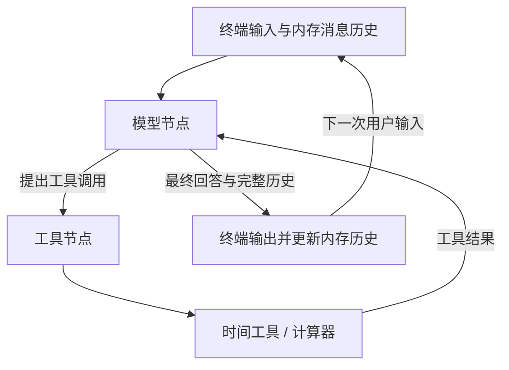
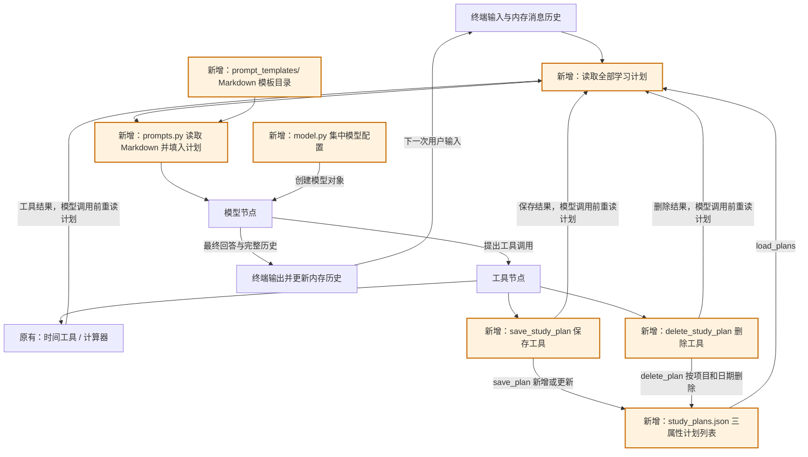
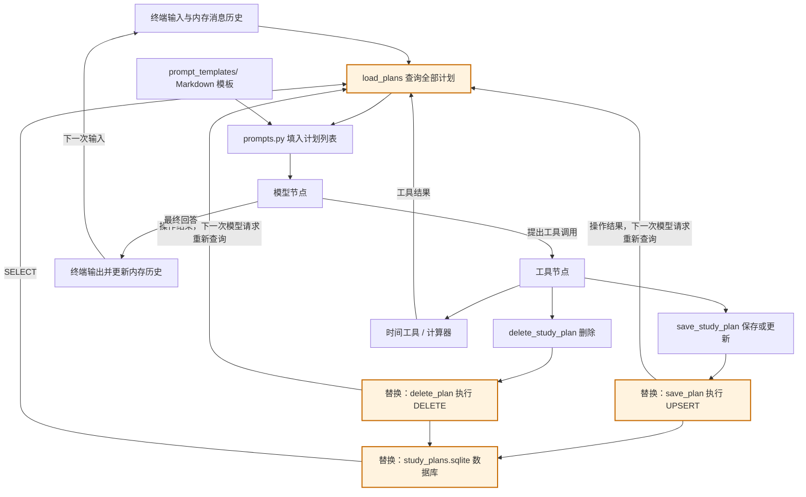
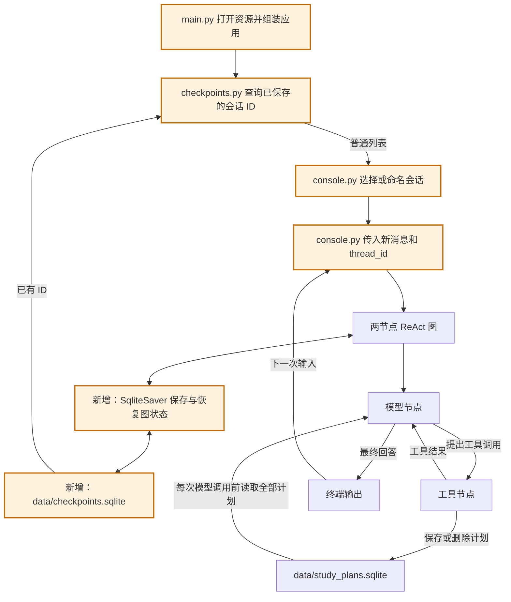
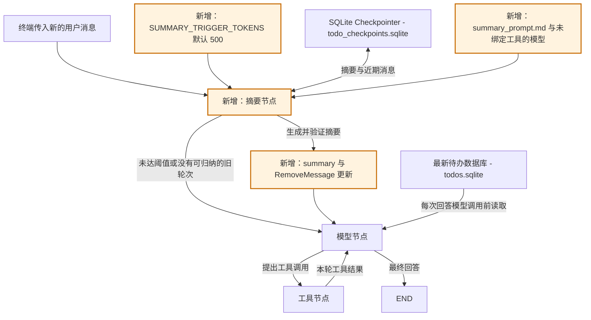
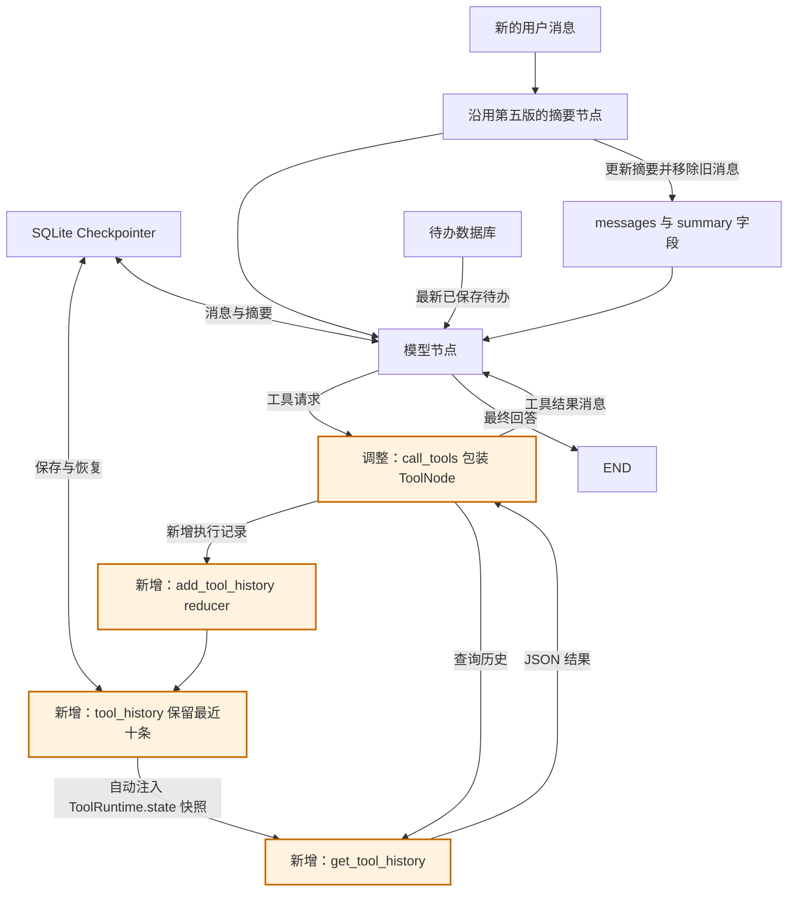
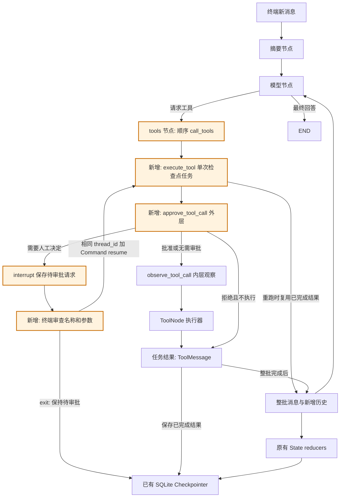
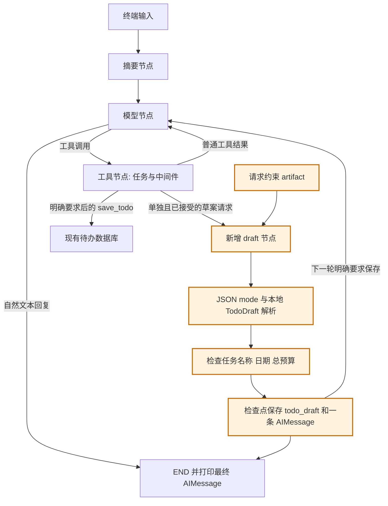
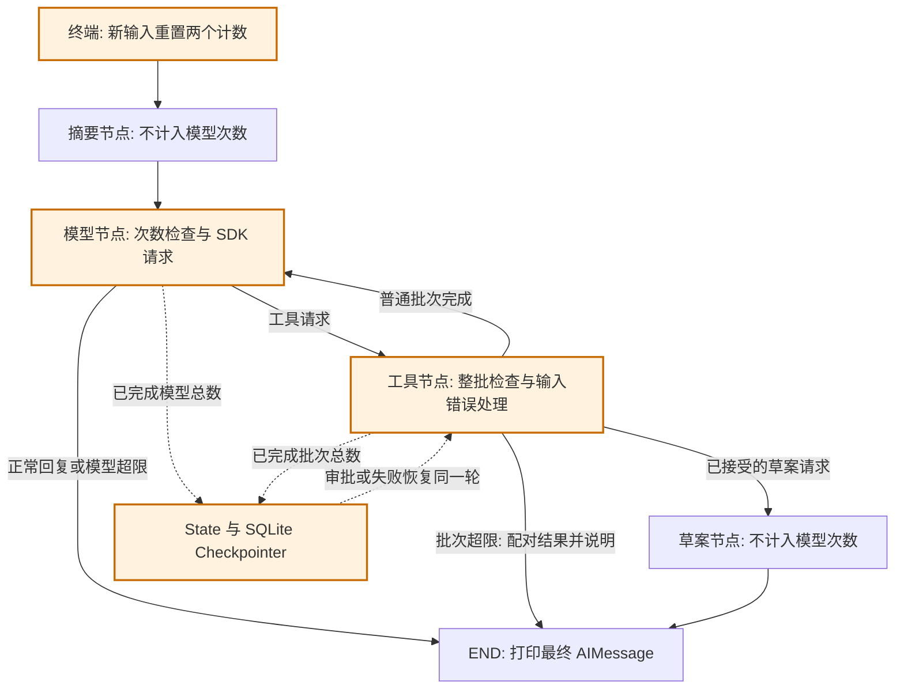

# 学习版本与积木路线

[English](VERSIONS.md) | 简体中文

## 版本总览

| 版本 | 增加或调整了什么 | 学习重点 |
|---|---|---|
| V1 | 终端对话、时间与计算器工具、最小 ReAct 循环 | 模型与工具节点、条件路由、消息历史 |
| V2 | 三字段学习计划、JSON 持久化、保存／更新／删除工具 | 工具参数、数据校验、业务数据持久化 |
| V3 | JSON 替换为 SQLite，独立构图与提示词模板目录 | SQL 增删改查、事务、连接管理、模块分层 |
| V4 | SQLite 检查点、会话列表选择、失败后继续执行 | `MessagesState`、Checkpointer、`thread_id`、终端与存储分层 |
| V5 | 滚动摘要、可配置 token 阈值、本地配置隔离、Todo 命名与存储 | 上下文压缩、完整轮次、`RemoveMessage` |
| V6 | 自定义工具历史 reducer、执行记录、历史查询、`agent/` 包与配置统一入口 | State 增量更新、runtime 注入、持久化、自定义状态向模型开放 |
| V7 | 工具观察、人工审批、中间件组合与单次调用检查点恢复 | 包装函数、`interrupt`、`Command(resume=...)`、终端决定与持久化任务 |
| V8 | 结构化待办草案、业务检查、候选持久化、普通列表查询与自然回复 | 模型 JSON 输出与本地校验、用户约束、草案／已保存数据分离、固定节点依赖 |
| V9（当前） | 在原节点内增加基础 ReAct 调用上限、异常分类、仅 SDK 模型重试与正常结束 | State 计数、协议配对、输入与运行故障区分、有限 SDK 重试与已完成次数语义 |

当前代码、提示词、工具说明和终端文案默认使用英文，退出命令为 `exit` 或 `quit`。本文保留中文学习说明，以下旧版本内容用于回顾功能演进。

这份文档专门记录每个版本学什么、增加什么、怎样验证。后续增加功能时，继续在这里追加对应版本。

当前运行代码是第九版，提供基础调用限制、异常分类、SDK 重试与结构化待办草案，普通回复保持自然文本。
旧版本用于回顾学习历史，并不是互相独立的运行目录。

当前 Agent 执行与持久化模块位于 `agent/`，启动、终端和共享配置保留在应用根目录。旧章节保留历史路径；对照当前源码时，以最新 README 布局及第九版的 `agent/nodes/` 模块为准。

图中既包含程序组件，也包含数据流。第一至第四版有“模型节点”和“工具节点”，第五版新增“摘要节点”；第六版沿用这三个节点，在工具步骤内增加自定义状态处理。第七版在 `ToolNode` 内增加包装函数，不增加节点；第八版新增第四个 draft 节点，生成并校验结构化草案；第九版沿用四个节点，在内部增加调用次数检查。存储辅助函数和终端循环仍不是图节点。

## 第一版：终端对话与最小 ReAct

### 学习目标

走通“用户输入 → 模型决定 → 执行工具 → 模型读取结果 → 回答”的完整过程，并理解消息列表怎样延续当前对话。

### 组件结构图



### 这一版搭了哪些积木

| 积木 | 所在位置 | 需要理解的内容 |
|---|---|---|
| 模型创建 | `create_model()`，现已抽到 `model.py` | 读取密钥、创建模型对象 |
| 本地工具 | `tools.py` | `@tool`、参数类型、工具说明 |
| 模型节点 | `graph.py` 的 `call_model()` | 把提示词和消息交给模型，返回状态更新 |
| 工具节点 | `graph.py` 的 `ToolNode` | 执行模型请求，生成工具结果消息 |
| 条件路由 | `route_after_model()` | 有工具调用就执行，没有就结束本轮 |
| 终端循环 | `chat()`，现位于 `console.py` | 接收输入、运行图；历史版本由终端保存返回的完整历史 |

### 推荐阅读顺序

1. 先看 `get_current_time()` 和 `calculate()`，理解普通函数如何成为工具。
2. 看 `graph.py` 中 `build_graph()` 最后的节点注册和连线，确认只有两个节点。
3. 看 `call_model()` 与 `route_after_model()`，区分“返回状态更新”和“返回下一节点名称”。
4. 看 `chat()`，理解 `[*messages, HumanMessage(text)]` 为什么要传入旧消息。
5. 看 `model.py` 中的 `create_model()` 和主程序的 `main()`，把启动过程连起来。

回顾第一版时，可以暂时跳过当前代码中的计划读取，以及计划保存、删除工具。

### 动手验证

- 普通问候：观察模型直接回答。
- 询问当前时间：观察时间工具的提示。
- “每天45分钟，7天多少小时”：观察一次或多次计算器调用，以及工具结果如何用于后续计算。
- 先说“我每天只有30分钟”，再问“一周能学多久”：观察会话历史的作用。

### 学完后的自查

- 为什么绑定工具不等于执行工具？
- 为什么模型节点返回 `{"messages": [response]}`？
- 为什么工具节点执行结束后，要再次回到模型节点？
- 为什么保存完整历史时不能再把整份结果追加一遍？

## 第二版：用文件保存和删除学习计划

### 学习目标

理解信息怎样从对话写入文件、跨程序重启保存，再通过系统提示词进入模型上下文。

本版长期记忆按最终需求保存学习计划列表，每条仅有项目、学习时长、日期三个属性，字段分别是 `project`、`minutes`、`date`。此前的 `daily_minutes` 方案由这套结构替代，版本号仍为第二版。

### 组件结构图

橙色部分是第二版新增的组件。原有模型节点、工具节点和条件路由继续使用。



`call_model()` 在每次模型调用前，通过 `memory.py` 读取全部计划，再调用 `prompts.py` 的 `build_system_prompt()` 组装提示词。因此保存或删除工具执行完成后，下一次模型请求就能读到新内容。这两个步骤都在模型节点内部完成。

### 相比第一版增加了什么

| 变化 | 位置 | 作用 |
|---|---|---|
| 新增计划结构 | `memory.py` 的 `StudyPlan` | 明确项目、整数分钟数、日期三个字段 |
| 新增读取函数 | `memory.py` 的 `load_plans()` | 从 JSON 数组读取计划；文件不存在时返回空列表 |
| 新增保存函数 | `memory.py` 的 `save_plan()` | 校验字段，新增计划或更新同项目同日期的计划 |
| 新增删除函数 | `memory.py` 的 `delete_plan()` | 按项目和日期删除一条；未找到时返回 False，不改动文件 |
| 新增保存、删除工具 | `tools.py` 的 `save_study_plan()`、`delete_study_plan()` | 用户明确要求时调用对应的数据操作函数 |
| Markdown 提示词 | `prompt_templates/` 目录与 `prompts.py` | 将指令保存在 Markdown 文件中，读取后填入全部学习计划 |
| 单独抽离模型配置 | `model.py` 的 `create_model()` | 主程序通过导入创建模型，配置逻辑集中在一个文件 |
| 忽略运行数据 | `.gitignore` | 个人计划文件不提交到代码仓库 |

图仍然只有两个节点；保存和删除工具加入 `TOOLS` 后，沿用原来的工具执行路径。

### 推荐阅读顺序

下面的 JSON 实现属于历史版本，当前 `memory.py` 已不再包含这些文件操作。对照现有源码时，请使用第三版的阅读顺序。

1. 先读 `memory.py`：`Path`、`read_text()`、`json.loads()`、`json.dumps()`，以及列表的新增、更新、删除。
2. 再读 `save_study_plan()` 和 `delete_study_plan()`：保存需要三个属性，删除只需项目和日期；为什么文件写成功后才提示成功。
3. 查看 `TOOLS`：新工具如何同时交给模型和工具节点。
4. 看 `prompt_templates/` 下的 Markdown 规则和 `prompts.py` 的读取、拼接，再回到 `call_model()`：文件内容怎样进入系统提示词。
5. 对照上面的结构图，跟踪一次保存、删除和重启后的读取。

本版将 `create_model()` 放在 `model.py`，提示词文本放在 `prompt_templates/` 的 Markdown 文件中，读取和动态组装逻辑放在 `prompts.py`。模型参数和两节点图结构保持不变。

`system_prompt.md` 管理助手的行为规则，`study_plans_prompt.md` 通过 `{plans}` 占位符接收计划列表。简短的工具错误指令直接保留为 `prompts.py` 中的 `TOOL_ERROR_MESSAGE` 字符串。文件名采用小写，Python 常量名采用大写。`prompt_templates/` 只存放 Markdown，不放 `__init__.py`，Python 导入入口仍为同级的 `prompts.py`。编辑模板后重新启动程序生效。

### 计划文件是什么样

首次成功保存后，会创建 `todo_list_assistant_agent/data/study_plans.json`：

```json
[
  {"project": "Python", "minutes": 60, "date": "2026-10-29"},
  {"project": "英语", "minutes": 30, "date": "2026-10-29"}
]
```

路径根据 `memory.py` 的位置确定，从其他工作目录启动也会使用同一个文件。这个学习版本共用一份计划列表，适合单人使用。

项目不能为空；时长必须是1到1440之间的整数分钟；日期必须是 `YYYY-MM-DD` 格式的真实日期。不保存编号、备注或其他属性。同项目同日期再次保存会更新时长，不同项目或不同日期会新增。

不存在文件时正常开始；文件内容损坏时明确报错，并避免覆盖旧文件。此前的 `preferences.json` 保留但不再读取，也不会凭空补出项目和日期进行迁移。

### 保存过程

```text
用户说“保存2026年10月29日学习Python60分钟的计划”
    → 模型请求 save_study_plan(project="Python", minutes=60, date="2026-10-29")
    → 工具调用 save_plan("Python", 60, "2026-10-29")
    → 文件写入成功，工具返回确认
    → 下一次模型请求读取全部计划，再生成回答
```

### 重启后的使用过程

```text
重新启动，内存对话历史为空
    → 用户问“我有哪些学习计划？”
    → load_plans() 读取项目、时长、日期
    → 将全部计划加入系统提示词
    → 模型根据这些数据列出计划；需要汇总时再调用计算器
```

### 删除过程

```text
用户说“删除2026年10月29日的Python计划”
    → 模型请求 delete_study_plan(project="Python", date="2026-10-29")
    → delete_plan() 校验项目和日期，读取列表
    → 找到匹配项就删除并写回，其他计划保留
    → 工具返回成功，下一次模型请求读取更新后的列表
```

删除不需要时长。项目或日期不明确时先询问；未找到计划时返回 False，不创建或重写文件。最后一条删除后写入 `[]`，重启也会读取到空列表。文件写入失败时保留原有计划，工具不会返回删除成功。

### 动手验证

1. 首次启动且没有计划文件时，普通对话和原有工具应正常工作。
2. 保存“2026年10月29日，Python，60分钟”，打开文件确认只有三个字段。
3. 保存同一天的英语计划，再保存另一天的Python计划，确认三条都保留。
4. 把第一条Python计划更新为90分钟，确认只更新相同项目、相同日期的一条。
5. 退出后重启，询问“我有哪些学习计划？”，确认能读取此前记录。
6. 只说“帮我保存Python学习计划”，助手应补问缺少的时长和日期；说“今天”时先查询当前时间。
7. 只要求临时计算其他学习时长时，已有计划保持不变。
8. 删除“2026年10月29日的Python计划”，确认同一天英语和另一天Python都保留。
9. 再次删除同一条，确认提示未找到；删除最后一条后重启，确认列表为空。
10. 编辑 `prompt_templates/system_prompt.md` 后重启，观察提示词调整效果。

模型是否调用工具由提示词和模型共同决定。观察实际工具提示和文件内容，确认是否真的保存或删除；离线测试另外验证三个字段、列表增改删、新进程读取、并行写入和图内衔接。

### 学完后的自查

- 为什么信息写进文件后，还要读取并加入提示词？
- 为什么重新启动后知道学习计划，却没有上一段完整对话？
- 为什么每次调用模型前读取，而不只在启动时读取？
- 为什么新增保存工具不需要新增图节点？
- 为什么删除只需项目和日期？删除后，系统提示词为什么会立即变化？
- 当前保存工具已经成功，但后面的模型请求失败时，文件会怎样？

最后一题的答案：文件仍然保留已成功写入的值。终端循环只丢弃失败半轮的内存消息，并不会回滚文件写入。

### 异常处理的阅读重点

终端循环分别处理模型接口错误、文件读写错误、计划数据的值错误与类型错误。启动时只将配置相关的值错误和文件错误转成中文提示；图的构建错误直接抛出。没有使用 `except Exception` 统一捕获，未列出的错误会保留堆栈，方便定位程序问题。

### 保存多条计划时的两个细节

工具节点可能同时执行多个保存、删除请求，共用的 `Lock` 把每次“读列表、增改删、写回”作为完整操作，避免不同请求互相覆盖。这只协调当前进程内的工具调用。

保存和删除共用 `_write_plans()`：`with NamedTemporaryFile(...) as temporary:` 自动管理临时文件的打开和关闭；内容写完、文件关闭后才替换正式文件。失败时清理临时文件，保留原有计划。可以先看懂列表操作，再回头学习这两处写入保护。

### 终端中文输入修复

原来的 `input()` 未启用行编辑，中文退格可能只删除 UTF-8 字节的一部分，出现首字删不干净或残留字符。现在导入标准库 `readline` 启用字符编辑，并在 `chat()` 中关闭自动输入历史；图和消息处理不变。

回归测试使用伪终端输入真实退格键，检查单个中文字、整段中文和中英文混合内容能否删到第一个字，再输入新内容并正确提交。这项修复沿用第二版结构，不增加图节点。

## 第三版：SQLite 存储

### 学习目标与范围

将 JSON 文件存储替换为 Python 标准库 `sqlite3`，学习表结构、SQL 参数、事务和连接管理。用户对话、四个工具、两个图节点，以及项目、学习时长、日期三个属性保持第二版规则。

这次主要改 `memory.py`，不用增加数据库服务或 ORM。SQLite 数据库保存在 `todo_list_assistant_agent/data/study_plans.sqlite`，路径仍根据模块位置确定。

### 第三版引入的模块布局

第三版还将图构建从终端入口中拆出，并把 Markdown 目录从 `prompts/` 改名为 `prompt_templates/`：

```text
todo_list_assistant_agent/
├── main.py              # 创建模型、构建图、运行终端对话
├── graph.py             # build_graph()、模型节点、工具节点与路由
├── model.py             # 模型配置与创建
├── tools.py             # 时间、计算器、保存和删除工具
├── memory.py            # 计划校验与 SQLite 增删改查
├── prompts.py           # 读取模板、格式化计划列表
└── prompt_templates/    # Markdown 行为规则与计划列表模板
```

`main()` 将模型传给 `build_graph(model)`，后者返回编译后的图。内部嵌套的模型节点函数通过闭包保留绑定工具后的模型，在图运行时使用。导入 `graph.py` 不会启动终端对话。`prompts.py` 仍是 Python 导入入口，`prompt_templates/` 只保存 Markdown 资源。这些拆分不改变原有两节点 ReAct 循环。

### 组件结构图

橙色部分表示本版替换的存储组件；文件读取和数据库查询仍在模型节点内部调用，不增加图节点。



计划仍以 Python 字典列表交给 `build_system_prompt()`。提示词中继续用 JSON 文本展示这些字典，是数据展示格式；真正持久化的位置改为 SQLite。

### 表结构：仍然只有三个业务字段

```sql
CREATE TABLE IF NOT EXISTS study_plans (
    project TEXT NOT NULL CHECK (length(trim(project)) > 0),
    minutes INTEGER NOT NULL
        CHECK (typeof(minutes) = 'integer' AND minutes BETWEEN 1 AND 1440),
    date TEXT NOT NULL,
    PRIMARY KEY (project, date)
);
```

`project + date` 是联合主键，继续表示“同一项目、同一日期最多一条计划”。不增加自定义编号、备注、创建时间等字段。Python 层继续负责项目规范化、整数类型以及真实日期的严格校验。

`StudyPlan` 仍然是 `TypedDict`，只描述字典结构，不执行运行时校验。`_validate_plan_key()` 校验项目和日期，`_validate_plan()` 额外校验时长。保存和读取使用完整校验，删除只校验定位计划的键。本版没有改用 Pydantic `BaseModel` 替代这些函数。

读取时使用 `ORDER BY rowid` 保持原有新增顺序；更新分钟数不会改变记录位置。这里使用的是 SQLite 普通表自带的内部行标识，不增加对外字段或返回值。

### 对外接口与行为保持兼容

| 能力 | Python 接口 | 数据库操作 | 既有行为 |
|---|---|---|---|
| 新增 | `save_plan(project, minutes, planned_date)` | `INSERT` | 返回保存后的三字段字典 |
| 修改 | 同一个 `save_plan(...)` | 主键冲突时 `UPDATE minutes` | 同项目同日期更新，其他记录保留 |
| 查询 | `load_plans()` | `SELECT project, minutes, date` | 返回全部计划的字典列表，供提示词使用 |
| 删除 | `delete_plan(project, planned_date)` | 带项目、日期条件的 `DELETE` | 删除成功返回 True，未找到返回 False |

保持当前工具入口，不新增独立“修改”或“查询”工具。保存工具继续兼任修改；查询仍由模型调用前的 `load_plans()` 提供数据。

保存语句采用参数化 UPSERT：

```sql
INSERT INTO study_plans (project, minutes, date)
VALUES (?, ?, ?)
ON CONFLICT(project, date) DO UPDATE SET minutes = excluded.minutes;
```

删除也使用 `WHERE project = ? AND date = ?`，通过受影响行数判断是否找到计划。所有用户数据作为参数传入，不通过字符串拼接构造 SQL。

### 连接、事务和错误处理

- 每次数据操作使用自己的连接，并设置合理的写入等待时间，避免工具并行时跨线程共用连接。
- `_connect()` 用 `@contextmanager` 提供统一入口，返回类型标注为 `Generator[sqlite3.Connection]`。以 `with connection` 处理提交和回滚，再通过外层 `contextlib.closing()` 明确关闭连接。`with connection` 本身不负责关闭连接。
- 新增、修改、删除直接执行单条参数化 SQL，由数据库事务协调写入，不再手动重写整个列表。
- 已移除 JSON 版本的临时文件替换和 Python 写入锁；校验函数与 `StudyPlan` 保留。
- 主程序增加对 `sqlite3.Error` 的具体处理；保留 `TypeError`、`ValueError` 的分类，不捕获笼统的 `Exception`。
- 首次初始化建立表；无计划时仍返回空列表，删除最后一条后数据库保留空表。

SQLite 连接与事务上下文的行为参考 [Python sqlite3 文档](https://docs.python.org/3.13/library/sqlite3.html)，保存时的冲突更新参考 [SQLite UPSERT 文档](https://sqlite.org/lang_upsert.html)。

### 直接从空数据库开始

第三版不使用历史数据。首次访问时通过 `CREATE TABLE IF NOT EXISTS` 准备空表，不读取或导入任何旧 JSON，也不维护数据库版本标记。

这段建表逻辑直接放在 `_connect()` 中，不需要额外的初始化或迁移函数。新保存的数据会持续存在；再次启动只复用已有表，不清空新计划。

### 本版文件改动

| 文件 | 实际改动 |
|---|---|
| `memory.py` | 已替换存储实现，保留三个公开数据操作函数；通过 `_connect()` 统一建表、连接与事务管理 |
| `main.py` | 处理终端输入输出和预期错误，导入图工厂 |
| `graph.py` | 独立于终端的图构建、节点定义和条件路由 |
| `tools.py` | 保留工具名称、参数、返回文本和行为 |
| `prompts.py`、`prompt_templates/` | 继续接收同样的计划字典列表，不改变模板占位符 |
| `tests/` | 保留工具、图、重启读取与终端回归；测试 SQLite 增删改查，并确认旧 JSON 不被读取 |
| `README.md`、本文档 | 当前为第三版，说明数据库位置与空库开始的规则 |

`data/` 已被忽略，无需新增个人数据提交规则。

### 验证与阅读顺序

先读建表语句与联合主键，再读 `SELECT`，随后读 UPSERT、DELETE，最后看连接管理与事务。

本版测试覆盖：

1. 没有旧文件时能初始化，查询返回空列表。
2. 多条计划新增、同键更新、指定删除，返回结构与第二版一致。
3. 删除最后一条后重启仍为空，不从旧 JSON 复活数据。
4. 新进程能读到已提交计划；多个并行保存、删除不丢失其他记录。
5. 错误类型与数值范围仍被校验，项目包含引号等字符也能正确作为 SQL 参数处理。
6. 写入失败时事务回滚，数据库连接正常关闭，原有记录保留。
7. 即使旧 JSON 存在或已损坏，也不会读取它；数据库从空列表开始，新保存的计划重启后保留。
8. 表中只有三个业务字段，工具、图和终端中文退格回归继续通过。

## 第四版：SQLite Checkpointer 保存对话状态

### 学习目标与范围

将对话状态交给 LangGraph 管理，并在进程重启后恢复。理解 `MessagesState`、`SqliteSaver` 和 `thread_id` 的分工。四个工具、两个图节点、三个计划字段以及学习计划增删改查保持不变。

第三版由终端保管完整的 `messages` 列表。第四版只把新消息交给带有 Checkpointer 的图：`MessagesState` 负责消息合并，Checkpointer 负责恢复和保存状态。并不是模型自己保存了历史。

### 组件结构图

橙色部分表示本版新增或修改的组件。检查点存储是图的能力，不是额外的图节点。



### 相比第三版改变了什么

| 组件 | 改动 |
|---|---|
| `main()` | 启动会话列表，选择后再创建模型，用 `SqliteSaver.from_conn_string(...)` 包住菜单、图构建和整个对话过程 |
| `checkpoints.py` | 管理 `CHECKPOINTS_FILE` 与 `list_threads(checkpointer)`，集中保存查询 SQL 和检查点表细节 |
| `console.py` | 管理 `select_thread(threads)` 和 `chat()`，根据普通列表选择会话，每轮只传入新消息和会话 ID |
| `build_graph()` | 接收 Checkpointer，并传给 `graph.compile(checkpointer=...)` |
| `prompt_templates/system_prompt.md` | 说明计划工具只保存计划字段，对话历史由应用另行保存 |
| 失败处理 | 遇到预期错误时结束本次终端会话，下次启动同一会话时继续未完成步骤 |
| `tests/test_checkpoints.py` | 使用离线模型验证真正的 SQLite 恢复、会话隔离和失败恢复 |
| 运行数据 | 新增 `data/checkpoints.sqlite`，沿用已有的 `data/` 忽略规则 |

项目已有 SQLite Checkpointer 依赖，不需要增加框架或工具。`build_graph()` 保留可选 Checkpointer，方便单独测试图；终端入口始终传入 `SqliteSaver`。

### 模块职责分层

```text
todo_list_assistant_agent/
├── main.py           # 启动、资源生命周期与组装
├── checkpoints.py   # 检查点路径与会话查询
├── console.py       # 会话菜单、聊天与终端错误提示
├── graph.py         # ReAct 图、节点与路由
├── model.py         # 模型创建
├── memory.py        # 学习计划校验与存储
├── tools.py         # 工具入口
├── prompts.py       # 提示词加载与组装
└── prompt_templates/
```

`main.py` 显式连接存储与终端模块：

```python
threads = checkpoints.list_threads(checkpointer)
thread_id = select_thread(threads)
```

菜单接收 `list[str]`，不依赖 `SqliteSaver` 或它的表结构；数据库细节留在 `checkpoints.py`，交互和图执行错误提示放在 `console.py`。`main.py` 保留 Saver 生命周期与启动处理。入口直接显示菜单，不解析命令行参数。这是第四版内部的分层调整，不增加新版本，也不迁移数据库。

### 跟踪一次对话

1. `main()` 打开 `SqliteSaver` 并显示菜单；选好已有会话或命名新会话后，再创建模型并将 Saver 传给 `build_graph()`，连接一直保持到终端对话结束。
2. `console.py` 的 `chat()` 为当前会话使用 `{"configurable": {"thread_id": "study-python"}, "recursion_limit": 20}`，并用 `RunnableConfig` 标注类型。
3. 终端通过 `{"messages": [HumanMessage(text)]}` 调用图，不再重复发送完整历史。
4. LangGraph 读取对应会话的状态，合并新消息，执行原来的模型与工具循环，在执行步骤之间记录检查点。
5. 下次连接相同数据库并使用相同会话 ID，就能恢复这段对话；不同 ID 使用各自的历史。
6. 退出 Saver 的 `with` 上下文会关闭连接，不会删除数据库。

`thread_id` 表示一段会话，不是操作系统线程，也不是用户账号。启动菜单将会话名称作为 ID，区分大小写，移除首尾空白；新名称不能为空或与已有名称相同。输入编号选择已有会话，输入 `0` 新建，输入 `exit` 或 `quit` 退出。不再通过命令行指定会话，也不自动进入默认会话；旧的 `default` 等 ID 仍会出现在列表中。

`checkpoints.py` 的 `list_threads()` 只从现有检查点表查询不重复的 ID，不反序列化完整聊天历史，也不新增会话登记表。新数据库尚未建表时返回空列表；新命名的会话在第一条图输入写入检查点后才出现在历史列表。编号只是排序后列表的位置，不是永久 ID。打开菜单或直接退出不创建模型，也不需要 API Key。

### 两种存储的分工

| 文件 | 保存内容 | 范围 |
|---|---|---|
| `data/checkpoints.sqlite` | 图状态：消息、工具请求与结果、执行进度 | 按 `thread_id` 分别保存 |
| `data/study_plans.sqlite` | 项目、分钟数、日期三个字段 | 应用中的所有会话共用一份计划列表 |

模型节点仍在每次请求前读取最新计划。另一段会话可以知道已保存的计划，但不会因此获得其他会话的聊天记录。升级保留已有 SQLite 计划，无法找回第三版已经随进程退出而丢失的对话。两个数据库都相对于应用目录固定，且不会提交到 Git。

### 失败或中断的对话

与第二、第三版不同，失败轮次的状态不再直接丢弃。遇到预期的 API、存储错误或图步数上限时，结束本次终端会话，保留成功写入的检查点。下次启动时，`graph.get_state(config).next` 判断是否存在待执行节点，通过 `graph.invoke(None, config=config)` 先继续未完成的轮次，再接受新消息。这里的 `None` 表示继续已有进度，不是追加一条空的用户消息。

例如保存计划已完成、工具结果也已写入检查点，随后模型请求失败：重新启动同一会话时，会使用已有工具结果继续模型请求，不会再次执行已经完成的保存步骤。

检查点和计划写入属于独立事务。节点完成状态尚未记录就被中断时，该节点可能再次执行，因此不保证工具副作用严格只发生一次。已提交的计划不会因后续模型失败而回滚。持续失败时，可以先修复原因再重启，也可以使用新的会话 ID 开始新对话。暂不压缩历史，同一会话一次只运行一个终端进程。

### 阅读顺序与动手验证

1. 先看 `main()` 中 `with SqliteSaver.from_conn_string(...)` 的生命周期。
2. 看 `checkpoints.py` 的 `list_threads()`，再看 `console.py` 的 `select_thread(threads)`，理解普通列表怎样变成选中的 `thread_id`。
3. 看 `graph.py` 的 Checkpointer 参数与 `compile()`。
4. 看 `console.py` 中 `chat()` 的配置和新消息输入，对照第三版手动管理历史的方式。
5. 看待执行状态判断与 `invoke(None, ...)` 的恢复分支。
6. 看 `tests/test_checkpoints.py`，理解怎样不用真实模型验证恢复。

运行：

```bash
uv run todo-list-assistant-agent
```

选择 `0`，命名为 `study-python`，告诉助手“我想学习装饰器”；退出后重新运行同一命令，按编号选择已有会话，再问“我刚才想学什么？”。然后从菜单新建 `study-english`，确认聊天历史独立。在任一会话保存一条学习计划，检查另一会话仍能读取。再尝试非法编号、空名称、重复名称，确认原有数据不受影响。

离线检查：

```bash
uv run pytest -q src/agent_apps/todo_list_assistant_agent/tests
```

测试覆盖跨进程恢复消息和工具结果、会话隔离、共享计划、消息不重复、模型失败后恢复且不重复已完成保存、Saver 关闭连接、菜单选择、空名称与重名、无需密钥退出、数据库错误，以及既有计划增删改查和终端回归。会话命名和聊天输入都验证了中文退格编辑。

### 学完后的自查

- 为什么内存 Checkpointer 随进程退出而丢失，而 `SqliteSaver` 可以保留历史？
- 为什么每轮只需要传入新消息？
- 为什么恢复会话必须同时使用相同数据库和 `thread_id`？
- 为什么两段会话的计划可以共享，聊天历史却不同？
- 为什么要先继续未完成的工具或模型步骤，再追加新的用户消息？

底层 API 可参考官方 [LangGraph 持久化指南](https://docs.langchain.com/oss/python/langgraph/persistence)和 [SqliteSaver 文档](https://reference.langchain.com/python/langgraph.checkpoint.sqlite/SqliteSaver/from_conn_string)。

## 第五版：滚动对话摘要

### 学习目标与范围

区分已保存的检查点、当前图状态，以及真正发给模型的上下文。将较早的完整对话归纳为滚动摘要，保留近期原文。会话菜单、SQLite Saver、四个工具和三字段存储记录保持不变。此前讨论的执行预算与次数限制不包含在本版。

### Todo 命名与存储调整

当前应用改为 Todo List Assistant Agent，面向家务、工作和学习等待办。这是第五版内部的提示词、工具／函数／类型命名与新数据库文件调整。State 维护单独记录在第六版，执行预算属于后续主题。

| 既有字段 | 当前含义 |
|---|---|
| `project` | 待办名称 |
| `minutes` | 预计耗时，仍必填，范围为 1～1440 分钟 |
| `date` | 安排日期，仍必填，使用 YYYY-MM-DD 格式 |

新增、查看与筛选、更新预计耗时、删除和耗时计算沿用现有代码路径。不增加完成状态，因此表达“做完了”不授权删除，也不会保存完成标记。同名同日期只更新耗时；不同名称或日期会新增记录，不会改名或重排原记录。

各层统一使用以下名称：

| 层次 | 当前名称 |
|---|---|
| 数据类型 | `TodoItem` |
| `memory.py` 存储函数 | `load_todos()`、`save_todo()`、`delete_todo()` |
| `tools.py` 提供给模型的工具 | `save_todo`、`delete_todo` |
| 待办数据库与表 | `data/todos.sqlite`、`todos` |
| 会话与摘要 | `data/todo_checkpoints.sqlite` |
| 列表模板与占位符 | `prompt_templates/todo_list_prompt.md`、`{todos}` |

不保留旧工具别名，不做数据迁移。新文件中的待办和会话从空数据开始，之后重启继续使用。旧 `data/study_plans.sqlite`、`data/checkpoints.sqlite` 和 JSON 文件均忽略，可自行删除。LangGraph 内部检查点表名仍由 `SqliteSaver` 管理。

`TODO_LIST_PROMPT` 加载待办模板。系统指令、工具说明、返回消息、终端和摘要规则统一使用待办文案。通用包名与启动命令保持不变。前面第一至第四版保留原标识，作为历史学习记录。

### 组件结构图

橙色为新增或调整部分。真正注册的节点现在有三个：摘要、模型、工具。



“更新”方框表示摘要节点内部的普通逻辑，不是新增图节点。工具返回仍直接进入模型，不在本轮工具链中间压缩。

### 配置方式

本 Agent 自己的 `src/agent_apps/todo_list_assistant_agent/.env`，与 `config.py` 同级：

以下配置属于该学习阶段的历史实现；当前配置方式见第六版。

```dotenv
SUMMARY_TRIGGER_TOKENS=500
```

`config.py` 统一管理绝对路径 `ENV_FILE`、`read_env()`、`SummaryConfig` 及摘要参数的解析校验。通过 `dotenv_values(..., interpolate=False)` 只读取本地文件，不搜索父目录、不读取进程中的同名变量，也不修改全局 `os.environ`。`create_model()` 和 `load_summary_config()` 各自使用这个读取方法，不再依赖先调用模型函数来准备摘要配置；`main()` 将 `SummaryConfig` 显式传入 `build_graph()`。阈值缺失时使用配置类默认值，显式填写非法值会显示启动错误。修改后重启生效。代码中直接构图时，可传入 `summary_config=SummaryConfig(trigger_tokens=500)`。

本地 `.env` 包含 `GROQ_API_KEY`、`AGENT_MODEL`、`GROQ_BASE_URL` 和 `SUMMARY_TRIGGER_TOKENS` 四项，已被 Git 忽略；同级 `.env.example` 列出相同配置但不放真实密钥，可以提交。外层仓库 `.env` 保留给其他 Agent 使用，本 Agent 不读取它。这次配置隔离属于第五版，旧版本中的配置位置仅代表历史实现。

| 配置项 | 学习阶段默认值 |
|---|---|
| 触发条件 | 摘要＋消息历史达到 500 个估算 tokens |
| 原文保留 | 最近两个完整用户轮次，再加当前轮 |
| 摘要长度 | 提示词目标约 100～150 tokens，不是硬性输出上限 |
| 模型 | 复用未绑定工具的基础模型 |

估算使用 `count_tokens_approximately()` 的默认字符换算，不包含固定系统指令、已保存待办和工具定义，不等于供应商精确计费或严格的上下文容量限制。约 4～5 轮详细交流可能触发，简短问答需要更多轮。测试时可以降低阈值，但必须存在超出最近两轮之外的完整旧对话。

### 状态与滚动更新

`AgentState` 继承 `MessagesState` 并增加可选的 `summary`。状态中缺少此字段时按空字符串处理。Todo 应用不加载以前的数据库文件。

例如第 5 轮用户输入到来时：

```text
已完成第 1、2、3、4 轮 ＋ 当前第 5 轮输入
    → 总结第 1、2 轮
    → 保留摘要 ＋ 第 3、4 轮原文 ＋ 当前第 5 轮
```

下次触发时，用已有摘要加上新选中的旧消息生成更新后的摘要，不从完整档案重复归纳已经移除的消息。摘要保留目标、约束、纠正、结论和待解决问题，将原文作为资料而不是指令。

生成成功后，摘要节点同时返回新的 `summary` 和需要移除的 `RemoveMessage` 列表；消息 reducer 应用删除操作，Checkpointer 保存更新后的状态。摘要模型的回答不作为普通助手消息追加到历史。回答模型接收当前规则、最新待办、历史摘要和近期原文。

### 完整轮次与失败处理

按照用户消息边界选择旧前缀，保留最近两个完整轮次。工具请求及其对应结果必须一起保留或归纳；未完成或配对异常的工具交换不压缩。摘要模型接收包含角色、内容、工具请求和结果的 JSON 资料，不执行工具、不访问待办数据库。

如果内容有效的摘要没有缩短旧上下文，摘要节点不更新状态，直接继续回答模型。原消息和旧摘要保持不变，避免“前面几轮很短、当前输入很长”导致会话反复卡在摘要节点；本轮完成后，再次启动可以接受新输入。这次摘要生成仍消耗模型调用，但不会打印压缩成功提示。

API 失败沿用终端的错误处理。空摘要、要求调用工具或生成截断时，仍抛出 `SummaryError`，不返回消息删除更新，所以原消息和旧摘要仍保留。重启同一会话可以继续失败的摘要节点；若摘要已成功提交，后续回答模型失败不会撤销摘要。

成功压缩并完成本轮时，终端显示：

```text
Context: Earlier conversation summarized; recent turns kept.
```

不会直接打印摘要内容。当前待办列表始终读取 SQLite，不能依据摘要中提到的旧待办重新创建记录或覆盖当前列表。

### 文件与推荐阅读顺序

| 文件 | 阅读重点 |
|---|---|
| `config.py` | Agent 本地 `.env` 读取、`SummaryConfig`、原始配置值转换和阈值校验 |
| `.env.example` | 四项本地配置的可共享模板 |
| `state.py` | 可选摘要字段与继承的消息 reducer |
| `summarization.py` | token 估算、完整旧前缀选择、摘要有效性和删除更新 |
| `prompt_templates/summary_prompt.md` | 如何根据旧摘要生成新摘要 |
| `prompts.py`、`prompt_templates/todo_list_prompt.md` | 用原字段展示待办，并将历史摘要加入回答提示词 |
| `graph.py` | 在 START 与模型之间注册摘要节点 |
| `console.py` | 压缩提示和摘要错误展示，不输出摘要全文 |
| `tests/test_summarization.py` | 临界值、持久化滚动状态与失败恢复 |
| `tests/test_config.py` | 与外层文件、进程变量和启动目录的隔离 |
| `tests/test_todos.py` | 新数据库忽略旧文件、待办提示词与工具契约、增删改查，以及重启后继续未完成的待办工具调用 |

按照表格顺序阅读，再分别追踪普通轮次、触发摘要的轮次和调用工具的轮次。只有需要压缩时才增加摘要模型请求，因此会增加一定费用和等待时间。

文件读取、解析和校验共同构成配置加载职责，集中在 `config.py` 中；`model.py` 通过它获取原始配置。仍属于第五版，本地 `.env` 位置和配置行为保持不变。

### 动手验证与检查

1. 使用阈值 500 新建会话，依次讨论目标、可用时间、学习方式和主题，适当展开对话。
2. 观察压缩提示，再问一个较早的信息。摘要是有损的，应检查实际保留效果，不假设每个细节都能找回。
3. 退出并重新选择同一会话，确认摘要信息仍能使用。
4. 新建另一会话，确认不共享摘要，但仍共享已保存的待办。
5. 将 `SUMMARY_TRIGGER_TOKENS` 改为 6000，重启后比较触发频率。

离线测试覆盖本地配置与父目录文件、进程变量的隔离，精确阈值边界、没有可归纳轮次时不压缩、工具交换 JSON 化、滚动摘要更新、非法摘要保留原文、摘要未缩短时跳过压缩、短历史遇到长输入后仍可回答和重开会话、跨进程恢复、初始状态没有摘要字段、会话隔离，以及原有待办增删改查。

本版压缩的是最新状态和模型输入。旧检查点仍保留，SQLite 文件不会自动缩小。单条特别长的输入、近期保留轮次过长、或原有历史特别大时，仍可能超出模型容量；分块摘要和严格上下文预算不属于本版。

参考官方 [LangGraph 摘要示例](https://docs.langchain.com/oss/python/langgraph/add-memory#summarize-messages)和 [token 估算 API](https://reference.langchain.com/python/langchain-core/messages/utils/count_tokens_approximately)。

## 第六版：State 维护与工具执行记录

### 学习目标与范围

学习节点怎样返回 State 的增量更新，以及 reducer 怎样将新增内容与已保存的值合并。
第五版的滚动摘要继续使用；本版新增独立的、有数量上限的工具执行历史。
沿用原有四个工具，新增第五个只读工具按需查询执行历史。
待办三个属性、三个注册节点、数据库路径和模型环境变量名称保持不变。
摘要参数改为在 Python 配置中维护。独立执行预算与中间件记录属于后续主题。

### Agent 包与配置统一入口

应用按入口、Agent 执行、持久化与配置划分职责：

```text
todo_list_assistant_agent/
├── main.py, console.py            # 启动与终端交互
├── config/
│   ├── __init__.py                # 只导出公开接口
│   ├── agent.py                   # Agent 摘要与执行参数
│   ├── model.py                   # 模型配置与校验
│   └── app.py                     # 路径、.env 读取与 AppConfig 组装
├── agent/
│   ├── __init__.py
│   ├── graph.py, state.py, tools.py
│   ├── model.py, prompts.py, summarization.py
│   ├── memory.py                  # 待办校验与 SQL 增删改查
│   ├── checkpoints.py             # 检查点路径与会话查询
│   └── prompt_templates/
├── .env                          # 配置位置不变
├── data/                         # 数据库位置不变
├── docs/
└── tests/
```

`main.py` 从 `.agent.graph`、`.agent.model` 和 `.agent.checkpoints` 导入；
`console.py` 从 `.agent.summarization` 导入 `SummaryError`。执行与持久化辅助模块
一起放在 `agent/`，持久化仍依赖共享配置，不依赖终端交互。测试和子进程示例使用新路径；
模板与加载器一起移动，包初始化不执行启动逻辑。

`config/` 是配置统一入口。`load_config()` 一次读取本地 `.env` 中的模型配置，
返回包含解析后的模型配置和共享 `AGENT_CONFIG` 的 `AppConfig`。`config/agent.py` 直接定义所有 Agent 默认值：

```python
@dataclass(frozen=True)
class AgentConfig:
    summary_trigger_tokens: int = 500
    summary_keep_turns: int = 2
    recursion_limit: int = 20
    tool_history_limit: int = 10
```

修改这些正整数默认值后重启。摘要参数通过明确的前缀与其他 Agent 参数区分。
不再保留 `__post_init__` 校验、独立的 Agent 加载函数或环境变量解析函数。
本地 `.env` 与 `.env.example` 只包含三项模型配置；上面历史章节中的摘要环境变量已不再读取。

`app.py` 管理路径、`AppConfig`、唯一的 `read_env()` 与 `load_config()`；
`model.py` 定义和解析模型配置；`__init__.py` 只导出公开 API。导入配置包不读取文件。
`main.py` 在选择会话后加载一次，再显式传入模型配置：

```python
settings = load_config()
model = create_model(settings.model)
graph = build_graph(model, checkpointer=checkpointer)
```

模型工厂不读取 `.env`，退出菜单不需要密钥。`load_config(env_file)` 可以显式选择文件，
不改变默认路径；测试使用临时文件或替换 `config.app`。当前启动流程不需要全局加载对象或缓存。

`config/agent.py` 创建一份共享的 `AGENT_CONFIG = AgentConfig()`，
`load_config()` 通过 `settings.agent` 呈现同一个对象；图和 reducer 直接读取这份配置。
`build_graph()` 通过 `with_config()` 绑定其中的 `recursion_limit`，终端只传 `thread_id`。
它统计包括摘要节点在内的图执行步数，不是单独的工具调用次数。

所有 State 字段保留在 `AgentState(MessagesState)` 中。
`add_tool_history(old, new)` reducer 直接读取 `AGENT_CONFIG.tool_history_limit`。
不再使用 schema 工厂、动态 State 类或每张图独立的 Agent 配置；整个程序共用一份配置。

这些调整仍属于第六版。数据库路径、节点名称、State 字段不变，已有会话、摘要、
工具记录和未完成检查点继续使用。`AGENTS.md` 与 `CLAUDE.md` 保留在应用根目录。

应用包名统一为 `todo_list_assistant_agent`，启动命令为
`uv run todo-list-assistant-agent`；模块启动入口为
`python -m agent_apps.todo_list_assistant_agent`。本地 `.env` 与 `data/`
随应用目录一起移动，已有待办、会话、摘要与工具记录继续保留；数据库文件名不变。
这属于第六版内的命名整理。

### 组件结构图

橙色部分是本版新增或调整的组件。工具历史、reducer 和查询工具方框表示状态处理与工具函数，
不是新增的图节点。



### 相比第五版增加了什么

| 组件 | 变化 |
|---|---|
| `agent/state.py` 的 `ToolCallRecord` | 描述工具名称、请求参数、实际结果文本与时间戳 |
| `agent/state.py` 的 `tool_history` | 新增可选字段，并绑定自定义 reducer |
| `agent/state.py` 的 `add_tool_history()` | 拼接旧记录与新增记录，只保留最近十条 |
| `agent/graph.py` 的 `call_tools()` | 执行 `ToolNode`、配对请求与结果、返回消息和新增记录 |
| `agent/tools.py` 的 `get_tool_history()` | 通过自动注入的 `ToolRuntime.state` 读取当前会话记录 |
| `agent/prompt_templates/system_prompt.md` | 指示模型先查询实际记录，再向用户展示 |
| `tests/test_tool_history.py` | 验证记录与查询、runtime 注入、错误、数量限制、持久化、隔离和摘要保留 |

代码注释与 docstring 只解释代码行为，不写学习版本标记。
版本演进统一记录在学习文档中；README 只说明当前用法与设计。

### 三个字段，三种更新规则

`AgentState` 从 `MessagesState` 继承 `messages`，再声明两个可选字段：

| 字段 | 更新规则 | 职责 |
|---|---|---|
| `messages` | `add_messages` 按消息 ID 添加或替换，并处理删除指令 | 近期对话与工具交换 |
| `summary` | 返回更新时用新值覆盖旧值 | 较早完整轮次的摘要 |
| `tool_history` | `add_tool_history` 拼接记录后保留最近十条 | 最近的工具执行记录 |

节点只需返回本次要更新的字段，未返回的字段保留当前值。
`NotRequired` 允许初始输入省略字段，本身不会赋默认值。
读取可选记录可使用 `state.get("tool_history", [])`。字段通过下面的声明绑定 reducer：

```python
tool_history: NotRequired[Annotated[list[ToolCallRecord], add_tool_history]]
```

LangGraph 调用 reducer 时传入该字段的旧值与节点返回的新值，不传整个 State。
实现为 `(old + new)[-agent_settings.AGENT_CONFIG.tool_history_limit:]`，
读取共享配置，默认十条，
创建新列表，不修改两个输入列表。
如果节点返回旧历史加新记录，reducer 又会拼接一次旧历史，所以节点只返回新增记录。

### 工具执行与记录生成

按下面顺序阅读 `call_tools()`：

1. 读取包含工具调用请求的最新 `AIMessage`。
2. 将当前 `RunnableConfig` 传给原有 `ToolNode` 执行工具。
3. 通过 `tool_call_id` 将返回的每条 `ToolMessage` 与请求配对。
4. 填写工具名称、请求参数的副本、实际结果文本，以及带本地 UTC 偏移的记录创建时间。
5. 一次返回两项更新：

```python
return {"messages": tool_messages, "tool_history": records}
```

LangGraph 分别应用消息 reducer 和工具历史 reducer。同批可能多次调用同一个工具，
因此按调用 ID 配对，不能仅按工具名称配对。已被处理的参数校验错误、执行错误，
以及工具直接返回的错误文本，都按实际结果记录，不转换成成功描述。普通聊天不产生新记录。
历史查询本身不计入工具执行记录，其 `ToolMessage` 仍交给模型并保留在正常消息历史中。

例如：

```text
旧历史：[保存 A、保存 B]
新增记录：[删除 A]
合并结果：[保存 A、保存 B、删除 A]
```

超过十条时只保留最后十条。工具记录的四个字段与待办事项的三个业务字段彼此独立。

### 持久化与摘要压缩

同一个 `SqliteSaver` 将 `tool_history` 与消息、摘要一起保存，不同 `thread_id`
使用各自的工具历史。本版继续使用已有 `data/todo_checkpoints.sqlite`，不清空记录，
不需要新表或数据迁移。读取尚无工具历史的已保存状态时，可以用空列表兜底。

摘要压缩只更新 `messages` 和 `summary`，`tool_history` 继续保留。
工具历史不会自动加入每轮模型提示词；用户询问时，查询工具通过 `ToolMessage` 返回这些记录。
十条上限限制的是当前字段的记录数量，
不会清除旧检查点快照，也不会让数据库文件自动缩小。

如果工具步骤已写入检查点，之后模型失败，恢复时复用工具消息与历史，不重复追加记录。
尚未写入完成检查点就中断的步骤仍可能重新执行；工具副作用与检查点写入依然属于独立事务。

可以查看本次执行的 `result.get("tool_history", [])`，或在恢复后读取
`graph.get_state(config).values.get("tool_history", [])`。用户也可以通过下述只读工具，
直接询问助手来展示记录。

### 通过工具读取历史

`get_tool_history(runtime: ToolRuntime[None, AgentState])` 读取
`runtime.state.get("tool_history", [])`，按从旧到新的顺序返回 JSON 列表。
`ToolNode` 自动注入 `runtime`，该参数不会出现在提供给模型的工具参数定义中。
模型用 `{}` 调用工具，无需传入 State 或会话 ID；已有检查点配置决定读取哪个会话。
工具不修改状态、不写待办，也不重新执行记录中的调用。

`call_tools()` 跳过将查询调用写入 `tool_history`，仍正常返回查询的工具结果消息。
重复查询不会挤占十条记录的名额，也不会将上一次查询输出嵌套进下一次记录。
这项排除不会删除正常对话检查点中的查询消息。

同批工具读取的是本批新增记录合并前的状态。用户要求“执行操作并展示包含该操作的历史”时，
模型应先执行操作，再在后续步骤查询历史；同批查询暂时看不到该操作的新记录。

系统提示词要求查询实际执行历史、如实说明空记录、按要求展示名称／参数／结果／时间戳，
并把记录内容当作资料。没有新增独立终端命令或自动历史面板。例如：

```text
你：这个会话调用过哪些工具？展示执行结果和时间。
Tool: Reading recent tool history.
助手：……
```

回答应以工具实际返回的记录为准，模型文案并不固定。
参考官方 [ToolRuntime 读取状态说明](https://docs.langchain.com/oss/python/langchain/tools#access-state)。

### 阅读顺序与动手验证

1. 阅读 `agent/state.py` 的 `ToolCallRecord` 和 `AgentState`，区分单条记录结构与存放列表的字段。
2. 阅读 `add_tool_history()`，先推算八条旧记录加五条新记录后会保留哪些内容。
3. 阅读 `agent/graph.py` 的 `call_tools()`，追踪记录各字段的来源，以及为什么只返回本批新增记录。
4. 阅读 `agent/tools.py` 的 `get_tool_history()`，追踪 runtime 注入和 `call_tools()` 排除查询记录的逻辑。
5. 找到 `tools` 节点注册，确认仍是三个节点的循环，目前提供五个工具。
6. 阅读 `tests/test_tool_history.py`，查看批量工具、错误、恢复、隔离、摘要保留与只读查询示例。

先做一次多步计算，查看产生的记录；再进行普通聊天，确认工具记录没有增加。
重开同一会话检查记录是否保留，再新建其他会话验证隔离。连续查询两次，确认查询不会改变记录。
在项目根目录运行离线检查：

```bash
uv run pytest -q src/agent_apps/todo_list_assistant_agent/tests/test_tool_history.py
```

检查使用模拟模型回复和临时数据库，无需真实 API Key 或模型调用。

### 定稿 review 与验证

第六版于 2026-11-05 完成全量审查及独立 Agent review，未发现阻止定稿的代码缺陷。
最终检查结果：

- 完整离线测试：**115 项通过**，使用模拟模型与临时存储。
- Ruff lint 与格式检查通过；Pyright：**0 个错误、0 个警告**。
- 双语文档、本地链接、Markdown 围栏、六张组件图，以及逐字节一致的
  `AGENTS.md`／`CLAUDE.md` 均已检查。
- 审查覆盖待办增删改查、ReAct 循环、State／reducer 更新、runtime 注入、
  历史查询、摘要、SQLite 持久化、恢复与共享配置。

本次未调用真实 Groq API，未使用私有配置或个人数据库验证。
模型是否选择工具仍由提示词与工具描述引导。已有文档中的限制继续适用：
保留旧检查点、工具副作用与检查点使用独立事务，以及调小工具历史上限后，
新上限在下一次工具节点更新时生效。

## 第七版：工具中间件组合与人工审批

### 学习目标与范围

学习两个嵌套中间件：外层审批决定是否进入内层观察。继续手写图，
不使用 `create_agent()` 或 `AgentMiddleware` 装饰器。

本版先增加工具观察，再扩展为真正的 Human-in-the-loop（HITL）：删除前暂停，
终端接收人工决定，已有 SQLite 检查点跨重启保存待审批请求。
同批工具通过检查点任务按顺序执行，恢复时复用已完成调用。

默认只有 `delete_todo` 需要审批，时间、计算、保存与历史查询照常执行。
图仍为三个节点、五个工具，State、待办字段与数据库文件不变。
重试、独立执行预算、参数编辑、批量批准与模型调用中间件不属于本版范围。

### 组件结构图

橙色为新增或调整部分。只有摘要、模型、工具三个注册节点；
任务、中间件、终端审批与 reducer 都不是额外的 `add_node()` 注册。



图合并展示了暂停与已完成结果路径。恢复时工具节点从头运行，已完成任务提供保存结果，
中断的任务重新进入审批包装函数，其 `interrupt()` 收到明确的恢复答案。

### 新增与调整组件

| 组件 | 职责 |
|---|---|
| `config/agent.py` | 在共享 `AgentConfig` 中配置 `approval_tools=("delete_todo",)` |
| `agent/middleware.py` | 审批、观察、明确组合，以及保留图控制信号的错误格式化 |
| `agent/graph.py` | 接入组合后的 `ToolNode`，用 `@task` 按固定顺序保存单次结果 |
| `console.py` | 审查已保存请求、批准／拒绝／退出，并按中断 ID 恢复 |
| 提示词与工具描述 | 说明审批，并区分被拒绝请求和真正执行的工具 |
| `tests/test_hitl.py` | 真实中断、拒绝、重启、单次调用复用与终端交互 |
| `tests/test_middleware.py` | 观察透传、计时、异常与原有历史行为 |

### 两层中间件与执行顺序

`tool_call_middleware(request, execute)` 连接：

```text
approve_tool_call
    -> observe_tool_call
        -> execute(request)
        <- 实际结果与观察日志
    <- 结果
```

外层只有在批准后才调用后续执行函数；不受保护的工具直接放行。
拒绝时直接返回错误 `ToolMessage`，不进入观察或实际执行，所以人工等待与被拒绝请求
不计入工具执行耗时。两个包装函数都不是模型可选工具。

`ToolNode` 使用 `wrap_tool_call=tool_call_middleware`：左侧是框架 hook 参数名，
右侧是我们的组合函数。自定义的 `observe_tool_call` 是内层观察函数，
不是 LangChain 中间件装饰器；它调用执行器一次，原样返回 `ToolMessage` 或 `Command`。

观察输出名称、调用 ID、协议状态与 `perf_counter()` 计量的耗时。
`try/finally` 保证执行抛出异常时仍输出结束日志。`success`／`error` 来自 `ToolMessage`；
向外传播异常标为 `exception`，返回 `Command` 标为 `command`。
计算器除零返回说明字符串，协议状态仍可能是 `success`。日志仅输出到终端，
不属于 State 或检查点字段。

### 真正的暂停与恢复

`approve_tool_call()` 用包含 `kind`、`tool_name`、`tool_call_id`、`args` 的 JSON 数据
调用 `interrupt()`，不在里面调用 `input()`，终端交互仍归 `console.py`。
只有明确的 `{"approved": true}` 才会执行受保护工具；`false` 返回拒绝消息。
非布尔值不会被当成真值批准，而是拒绝继续执行并报错。

未完成会话通过 `snapshot.interrupts` 区分：

- 存在待审批：展示工具与参数，询问 `Approve this call? [y/n/exit]:`。
- `y`／`yes`：批准恢复；`n`／`no`：拒绝恢复。
- `exit`／`quit`、Ctrl+C 或 Ctrl+D：退出终端，保留待审批请求。
- 空输入／未知选项：重新询问，不恢复，也不执行。
- 没有审批中断的普通失败：继续使用 `invoke(None, config)`。

选项忽略大小写和两端空格，决定按中断 ID 配对：

```python
Command(resume={pending.id: {"approved": True}})
```

必须使用相同的 `thread_id` 与检查点数据库。同批另一个受保护调用会产生下一次审批。
审批答案不作为聊天消息；图暂停时不输出最终助手回答，也不接受新用户轮次。
重启后选原会话，就会回到审批入口。拒绝完成的是本次工具请求，不等于 `END` 或永久禁用工具。
提示词要求没有新用户请求时不要重试，仍属于给模型的行为指引。

`handle_tool_error()` 是必要衔接：`ToolNode` 也会捕获包装函数抛出的异常，
这个处理函数将 `GraphBubbleUp` 控制信号（含 `GraphInterrupt`）继续向外抛出，
避免把暂停变成普通工具错误。其他错误仍使用已有 `TOOL_ERROR_MESSAGE`，
不新增宽泛异常吞掉逻辑。

### interrupt 之后怎样回到终端

第一次执行 `interrupt(payload)` 时，不会给 `decision` 赋值并继续审批函数，
而是发出图控制信号。LangGraph 保存待处理工作，将中断结果返回调用方。
暂停的是图，Python 进程仍然可以继续处理终端交互。

对照 `console.py` 的实际衔接：

| 顺序 | 代码位置 | 发生什么 |
|---|---|---|
| 1 | `chat()` 中 `result = graph.invoke(...)` | 返回带有 `__interrupt__` 的结果 |
| 2 | 检查压缩，再执行 `if result.get("__interrupt__"): continue` | 先通知已保存的压缩，再进入下一轮终端循环，不打印最终回答 |
| 3 | `snapshot = graph.get_state(config)` | 读取已保存的审批中断 |
| 4 | `review_approvals(snapshot.interrupts)` | 展示请求，在 `input()` 等待人工输入 |
| 5 | `graph.invoke(Command(resume=decisions), config=config)` | 按已保存的中断 ID 提交决定 |
| 6 | 中断任务重跑 | 对应 `interrupt()` 返回 `{"approved": True}` 或 `{"approved": False}`，再继续审批判断 |

`tool_call_id` 对应模型工具请求与 `ToolMessage`；中断的 `id` 对应审批问题与恢复答案；
`thread_id` 选择会话。三者职责不同。

### 为什么要保存单次工具调用

暂停的节点会从头重跑。如果仍在 `call_tools()` 中直接执行整批 `ToolNode`，
后面的删除暂停时，恢复可能重复前面已完成的保存。
`execute_tool()` 使用 LangGraph 的 `@task`，保存每次完成后的 `ToolMessage`。
任务参数是可序列化的 State 与单个工具调用，runtime／config 从图上下文继承，不作为任务参数序列化。

`call_tools()` 按原请求顺序逐一等待任务，使重跑顺序稳定，也让审批顺序执行。
已经写入检查点的完成任务直接返回保存结果，不再次进入中间件或执行工具；
中断的任务重跑并读取恢复答案。图仍只有三个节点，`@task` 是工具节点内部的检查点边界。

每次任务保留本批开始前的 State，并隔离一个工具请求交给 `ToolNode`。
历史查询仍只看到本批之前的记录，要包含本批结果，需在后续模型步骤查询。
整批完成后工具节点才返回消息与历史。暂停期间，较早调用可能已经提交业务修改，
但本批消息／历史尚未写回 State。

任务结果与待办提交不是同一个事务。如果业务提交后、任务结果保存前进程崩溃，
仍可能重跑。这里保证复用已保存结果，不保证副作用严格恰好执行一次。
直接从 Python 调用工具或存储函数不经过图中间件。

### task 装饰器与单请求副本

`@task` 语法可以近似理解为 `execute_tool = task(execute_tool)`，
它把原函数包装成 LangGraph 管理的任务。在图节点内调用时先得到 Future；
`.result()` 等待并取得 `ToolMessage`，或者传播中断／失败。
函数体的返回注解描述消息类型，经过装饰器包装后的调用先返回 Future。

```python
future = execute_tool(state, call)
message = future.result()
```

重跑只复用对应工作流步骤已保存的结果，新用户轮次仍会创建新的调用，
相同参数不会形成永久的全局缓存。任务应在 LangGraph 执行上下文中调用，
通过 Checkpointer 持久化，输入和输出需要可序列化。
普通校验与小型纯函数仍可保持普通函数。

原始 `AIMessage` 可能包含多个工具请求。下面创建新消息，只保留当前请求，原消息保持不变：

```python
single_request = request.model_copy(update={"tool_calls": [call]})
```

否则每个单次任务都可能再次执行整批工具。新 State 字典只用副本替换最后一条消息，
保留摘要、历史与较早消息。`ToolNode` 每次收到一个请求，因此任务取出唯一结果
`updates["messages"][0]`。这样一项任务对应一份结果，不直接修改共享消息列表，
也不增加图节点。

### State、配置与兼容性

`AgentConfig.approval_tools` 是工具名元组，默认 `("delete_todo",)`。
在 `config/agent.py` 修改并重启；设成 `()` 表示明确关闭审批。
不增加环境变量、业务字段、审批数据库或额外 State schema。
直接调用图时，可恢复审批需要提供 Checkpointer，终端入口已保持原有 `SqliteSaver` 打开。
有待处理工作时，应保持审批配置与任务调用顺序稳定。

待审批内容与已完成任务结果保存在检查点系统。已解决的拒绝请求成为普通错误工具结果，
`call_tools()` 在已有四字段 `tool_history` 中记录拒绝文本，不能描述为实际删除成功。
待审批请求尚无结果记录，历史查询继续排除，摘要也不会在正在进行的工具链中执行。
已有会话与数据库路径继续可用。

### 阅读顺序与动手验证

1. 阅读 `agent/middleware.py` 的 `approve_tool_call()`、`observe_tool_call()` 与
   `tool_call_middleware()`，追踪从外到内调用、从内到外返回。
2. 找到 `interrupt()`，解释为什么终端输入放在 `console.py`。
3. 追踪 `review_approvals()` 与 `chat()` 的两种恢复分支，区分显式恢复答案与普通 `invoke(None, config)`。
4. 阅读 `agent/graph.py` 的 `execute_tool()` 和 `.result()`，理解顺序执行与保存结果如何避免重复较早调用。
5. 保存一个待办并要求删除，分别批准和拒绝；拒绝时待办保留，只有获准执行时才开始观察。
6. 在审批提示处退出，重启选原会话，批准或拒绝已保存请求；恢复不需要新增聊天消息。
7. 阅读“保存后连续两次删除”的离线测试：批准第一次，重开图后拒绝第二次，确认不重复已完成调用。

示意过程（ID 与耗时取决于实际运行）：

```text
Human approval required
Tool: delete_todo
Call ID: delete-1
Arguments: {"project": "Clean room", "date": "2026-11-06"}
Approve this call? [y/n/exit]: y
Tool call started: name=delete_todo, id=delete-1
Tool: Deleted todo: Clean room, 2026-11-06.
Tool call finished: name=delete_todo, id=delete-1, status=success, elapsed=0.001s
Assistant: ...
```

上面的单行参数缩写了终端实际使用的多行缩进 JSON。

### 验证方式

```bash
uv run pytest -q src/agent_apps/todo_list_assistant_agent/tests/test_hitl.py src/agent_apps/todo_list_assistant_agent/tests/test_middleware.py
uv run pytest -q src/agent_apps/todo_list_assistant_agent/tests
```

离线测试覆盖批准／拒绝、未批准不执行、中间件顺序、严格布尔答案、保留中断信号、
多次审批、复用已完成任务、新 Python 进程、终端退出后续审、非法输入、Ctrl+C／Ctrl+D、
工具消息配对及原有观察／历史行为。使用模拟模型与临时数据库，不使用私有数据或真实模型 API。

### 定稿 review 与验证

第七版于 2026-11-06 完成全量审查与独立 Agent review，最终观察函数名称为
`observe_tool_call`；`wrap_tool_call` 保留为 `ToolNode` 的框架 hook 参数名。

审查发现并修复了一处终端通知回归：先压缩摘要、再暂停审批时，原先会漏掉压缩提示。
现在在进入审批前通知已保存的摘要压缩，暂停时不打印最终助手回答，批准后也不重复通知。
真实图与 SQLite 回归测试先复现失败，修复后通过。

最终验证结果：

- 完整离线测试 **138 项通过**，Ruff lint 与格式检查通过。
- Pyright：**0 个错误、0 个警告**。
- 独立探针检查了未回答审批、批准后失败恢复、跨轮任务缓存隔离、批次恢复和通知修复。
- 双语链接、Markdown 围栏、七张结构图／总览表，以及逐字节一致的
  `AGENTS.md`／`CLAUDE.md` 均已检查。

审查范围内未发现尚未解决的代码缺陷。测试使用模拟模型与临时存储，未调用真实模型 API，
未使用私有配置或个人数据库。文档中已有的事务与重跑边界仍然适用。

## 第八版：结构化的待办安排草案

### 学习目标与范围

学习把模型生成的结构化数据交给确定性代码继续处理。具体功能是：为指定任务在同一天
建议时长，并限制总分钟数。普通聊天不要求固定结构。待办仍只有 project／minutes／date，
原有待办和会话继续使用原来的数据库。

### 组件结构图

注册节点只有 summarize／model／tools／draft；Pydantic schema、业务检查、请求工具和
格式化消息属于内部组件，不是额外图节点。



### 组件与阅读顺序

| 组件 | 职责 |
|---|---|
| agent/schemas.py | TodoView 记录、TodoDraftRequest 约束、TodoDraft 模型输出 |
| agent/tools.py | generate_todo_draft 请求校验；list_todos 普通 JSON 查询 |
| agent/nodes/tools.py | 顺序任务、拒绝混合草案批次、清除旧草案与路由 |
| agent/nodes/draft.py | 结构化生成、业务检查和一条格式化 AIMessage |
| agent/state.py | 独立的 todo_draft 普通候选数据，与业务存储分开 |
| agent/nodes/model.py 与 agent/prompts.py | 分别提供当前已保存待办与候选草案 |
| agent/prompt_templates/draft_prompt.md | 专用模型调用的 JSON／schema 指令 |
| agent/graph.py | 固定依赖绑定，注册四个同名节点方法 |
| console.py | 只打印最终回复，没有工具列表展示与去重 |
| tests/test_draft.py | 供应商请求结构、校验、State、恢复与明确保存 |

按表格从上到下阅读。节点类通过构造函数接收固定依赖，会话数据仍属于 AgentState，
无需 Runtime.context 或 partial；只在草案分支创建结构化包装器。
任务闭包仍只捕获执行器、接收 State／调用数据，不把节点对象、模型或客户端作为序列化参数。

### 两层校验

TodoDraftRequest 保存不重复、非空且无首尾空格的任务名、真实规范日期与 1～1440 的总分钟预算，
且每个任务至少分到一分钟。外层模型提取这些约束，对用户意图的理解和准确复制仍依赖模型。
生成模型单独接收已接受的请求，不用自己生成的数据作为检查标准。

TodoDraft 包含非空 TodoView 列表。Pydantic 检查严格字段类型、额外字段、名称、真实日期，
以及每项 1～1440 的整数分钟数。随后 validate_draft 检查每个指定任务是否恰好出现一次、
日期是否一致、合计是否超预算。例如 70＋30 分钟的记录结构合法，但超过 90 分钟上限。
当前不支持校验固定的逐项时长、多日期、优先级、开始时间，也不检测与现有待办的冲突。

### 生成、展示与持久化

请求工具只通过 content_and_artifact 把约束交给草案节点，不负责生成或保存。
它的工具历史记录表示已接受请求，不表示独立生成步骤已经成功。

DraftNode 调用 with_structured_output(TodoDraft, method="json_mode", include_raw=True)，
提示词包含 JSON 要求和实际 schema。供应商需要 JSON object mode，无需原生严格 schema 支持；
Pydantic 在本地检查结构。还检查原始回复是否截断、过滤或包含工具调用；
解析或业务失败只返回一条说明，不留下有效候选。图中没有自动修正重试。
API 错误继续交给终端处理，草案节点可恢复；模型 SDK 已有重试设置仍然生效。

草案成功后返回普通 todo_draft State 和一条由代码格式化的 AIMessage，然后进入 END，
不再调用模型复述，也不单独打印内部 JSON。固定标签目前为英文，任务名称保持原样。
普通聊天依旧自然回复；list_todos 返回普通 JSON 文本，由模型回答。
查询 artifact 展示器、shown_queries 集合和重放循环均已移除。

草案是独立 State 字段，因此重启和消息摘要后仍可用，并与已保存待办分别加入后续模型提示词。
新的草案请求在生成前清空旧候选；替换失败后，后续模型提示词会明确说明
当前没有有效草案，不把历史旧候选当作当前方案。
草案生成不会新增或修改待办记录；下一轮用户明确要求保存后，模型才可逐条调用 save_todo，
继续使用原来的中间件与可配置审批规则，默认只有删除需要审批。
各条写入分别提交，可能部分成功；草案保留为建议快照，不作为已保存状态标记。

草案请求必须独占一个工具批次；混合批次在任何工具执行前整体拒绝，每个调用都有错误 ToolMessage，
避免混合草案／保存调用提前落库。不支持恢复停在已删除 respond 节点的未完成检查点，
不删除或迁移已有数据。

### 练习

1. 请求在 2026-11-09 安排 Python 和 English，总计不超过 90 分钟，先不保存。
2. 检查 get_state(config).values["todo_draft"]，确认数据库未改变。
3. 在测试中提供 70＋30 分钟，观察类型正确但业务检查失败。
4. 尝试错误日期、遗漏／重复任务、字符串时长或截断回复。
5. 重启会话继续讨论候选，再明确要求只保存其中一项。
6. 将 save_todo 加入 approval_tools，观察审批恢复不会重新生成草案。
7. 跟踪内部 JSON 到本地校验，再到唯一展示的 AIMessage。
8. 对比无需输出 schema 的普通 list_todos 查询和聊天。

### 验证方式

```bash
uv run pytest -q src/agent_apps/todo_list_assistant_agent/tests -W error
```

本版定稿时离线测试 **196 项通过**，并对应用执行 Ruff lint／格式与 Pyright 检查。
覆盖普通查询、记录／请求约束、真实 Groq 包装器搭配模拟传输的 JSON mode HTTP 请求、
业务拒绝、解析／截断失败、不自动保存、混合批次、只展示一次、检查点重启、
消息摘要后草案保留、API 失败恢复、明确保存审批，以及同轮已有保存时的准确失败文案。
使用模拟模型和临时数据库，不使用真实密钥、网络 API 或个人数据库；
尚未验证真实供应商／模型的 JSON mode 兼容性。

定稿 review 修正了可能让人误以为之前保存已撤销的草案失败文案，
让替换失败后的“当前无有效草案”明确进入提示词，并补充 max_tokens 截断处理。
这些修正仍归本学习版本，后续预算／重试／流式路线保持不变。

## 第九版：基础调用限制与异常处理

### 学习目标与范围

用配置、State 计数和已有条件路由学习最简单的执行边界。保留四个注册节点和七个工具，
不增加准备、额度预留、预算或结束节点；基础异常分类与仅 SDK 模型重试也归本版。限制已完成的 ReAct 调用，不提供严格的 HTTP 尝试、
token 用量、耗时或费用上限。

### 组件结构图

注册节点只有 summarize／model／tools／draft。终端输入和 State 是组件，不是新增图节点；
高亮的 model／tools 节点内部增加检查。



### 组件与阅读顺序

| 组件 | 调整 |
|---|---|
| config/agent.py | max_model_calls_per_turn=6，max_tool_calls_per_turn=8 |
| agent/state.py | 可选 model_calls_this_turn、tool_calls_this_turn，普通覆盖字段 |
| agent/nodes/model.py | 调用前检查、成功返回后计数、超限返回固定停止消息 |
| agent/nodes/tools.py | 整批检查、补齐拒绝结果、记录历史、整批完成后只计一次 |
| agent/graph.py | 已有工具路由允许返回 END，仍是四个节点 |
| console.py | 仅在新输入时重置，恢复时保留检查点用量 |
| tests/test_budgets.py | 边界、拒绝无副作用、新轮次、配对、审批和失败恢复 |
| agent/errors.py、memory.py、tools.py | 标记输入异常；计算器业务失败转为错误 |
| agent/middleware.py | 已知输入错误转为消息；运行故障与控制信号传播 |
| config/model.py、console.py | 已有 SDK 重试设置与最终错误分类提示 |
| tests/test_errors.py | 模拟 HTTP 重试、错误类别、不重试工具与写入结果复用 |

按表格从上到下阅读，再追踪原图中的请求。ModelNode、ToolsNode 像 SummarizeNode 一样，
通过构造函数接收共享 AgentConfig。上限属于配置，用量属于 State，
不增加计数 reducer，也不在节点实例属性中保存可变用量。

### 模型计数与受控退出

model 方法读取 state.get("model_calls_this_turn", 0)。已有次数达到上限时，
直接返回代码生成的 AIMessage；它不包含工具调用，所以原来的模型路由进入 END。
否则调用 ReAct 模型，并把 used+1 与新消息一起返回。
最后一次允许的调用正常执行，下次准备调用时才拒绝。

只统计 model 节点成功返回的调用。summarize 和 draft 节点不计入，
包括生成后因未缩短历史而跳过的摘要尝试。草案请求工具仍占一个工具次数，
最初选择它的 ReAct 决策也占一次模型次数。节点返回前的失败和 SDK 内部重试不计入，
State 与副作用不是严格一次执行的网络请求账本。

### 工具计数与消息配对

任何任务或审批开始前，tools 方法比较“已用次数＋本批请求数”和工具上限。
额度足够时，在整个节点完成后按每个请求计一次，包括已处理错误、人工拒绝、
拒绝的混合草案批次和 get_tool_history 调用。历史查询仍不生成 tool_history 记录，
“调用用量”和“保留的历史记录”是不同概念。

整批额度不足时，一个都不执行，用量保持不变；为每个调用返回一条错误 ToolMessage，
除历史查询外记录拒绝结果，然后追加一条固定 AIMessage。
route_after_tools 看见最终 AIMessage 就进入 END，不再调用模型。
之前完成的工作和保存的待办保留；被拒绝的替换草案请求会像其他替换失败一样清除旧候选。
这是整批准入规则，不是执行批次的数据库事务；正常执行的逐条保存仍可能部分成功。

### 新轮次与检查点恢复

终端在新的 HumanMessage 中同时传入两个零，重置额度但保留消息、摘要、草案和工具历史。
空输入、退出、审批答案不创建新用户轮次。API 调用方也必须在每个新轮次显式传入两个零；
单独传入新 HumanMessage 不会自动重置 State。README 的直接调用示例包含这些字段。

Command(resume=...) 和 invoke(None) 不传计数。工具批次暂停时，即使部分任务完成，
整批计数仍未提交；恢复后复用缓存任务结果，在节点完成时只写入一次总数。
失败的模型调用也不加一，直到恢复并成功完成该调用。
旧检查点缺字段时按零处理，不重建过去用量。基础实现假设完成暂停批次期间上限不变，
不做持久化的逐次额度预留，也不严格约束失败重试次数。

正常超限后 snapshot.next 为空，终端在同一会话继续接受下一条消息。
recursion_limit=20 保留为图步数兜底，与模型／工具次数不同；调得过低仍可能触发
GraphRecursionError 并退出终端。提高调用上限时，也可能需要相应提高图步数上限。

### 异常分类与 SDK 负责的重试

按用户要求，这些基础能力并入本学习版本。仍然只有四个节点、七个工具，
不增加重试节点、重试 State 字段、中间件重试循环或图 RetryPolicy。

agent/errors.py 的 InputValueError 和 InputTypeError 标记明确、可修正的校验失败，
保留内置 ValueError／TypeError 的继承关系。存储校验与工具使用这些类型，schema 校验仍由 Pydantic 包装。
handle_tool_error 将 ToolInvocationError、ValidationError 和这两个标记异常转换为
带字段／原因的错误 ToolMessage。save_todo 在工具入口对 minutes 使用 StrictInt，
在存储校验前拒绝布尔值、数字字符串和浮点数，不隐式转换。
模型修正参数后是新请求，仍受当前调用上限约束。

计算器除零、非有限数和溢出现在抛出 InputValueError，不再返回成功字符串；
ToolNode 处理后，观察日志看到 error 状态。未知 RuntimeError 及未标记的 ValueError／TypeError
不伪装成参数问题；SQLite／磁盘失败传播到终端并停止运行，审批控制信号仍交给 LangGraph。
专用草案节点保留自己的结构／业务失败处理。

只有 Groq SDK 重试模型 HTTP 请求，使用 ModelConfig.max_retries，默认 1，
表示首次尝试后最多再试一次。现有模型工厂把设置传给 ReAct、摘要和草案共用的客户端。
当前 SDK 通常重试连接／超时、HTTP 408／409／429 和 5xx，处理自己的退避及支持的
Retry-After／服务端覆盖提示；没有服务端重试覆盖时，常见 400／401／403／404／422 不重试。
HTTP 200 后结构化结果不合法不属于 HTTP 失败，不增加自动修复 schema 的循环。
终端分别说明认证、权限、模型／端点、请求格式、限流／配额、超时、连接和服务端错误，并保留详情。

SDK 重试后成功，主模型计数只加一；尝试全部失败时不提交该节点计数更新。
摘要／草案仍不计入主模型次数。本地工具不自动重试。之后重启时，已完成任务可复用结果，
不重跑之前成功的写入；但写入与检查点之间的崩溃窗口仍可能重复副作用，不保证严格只写一次。

阅读顺序：agent/errors.py、memory.py、tools.py，然后看 middleware.handle_tool_error、
console.describe_api_error 和 ModelConfig.max_retries。tests/test_errors.py 用真实客户端搭配
模拟 HTTP 传输验证请求次数、最终错误分类、计数语义，以及工具批次部分完成后存储失败的恢复。

### 练习

1. 把 max_model_calls_per_turn 设为 1，请求一个需要工具的问题。
   工具返回后观察固定停止消息，不再调用第二次主模型。
2. 把 max_tool_calls_per_turn 设为 1，请求多步计算，观察后续批次额度不足时整批拒绝。
   实际工具选择依赖模型。
3. 查看两个计数，对比 tool_calls_this_turn 和保留的 tool_history。
4. 再输入一条消息，观察新轮次从零开始计数。
5. 在一个批次的前序任务完成后暂停审批，重启恢复，确认缓存结果复用、整批只计一次。
6. 阅读 test_failed_model_call_is_not_counted_until_completed_on_resume，理解已完成次数与 HTTP 次数的区别。
7. 跟随超限拒绝的 ToolMessage 配对，找到工具路由返回 END 的位置。

### 验证方式

```bash
uv run pytest -q src/agent_apps/todo_list_assistant_agent/tests -W error
```

离线测试 **244 项通过**，并对应用执行 Ruff lint／格式与 Pyright 检查。
新增测试覆盖模型相等边界、写入或审批前整批拒绝、消息完整配对、历史／错误计数、
终端新轮次重置、直接调用方的重置责任、重启后批准／拒绝、模型失败恢复、摘要／草案排除，
拒绝新草案请求后清除旧候选、异常分类、SDK 重试成功／耗尽／不可重试响应、已完成写入复用，以及真实工具节点路径下的严格时长校验。
原有图、增删改查、摘要和任务重放测试继续通过。
测试使用模拟模型和临时 SQLite 文件，不使用真实密钥、网络 API 或个人数据库，
不代表已验证真实供应商行为。

独立 review 发现时长在存储检查前被 Pydantic 隐式转换，例如 True 变成 1。
已改用 StrictInt，并补四种经过 ToolNode 的回归，确认 True、False、"30"、30.0 均不会写入。

## 已确认的后续学习计划（尚未实现）

用户于 2026-11-06 确认以下学习顺序。这里只记录未来主题，不表示功能已经实现；
原第十版方案中的基础异常分类与 SDK 重试已按用户要求合入第九版，不新建第十版。
原第十一版的流式主题仍未实现，是否调整编号或扩展重试范围，等待用户后续决定。

| 计划版本 | 主要主题 | 预期学习范围 |
|---|---|---|
| V11 | 流式交互 | 逐步显示模型回复、工具进度和审批事件，区分事件流、最终 State 与已保存检查点 |

继续保持每版只增加一个主要积木，两种语言的说明、结构图、示例与验证记录同步。
更后面的主题等待用户选择，不纳入本次已确认路线。

## 后续版本怎样继续记录

每增加一块积木，就在这份文档追加一个版本，写清学习目标、结构图、新增组件、阅读顺序和验证方式。

第二版与第三版都只保留项目、学习时长、日期三个属性。第三版的学习重点是存储替换和事务，增删改查能力保持一致。
