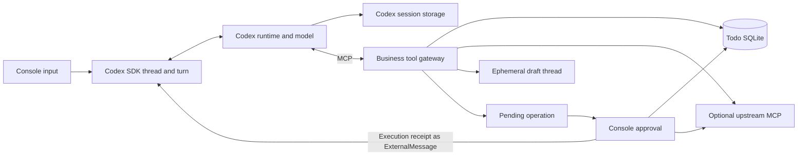

# Three implementations of the todo assistant

[简体中文](COMPARISON.zh-CN.md)

| Concern | Manual LangGraph | LangChain create_agent | Codex SDK |
|---|---|---|---|
| Execution loop | Graph nodes and edges | Framework graph and middleware | The Codex app-server runtime |
| Conversation persistence | SQLite Checkpointer and AgentState | SQLite Checkpointer and extended State | Codex threads, listed and resumed through the SDK |
| Business tools | LangChain tools in a tool node | LangChain tools in framework dispatch | MCP tools exposed by the application |
| Approval | Graph interrupt and checkpoint resume | Built-in HITL middleware | Console commits a pending business operation |
| Tool observation | Tool wrapper and State records | Middleware and State records | SDK events for display, gateway records for history |
| Compaction | Custom summary and retained turns | Built-in summary middleware | Runtime-managed context compaction |
| Limits | Model calls, tools, graph steps | Model calls, tools, graph steps | Business tools and wall time |
| Skills | Catalog, loaders, and stored active names | Middleware and skill tools | Native explicit skill input, plus allowlisted skill files |
| Draft | Draft node, separate structured generation | Draft tool with a separate generator | Ephemeral Codex thread with a per-turn schema |
| Model | Groq in this app | Groq in this app | Models available to the configured Codex account |

A **thread** contains conversation history. A **turn** is one run in a thread,
and can contain multiple tool calls. A console input may cause a second SDK turn
when the console sends the results of approved or declined operations. In that
second turn the gateway is closed to new operations. The typed
`ExternalMessage` preserves the receipt's role as application output.
[Codex Python API](https://github.com/openai/codex/blob/main/sdk/python/docs/api-reference.md)

A **stream notification** tells the console about a runtime event. The
notification that an MCP call completed is useful for display. The gateway has
the actual tool arguments and can decline execution before an effect occurs.
For an approval-required tool, a completed MCP call can mean the gateway
returned a pending receipt. The terminal shows the actual outcome after the
user decides. The gateway's history is independent of conversation compaction.

Try requesting a deletion and first decline it, then request it again and approve.
Check the saved todos and tool history. Trace which code records the pending
operation, which code commits the database write, and which code reports the
result back to the conversation. Restart the app to compare the restored thread
with the independent SQLite records.
