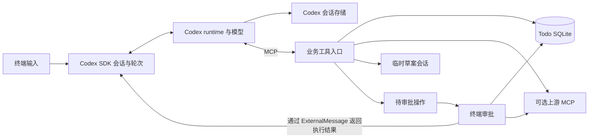

# 待办助手的三种实现

[English](COMPARISON.md)

| 对比项 | 手写 LangGraph | LangChain create_agent | Codex SDK |
|---|---|---|---|
| 执行循环 | 自己编排节点与边 | 框架构图和中间件 | Codex app-server runtime |
| 会话持久化 | SQLite Checkpointer 和 AgentState | SQLite Checkpointer 和扩展 State | 通过 SDK 列出及恢复 Codex thread |
| 业务工具 | 工具节点运行 LangChain 工具 | 框架分发 LangChain 工具 | 应用通过 MCP 提供工具 |
| 审批 | 图中断，检查点恢复 | 内置 HITL 中间件 | 终端确认后提交待审批业务操作 |
| 观察工具 | 工具包装和 State 记录 | 中间件和 State 记录 | SDK 事件供展示，业务入口保存历史 |
| 压缩 | 自定义摘要与保留轮次 | 内置摘要中间件 | runtime 管理上下文压缩 |
| 限制 | 模型次数、工具次数、图步数 | 模型次数、工具次数、图步数 | 业务工具次数和轮次耗时 |
| 技能 | 目录、加载工具及激活状态 | 技能工具和中间件 | 原生显式技能输入及受限文件读取 |
| 草案 | 草案节点调用独立结构化生成 | 草案工具使用独立生成器 | 仅临时 Codex thread 的单轮使用 Schema |
| 模型 | 本应用使用 Groq | 本应用使用 Groq | 配置的 Codex 账号可用的模型 |

**Thread** 是保存对话历史的会话。**Turn** 是会话里的一次运行，可以包含多个
工具调用。终端输入有时会产生第二个 SDK 轮次，用来发送确认或拒绝后的实际结果。
该轮次关闭新业务操作入口。类型化的 `ExternalMessage` 让模型收到的是应用返回的数据。
[Codex Python API](https://github.com/openai/codex/blob/main/sdk/python/docs/api-reference.md)

**运行事件** 告诉终端发生了什么。例如 MCP 调用完成事件可用于展示进度。
实际工具参数经过业务入口，应用能在产生副作用前拒绝执行。对于需要审批的工具，
MCP 调用完成可能表示业务入口已返回待审批回执。用户作出决定后，终端才显示实际
结果。这里保存的历史可以在会话上下文压缩后继续查询。

可以先请求删除并拒绝，然后再发起一次请求并同意。查看保存的待办和工具历史，
顺着代码找出谁记录待审批操作、谁提交数据库修改、谁把结果交回对话。重启应用后，
再对照恢复的会话和独立的 SQLite 记录。
