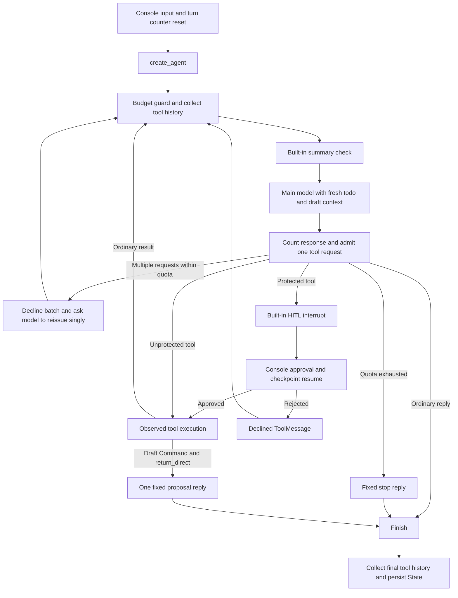

# Learning the create_agent implementation

[简体中文](COMPARISON.zh-CN.md) · [Usage](../README.md)

This is a separate implementation for comparison, not a new numbered learning
version and not an in-place replacement of the manual graph.

## What changes

| Responsibility | Manual LangGraph app | This app |
|---|---|---|
| ReAct loop | `StateGraph`, nodes, conditional edges | `create_agent` builds it |
| Fixed resources | Node constructors | Factory and middleware/tool constructors |
| Dynamic saved context | Model node | `ContextMiddleware.wrap_model_call` |
| Tool execution logging | ToolNode wrapper | `ToolExecutionMiddleware.wrap_tool_call` |
| Approval | Custom `interrupt` wrapper and resume schema | `HumanInTheLoopMiddleware` and its decision schema |
| Compression | Custom summary node/State field; keeps turns | `SummarizationMiddleware`; summary message; keeps messages |
| Structured draft | Dedicated graph branch | Return-direct tool plus presentation hook |
| Budgets | Node-level counters and routing | `before_model` / `after_model` hooks |
| Persistent tool history | Tools node updates State | History hooks collect ToolMessages into custom State |
| Tool sequencing | Sequential multi-call task execution | One admitted call per model response |
| Storage and console | Local SQLite, conversation menu | Independent local SQLite, same user-facing concepts |

`create_agent` still returns a compiled LangGraph graph. Checkpoints,
`thread_id`, `Command(resume=...)`, message reducers and tool runtime injection
remain relevant. There is no hand-maintained `nodes/` folder here because the
factory owns those nodes. Middleware classes group hooks by responsibility;
these classes do not represent separate agents.

## Control flow

The following is a conceptual flow, not a list of manually registered node names:

The model guard can also stop before the next summary/model request. Tools and
hooks update State through the graph; final collection is not the only point at
which checkpoints are saved.

## Middleware composition order

| Module | Responsibility |
|---|---|
| `middleware/turn_control.py` | Main-model/tool quotas and one-call admission |
| `middleware/history.py` | Collect and deduplicate tool history |
| `middleware/context.py` | Refresh saved todos and draft in model context |
| `middleware/tool_execution.py` | Execution timing and recognized input errors |
| `middleware/draft_presentation.py` | Present the final draft reply |
| `middleware/__init__.py` | Export classes without composing them |

The factory registers:

1. Built-in HITL
2. Turn control
3. History collection
4. Built-in summarization
5. Dynamic model context
6. Tool execution observation/error formatting
7. Draft presentation

`before_*` hooks run in registration order; `after_*` hooks run in reverse order.
Therefore budget admission and draft clearing in `TurnControl.after_model` happen
**before** HITL can interrupt. A resumed approval does not reserve the same slot
again. `History.before_model` collects tool results **before** summarization can
remove their source messages. `DraftPresentation.after_agent` appends the final
proposal reply before final history collection.

`wrap_model_call` changes only the model request's system message; it does not
write dynamic todo context into conversation messages. `wrap_tool_call` observes
one admitted execution. An approval rejection happens before tool execution, so
it has a retained ToolMessage/history record but no execution timing log.

## State and structured output

`AgentState` extends LangChain's base state, retaining its message reducer. It
adds `todo_draft`, `draft_reply`, bounded `tool_history`, observed call IDs and
two usage counters. History updates contain only new records. The reducer merges
and truncates them. `recorded_tool_call_ids` prevents duplicate collection across
hooks; the console resets it with counters for each new user turn.

Tool runtime is supplied by the graph, not by the model. The history tool reads
`runtime.state`; the draft tool uses `runtime.tool_call_id` to create the matching
ToolMessage. The public tool schema excludes this injected parameter.

`tools/__init__.py` defines and exports `create_tools(model)` to assemble the tools.
Time, arithmetic, todo CRUD and history each have a capability module. The draft
entry point and its generator/business validation live together in `tools/draft.py`;
`create_draft_tool(model)` binds the model once and returns `generate_todo_draft`.
Pydantic request/output definitions remain in `schemas.py`.

For drafts:

1. The main model requests `generate_todo_draft` with task names/date/budget.
2. Turn control clears the old candidate and admits the request.
3. The tool calls the base model with JSON mode and a schema in its instructions.
4. Pydantic checks shape/types; application code checks exact names/date/total.
5. A `Command` stores the candidate and a matching ToolMessage. It does not write
   a todo or append a final AIMessage inside the tool.
6. `return_direct=True` ends the tool loop. `after_agent` appends one fixed reply
   from `draft_reply` and clears that temporary handoff field.

Appending the final AIMessage inside the tool would interfere with the factory's
routing, which identifies tool results using the latest AI tool request. Keeping
presentation in `after_agent` preserves that request/result relationship. A
validation failure also ends this return-direct turn with an explanation; it does
not ask the main model to repair the draft automatically.

## Deliberate differences and limits

- This implementation enforces one tool per model response, avoiding the
  factory's default parallel dispatch. It declines a multi-call batch instead of
  executing it serially. A model that repeatedly ignores this rule reaches its
  quotas. It does not modify the factory's internal graph.
- Tool quotas count admitted requests before approval, including rejected
  approvals and declined multi-call requests within quota. The manual app counts
  completed batches differently. Neither is a token/cost budget.
- Main-model quotas exclude summary/draft calls and count successful responses;
  failed HTTP attempts are handled by the SDK. Explicit checkpoint resumes can
  retry unfinished work, while completed tool nodes are reused. A process crash
  between a database commit and checkpoint save still requires idempotent writes
  for stronger guarantees.
- Built-in compression runs before each main-model call, not once per new user
  input. It retains recent message groups, not a fixed number of turns. Its
  message-based summary replaces the manual app's separate summary field and
  custom summary-quality checks. It has a context-overflow fallback request.
- All saved todos enter the dynamic system context. This learning app does not
  retrieve only relevant rows or impose a whole-request token cap.
- Prompt instructions guide model behavior; validation, approval, one-call
  admission and quotas enforce the boundaries described above.

## Reading and practice

Read `agent.py` → `middleware/` → `state.py` → `tools/__init__.py` → `tools/draft.py`, then
follow console approval handling and the two SQLite helpers.

Try these with a local key: a normal chat; two sequential calculator operations;
a deletion rejected with `n`; exiting approval then reopening the conversation;
a valid draft followed by explicit saving; a low summary trigger. These are
exercises, not claims of live-model verification.

For deterministic inspection, read/run `tests/test_agent.py`. Its fake model
executes the real factory graph, middleware, approvals, State updates and tools.
`test_errors.py` uses mock HTTP for SDK retries; other tests cover configuration,
CRUD and a real pseudo-terminal. Tests never use personal databases or real keys.

## Official references

- [Agents](https://docs.langchain.com/oss/python/langchain/agents)
- [Built-in middleware](https://docs.langchain.com/oss/python/langchain/middleware/built-in)
- [Custom middleware](https://docs.langchain.com/oss/python/langchain/middleware/custom)
- [Human-in-the-loop](https://docs.langchain.com/oss/python/langchain/human-in-the-loop)
