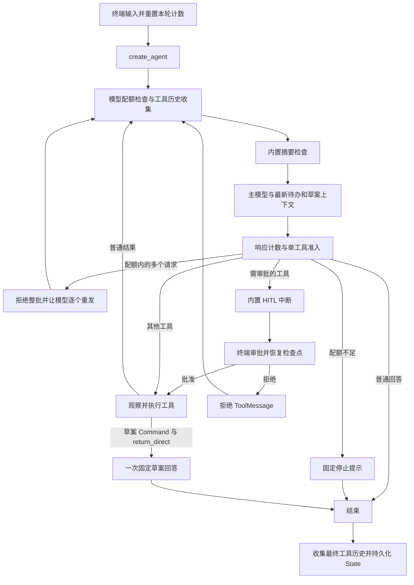

# 学习 create_agent 实现

[English](COMPARISON.md) · [使用说明](../README.zh-CN.md)

这是用于对照学习的独立实现，不新开数字学习版本，也不替换原来的手动图。

## 改变了什么

| 职责 | 手动 LangGraph 应用 | 当前应用 |
|---|---|---|
| ReAct 循环 | `StateGraph`、节点、条件边 | 由 `create_agent` 生成 |
| 固定依赖 | 节点构造函数 | 工厂与中间件/工具构造函数 |
| 动态待办上下文 | 模型节点 | `ContextMiddleware.wrap_model_call` |
| 工具执行日志 | ToolNode wrapper | `ToolExecutionMiddleware.wrap_tool_call` |
| 审批 | 自定义 `interrupt` wrapper 与恢复数据 | `HumanInTheLoopMiddleware` 及其决策格式 |
| 压缩 | 自定义摘要节点/State 字段，保留轮数 | `SummarizationMiddleware`，摘要消息，保留消息数 |
| 结构化草案 | 独立图分支 | return-direct 工具与展示 hook |
| 配额 | 节点计数与路由 | `before_model` / `after_model` hooks |
| 持久化工具历史 | 工具节点更新 State | 历史 hooks 收集 ToolMessage 到自定义 State |
| 工具顺序 | 顺序执行同批多个工具的 task | 每次模型响应只准入一个工具 |
| 存储与终端 | 本地 SQLite、会话菜单 | 独立本地 SQLite，保留同类使用方式 |

`create_agent` 返回的仍然是编译后的 LangGraph 图，所以检查点、`thread_id`、
`Command(resume=...)`、消息 reducer 与工具 runtime 注入仍然适用。
这里不手动维护 `nodes/`，节点由工厂生成。中间件类按职责组织 hooks，
这些类不代表多个 Agent。

## 执行流程

下面是概念流程，不是手动注册的节点名称列表：

模型配额也可以在下一次摘要/模型调用前直接终止。工具与 hooks 都通过图更新 State，
不是只有最终收集时才保存检查点。

## 中间件组合顺序

| 模块 | 职责 |
|---|---|
| `middleware/turn_control.py` | 主模型/工具配额与单工具准入 |
| `middleware/history.py` | 工具历史收集与去重 |
| `middleware/context.py` | 刷新模型上下文中的待办与草案 |
| `middleware/tool_execution.py` | 执行耗时与明确的输入错误处理 |
| `middleware/draft_presentation.py` | 展示最终草案回答 |
| `middleware/__init__.py` | 统一导出类，不负责组合 |

工厂按以下顺序注册：

1. 内置 HITL
2. 本轮控制
3. 工具历史收集
4. 内置摘要
5. 动态模型上下文
6. 工具执行观察与输入错误格式化
7. 草案展示

`before_*` 按注册顺序执行，`after_*` 反序执行。因此
`TurnControl.after_model` 的配额检查和旧草案清空会**先于** HITL 中断。
审批恢复不会重复占用同一个配额。`History.before_model` 会**先于**摘要收集
工具结果，避免原消息被压缩后无法生成历史。
`DraftPresentation.after_agent` 先追加最终草案回答，再进行最终历史收集。

`wrap_model_call` 只替换这次模型请求的 system message，不把动态待办上下文写进
聊天消息。`wrap_tool_call` 观察一次准入后的真实执行。审批拒绝发生在工具执行前，
因此会有拒绝 ToolMessage 和历史记录，但没有工具执行耗时日志。

## State 与结构化输出

`AgentState` 继承 LangChain 的基础状态，保留消息 reducer，增加 `todo_draft`、
`draft_reply`、有界 `tool_history`、已观察调用 ID，以及两个计数器。
历史更新只包含新增记录，reducer 负责合并与截断。
`recorded_tool_call_ids` 防止多个 hook 重复收集；每轮新输入时与配额计数一起重置。

工具 runtime 由图注入，不由模型提供。历史工具读取 `runtime.state`；草案工具使用
`runtime.tool_call_id` 创建匹配的 ToolMessage。公开工具 schema 不包含该注入参数。

`tools/__init__.py` 定义并导出 `create_tools(model)`，统一组装工具。
时间、计算、待办 CRUD、历史各自按能力组织。草案工具入口、生成器与业务校验
集中在 `tools/draft.py`；`create_draft_tool(model)` 绑定一次模型，返回
`generate_todo_draft` 工具。Pydantic 请求/输出模型仍然定义在 `schemas.py`。

草案流程：

1. 主模型用名称、日期、总预算请求 `generate_todo_draft`。
2. 本轮控制先清空旧候选，再准入请求。
3. 工具使用基础模型的 JSON mode，并在指令中提供 schema。
4. Pydantic 校验结构和类型；业务代码校验精确名称、日期、总时长。
5. `Command` 写入候选与匹配的 ToolMessage，不保存待办，也不在工具中追加最终 AIMessage。
6. `return_direct=True` 结束工具循环；`after_agent` 使用 `draft_reply` 生成一次
   固定回答，然后清空这个临时交接字段。

如果工具直接追加最终 AIMessage，会影响工厂通过最近 AI 工具请求识别结果的路由。
将展示放在 `after_agent`，可以保留原请求/结果关系。
校验失败同样直接结束本轮并解释原因，不自动交给主模型修复草案。

## 有意保留的差异与限制

- 当前实现强制一次模型响应只请求一个工具，避开工厂默认的并行派发。
  多工具整批拒绝，不是串行执行；模型持续违反规则最终会达到配额。
  不修改工厂的内部图。
- 工具配额在审批前按准入请求计数，包括拒绝的审批与配额内被拒绝的多工具请求。
  原手动应用按已完成批次的计数时机不同。两者都不是 token/费用预算。
- 主模型配额不包括摘要/草案，按成功响应计数；失败 HTTP 尝试由 SDK 处理。
  显式恢复检查点可以重试未完成步骤，完成的工具节点会复用。
  如果进程恰好在数据库提交与检查点保存之间崩溃，仍需要幂等写入才能获得更强保证。
- 内置压缩在每次主模型调用前检查，不是每轮新输入只检查一次。
  保留近期消息组，不保证固定轮数；消息内摘要替代原应用独立的 summary 字段及
  自定义摘要质量检查。内置实现带有上下文溢出时缩减输入再请求的兜底。
- 所有已保存待办进入动态 system context。教学应用暂未做相关记录检索，
  也没有限制完整请求的 token 总长度。
- prompt 指令引导模型；校验、审批、单工具准入和配额是代码实际执行的边界。

## 阅读与练习

建议顺序：`agent.py` → `middleware/` → `state.py` → `tools/__init__.py` → `tools/draft.py`，
然后跟踪终端审批数据和两个 SQLite 辅助模块。

配置本地 key 后可以练习：普通聊天；连续两步计算；用 `n` 拒绝删除；审批时退出后
重新打开会话；生成合法草案后明确保存；调低摘要阈值。
这些是练习建议，不表示已经验证真实模型效果。

要确定性地观察流程，阅读并运行 `tests/test_agent.py`。
假模型驱动的是真实工厂图、中间件、审批、State 更新和工具。
`test_errors.py` 用 mock HTTP 检查 SDK 重试，其他测试覆盖配置、CRUD 与真实伪终端。
测试不使用个人数据库或真实 key。

## 官方参考

- [Agents](https://docs.langchain.com/oss/python/langchain/agents)
- [内置中间件](https://docs.langchain.com/oss/python/langchain/middleware/built-in)
- [自定义中间件](https://docs.langchain.com/oss/python/langchain/middleware/custom)
- [Human-in-the-loop](https://docs.langchain.com/oss/python/langchain/human-in-the-loop)
